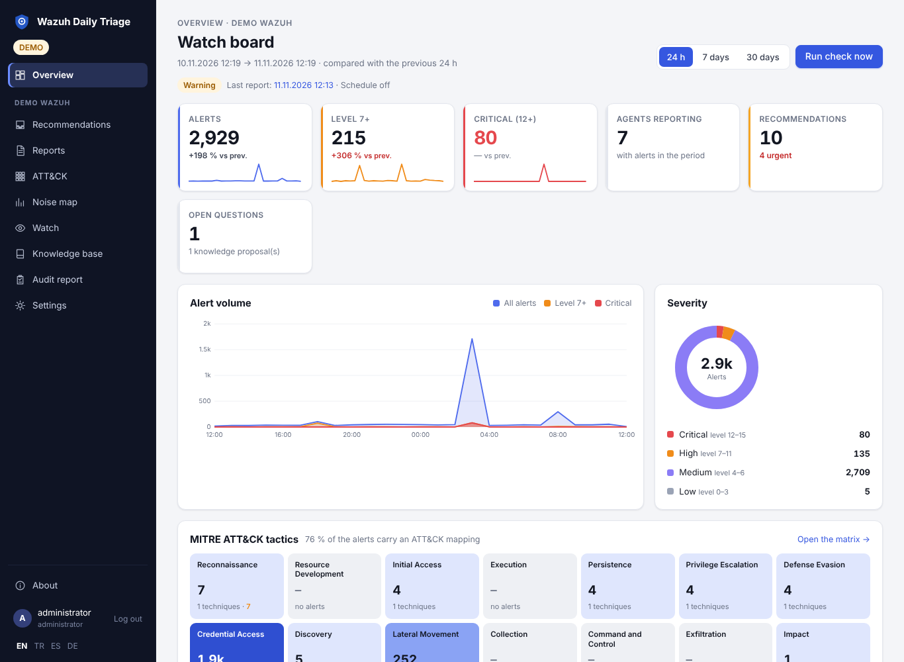
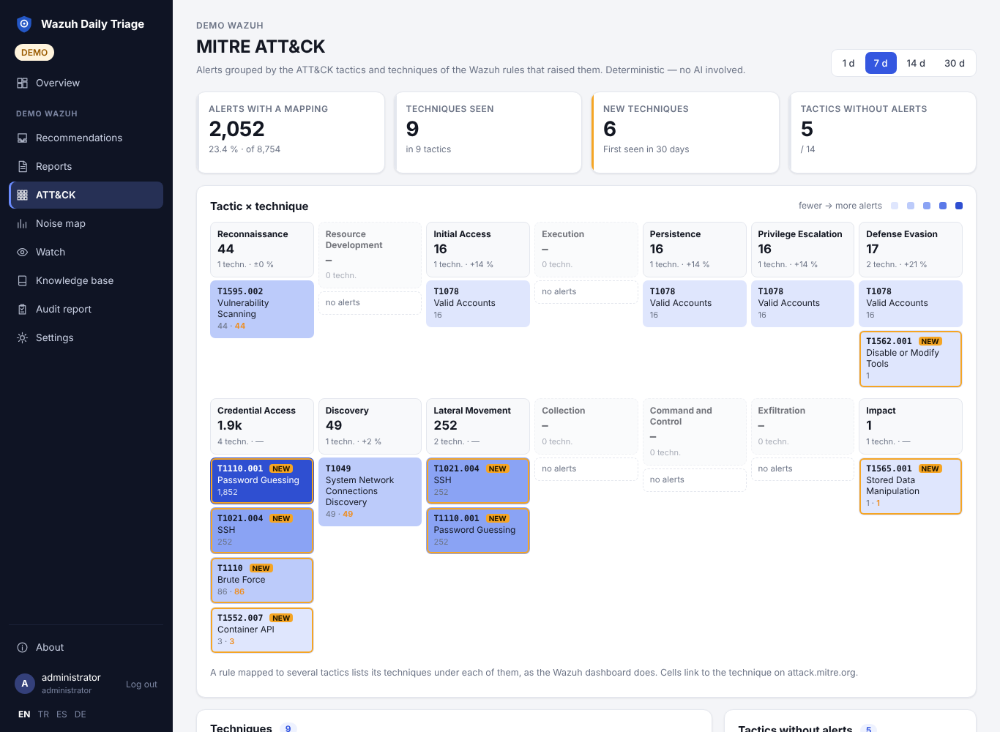
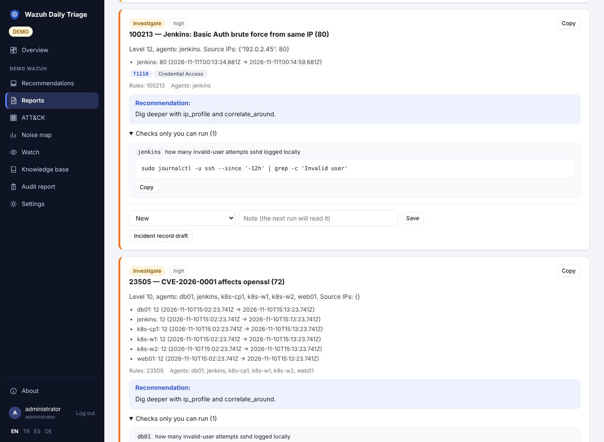

# Wazuh Daily Triage

**Ein Bereitschaftsbegleiter für das SIEM [Wazuh](https://wazuh.com).** Eine regelbasierte Wache meldet
innerhalb von Minuten, wenn etwas Dringendes passiert, ohne eine KI aufzurufen. Ein- oder zweimal am Tag prüft
eine KI-Runde, ob das SIEM tatsächlich lebt, trennt echtes Risiko von bekanntem Rauschen, schreibt einen kurzen
Bericht in Ihren eigenen Wazuh Indexer und fragt Sie nur dort, wo eine menschliche Entscheidung nötig ist. Ihre
Antworten merkt sie sich.

Bringen Sie Ihr eigenes Modell mit: Anthropic, OpenAI, Azure OpenAI oder jeden OpenAI-kompatiblen Endpunkt
(Ollama, vLLM, LM Studio, LiteLLM). Ein Docker-Container, standardmäßig nur lesend gegenüber Wazuh;
personenbezogene Daten werden maskiert, bevor sie das Modell erreichen.

[English](README.md) · [Türkçe](README.tr.md) · [Deutsch](README.de.md) · [Español](README.es.md) ·
**[Wiki](https://github.com/dururustem68/wazuh-daily-triage/wiki)** ·
[Erste Schritte](https://github.com/dururustem68/wazuh-daily-triage/wiki/Getting-Started) ·
[Sicherheitsmodell](https://github.com/dururustem68/wazuh-daily-triage/wiki/Security-Model) ·
[Änderungsprotokoll](CHANGELOG.md)



| MITRE ATT&CK | Bericht |
|---|---|
|  |  |

## Warum

Wenn Ihr Morgen mit derselben Wazuh-Routine beginnt (fließen Daten, sind die Agenten verbunden, was liegt auf
Stufe 7 und höher, was davon ist das übliche Rauschen, was ist echt), übernimmt dieses Werkzeug die Vorarbeit
und ruft Sie nur dort, wo eine Entscheidung nötig ist. Es enthält mühsam erlernte Prüfgewohnheiten: Zustand vor
Alarmen, Verteilungen statt Durchschnitten, „gleiche Anzahl auf jedem Agenten ist ein Feed-Ereignis“, „null
heißt nicht, dass die Regel funktioniert“, Stufe senken statt stummschalten.

## Was es ist und was nicht

| Es ist | Es ist nicht |
|---|---|
| eine Hilfe für die tägliche Prüfung und die Bereitschaft, die liest, was Wazuh erzeugt hat | ein Ersatz für Wazuh oder sein Dashboard |
| standardmäßig nur lesend gegenüber Wazuh | ein SOAR: es blockiert nicht, isoliert nicht und führt keine Befehle auf Agenten aus |
| ein Assistent, der vorschlägt; ein Mensch entscheidet | ein autonom reagierendes System |
| ein Container, der seine Daten in Ihrem eigenen Wazuh Indexer hält | ein gehosteter Dienst oder eine weitere Datenbank im Betrieb |

## Das Wichtigste

- **Dashboard.** Kennzahlen mit Trendlinien und der Änderung gegenüber dem vorherigen Zeitraum, Alarmvolumen über
  die Zeit, Schweregrade, häufigste Regeln, Agenten und Quelladressen — für 24 Stunden, 7 oder 30 Tage, ohne KI.
- **MITRE ATT&CK.** Ein Taktik-Streifen im Dashboard und eine Taktik-×-Technik-Matrix je Umgebung: neue Techniken,
  Veränderungen, Taktiken ohne Alarm; Befunde tragen ihre Technik-IDs.
- **Die Wache.** Lokale Regeln prüfen alle paar Minuten auf einen kritischen Alarm, eine beobachtete Regel, eine
  erfolgreiche Anmeldung nach Fehlversuchen, Active Response, einen plötzlichen Anstieg oder verlorene Agenten
  und melden sofort. Kein Modellaufruf.
- **Die KI-Runde.** Zuerst die deterministische Erfassung (Zustand, Volumen, neue Regeln, Anomalien), dann
  schreibt ein Modell mit nur lesenden Werkzeugen Befunde mit Belegen, stellt Fragen und beurteilt jedes
  Ereignis der Wache.
- **Es lernt von Ihnen.** Entscheidungen, bekanntes Rauschen und Antworten gehen in eine Wissensdatenbank, die
  jeder spätere Lauf liest. Vorschläge der KI haben keine Wirkung, bis Sie sie freigeben.
- **Empfehlungseingang.** Befunde einzeln, ohne Dubletten über mehrere Läufe; eine Entscheidung erledigt jedes
  Vorkommen.
- **Regelentwürfe, denen man trauen kann.** Spielen Sie einen Entwurf gegen 14 Tage echter Alarme durch, wenden
  Sie ihn mit kopierbaren Befehlen oder einer optionalen Ein-Klick-Bereitstellung mit Validierung und
  automatischem Rollback an und sehen Sie ihn danach an echten Ereignissen bestätigt.
- **Personenbezogene Daten bleiben drinnen.** E-Mail-Adressen, Telefonnummern, Ausweisnummern, IBANs, Karten und
  Geheimnisse werden maskiert, bevor etwas an das Modell geht (DSGVO). Standardmäßig aktiv.
- **MCP-Server.** Dieselben nur lesenden Werkzeuge für Claude Desktop, Cursor, VS Code oder jeden MCP-Client.
- **Benachrichtigungen** per E-Mail, Telegram, Microsoft Teams, Slack, Discord, ntfy oder generischem Webhook.
- **Keine zusätzliche Datenbank.** Der Zustand liegt in `daily-triage-*`-Indizes Ihres eigenen Indexers, mit
  verschlüsselter Sicherung.
- **Monatlicher Prüfbericht** ohne KI, als PDF oder Markdown: Volumen, Entscheidungen, Regeländerungen, Ausfälle.
- **Rollen.** Administrator und nur lesender Betrachter, per Passwort oder — hinter Keycloak, Authentik oder
  oauth2-proxy — per SSO-Gruppe.
- **Mehrere Umgebungen, mehrere Sprachen** (Englisch, Türkisch, Spanisch, Deutsch); Docker Compose oder
  Kubernetes.

Jede Funktion ist im [Wiki](https://github.com/dururustem68/wazuh-daily-triage/wiki) beschrieben (Englisch und
Türkisch).

## Schnellstart

### Demo ausprobieren (weder Wazuh noch Modell nötig)

```sh
git clone https://github.com/dururustem68/wazuh-daily-triage.git && cd wazuh-daily-triage
cp .env.demo .env
docker compose up -d --build
# http://127.0.0.1:8080 öffnen und anmelden mit: demo-password-change-me
```

Die Demo nutzt synthetische Daten und ein Mock-Modell und startet mit einem fertigen Bericht, Ereignissen der
Wache und wartenden Vorschlägen.

### Ihr Wazuh verbinden

1. Legen Sie die nur lesenden Konten aus [docs/permissions.md](docs/permissions.md) an. Verwenden Sie keine
   Administrator-Zugangsdaten.
2. Beginnen Sie mit der Beispieldatei und tragen Sie Ihre Werte ein:

   ```sh
   cp .env.example .env
   openssl rand -hex 32            # APP_SECRET
   vi .env                         # APP_PASSWORD, LLM_*, WAZUH_INDEXER_*, WAZUH_API_*, WAZUH_CA_FILE
   docker compose up -d
   docker compose exec triage python -m app.check
   ```

3. Klicken Sie auf **Jetzt prüfen** und kontrollieren Sie den ersten Bericht.

Die Schritt-für-Schritt-Fassung mit erwarteten Ergebnissen und häufigen Fehlern:
**[Getting started](https://github.com/dururustem68/wazuh-daily-triage/wiki/Getting-Started)**. Gehen Sie vor
dem Produktivbetrieb die
[Sicherheits-Checkliste](https://github.com/dururustem68/wazuh-daily-triage/wiki/Security-Checklist) durch.

### Kubernetes

Ein [Helm-Chart](deploy/helm/wazuh-daily-triage) und eine [Kustomize-Basis](deploy/kubernetes/README.md) mit
optionalen Komponenten: ein Replikat, kein Root, schreibgeschütztes Dateisystem, kein PVC. Leitfaden für den
Produktivbetrieb: [Kubernetes](https://github.com/dururustem68/wazuh-daily-triage/wiki/Kubernetes).

## KI-Anbieter

| Anbieter | `LLM_PROVIDER` | `LLM_BASE_URL` |
|---|---|---|
| Claude (Anthropic) | `anthropic` | – |
| OpenAI | `openai` | `https://api.openai.com/v1` |
| Google Gemini | `openai` | `https://generativelanguage.googleapis.com/v1beta/openai` |
| DeepSeek | `openai` | `https://api.deepseek.com` |
| Azure OpenAI | `openai` | vollständige Deployment-URL mit `?api-version=` |
| Ollama, vLLM, LM Studio, LiteLLM | `openai` | zum Beispiel `http://ollama:11434/v1` |

Das Modell muss Werkzeugaufrufe (Function Calling) unterstützen. Jede Umgebung kann ihr eigenes Modell nutzen,
etwa ein lokales für Daten, die Ihr Netz nicht verlassen dürfen. Modellnamen und Parameter-Besonderheiten:
[docs/providers.md](docs/providers.md).

## Sicherheit und Datenschutz in Kürze

- **Standardmäßig nur lesend gegenüber Wazuh.** Kein Active Response, keine Konfigurationsänderungen, keine
  Agentenbefehle. Geschrieben wird nur in die eigenen Indizes der Anwendung.
- **Das Modell liest und schlägt vor.** Keine Shell, keine ausgehenden Anfragen; Abfragen sind durch eine
  Feld-Positivliste und Größenlimits begrenzt, sodass in einen Alarm eingeschleuster Text nicht zu einer
  beliebigen Abfrage werden kann.
- **Die Regelbereitstellung ist optional**, nutzt einen separaten API-Benutzer mit minimalen Rechten, schreibt
  eine einzige Datei und macht bei jedem Fehler rückgängig.
- **Bei einem gehosteten Modell gehen Zusammenfassungen und Beispiel-Logzeilen an diesen Anbieter.**
  Personenbezogene Daten und Geheimnisse werden vorher pseudonymisiert (nach bestem Bemühen; kein DLP); für
  regulierte Daten nutzen Sie ein lokales Modell.
- **Im Produktivmodus verweigert die Anwendung den Start** bei Beispielpasswörtern, fehlendem `APP_SECRET`,
  unsicheren Cookies und abgeschalteter TLS-Prüfung. Zustandsändernde Anfragen werden in ein Audit-Protokoll mit
  Hash-Kette geschrieben.

Details: [Security model](https://github.com/dururustem68/wazuh-daily-triage/wiki/Security-Model) ·
[Privacy](https://github.com/dururustem68/wazuh-daily-triage/wiki/Privacy) ·
[docs/security-exceptions.md](docs/security-exceptions.md). Schwachstellen bitte vertraulich melden:
[SECURITY.md](SECURITY.md).

## Dokumentation

Dieses README ist die Kurzfassung. Das [Wiki](https://github.com/dururustem68/wazuh-daily-triage/wiki) ist das
Handbuch (Englisch und Türkisch); der Ordner `docs/` enthält die Referenzdokumente.

| Thema | Wo |
|---|---|
| Von der Demo zum ersten echten Bericht | [Getting started](https://github.com/dururustem68/wazuh-daily-triage/wiki/Getting-Started) |
| Installation und Konfiguration | [Installation](https://github.com/dururustem68/wazuh-daily-triage/wiki/Installation), [Configuration](https://github.com/dururustem68/wazuh-daily-triage/wiki/Configuration), [Kubernetes](https://github.com/dururustem68/wazuh-daily-triage/wiki/Kubernetes) |
| Tägliche Nutzung | [User guide](https://github.com/dururustem68/wazuh-daily-triage/wiki/User-Guide), [Rule lifecycle](https://github.com/dururustem68/wazuh-daily-triage/wiki/Rule-Lifecycle), [Watch](https://github.com/dururustem68/wazuh-daily-triage/wiki/Watch), [MCP](https://github.com/dururustem68/wazuh-daily-triage/wiki/MCP) |
| Sicherheit und Datenschutz | [Security model](https://github.com/dururustem68/wazuh-daily-triage/wiki/Security-Model), [Privacy](https://github.com/dururustem68/wazuh-daily-triage/wiki/Privacy), [Security checklist](https://github.com/dururustem68/wazuh-daily-triage/wiki/Security-Checklist) |
| Betrieb | [Troubleshooting](https://github.com/dururustem68/wazuh-daily-triage/wiki/Troubleshooting), [Backup](https://github.com/dururustem68/wazuh-daily-triage/wiki/Backup), [Upgrade](https://github.com/dururustem68/wazuh-daily-triage/wiki/Upgrade) |
| Versionen und Grenzen | [Compatibility](https://github.com/dururustem68/wazuh-daily-triage/wiki/Compatibility) |
| Beispiele, FAQ, Glossar | [Scenarios](https://github.com/dururustem68/wazuh-daily-triage/wiki/Scenarios), [FAQ](https://github.com/dururustem68/wazuh-daily-triage/wiki/FAQ) |
| Referenz | [Berechtigungen](docs/permissions.md), [Regelbereitstellung](docs/rule-deployment.md), [Benachrichtigungen](docs/notifications.md), [Anbieter](docs/providers.md), [Quellen](docs/sources.md), [Architektur](docs/architecture.md), [Eval](docs/eval.md) |

## Kompatibilität

- Wazuh **4.x**, entwickelt und getestet mit 4.14; Wazuh Indexer (OpenSearch 2.x) mit der Standardvorlage
  `wazuh-alerts-*`.
- Die Wazuh-Server-API ist optional; ohne sie gibt es keinen Agenten- und Daemon-Zustand, keine
  Regelinformationen und kein Logtest.
- Python **3.11–3.15**.

Was getestet ist, was erwartet wird und was nicht unterstützt wird:
[Compatibility](https://github.com/dururustem68/wazuh-daily-triage/wiki/Compatibility).

## Entwicklung

```sh
python -m venv .venv && . .venv/bin/activate
pip install -r requirements.txt -r requirements-dev.txt
pytest
ruff check .
WDT_DEMO=true APP_PASSWORD=x uvicorn app.main:app --reload
```

Die Tests laufen auf einer eingebauten Demo-Engine und brauchen keinen Cluster. Hier stehen keine
Marketingzahlen: Messen Sie ein Modell an Tagen, die Sie selbst geprüft haben, mit `python -m app.eval`
([docs/eval.md](docs/eval.md)). Mehr:
[Development](https://github.com/dururustem68/wazuh-daily-triage/wiki/Development) ·
[CONTRIBUTING.md](CONTRIBUTING.md) · [ROADMAP.md](ROADMAP.md).

## Danksagungen

- [Wazuh — Threat hunting with agentic AI](https://wazuh.com/blog/threat-hunting-with-agentic-ai/) (Rollen mit minimalen Rechten, Korrelationsfenster)
- [gensecaihq/Wazuh-MCP-Server](https://github.com/gensecaihq/Wazuh-MCP-Server), [gbrigandi/mcp-server-wazuh](https://github.com/gbrigandi/mcp-server-wazuh)

## Lizenz

Copyright © 2026 Rüstem Duru. Lizenziert unter der **GNU Affero General Public License v3.0**; siehe
[LICENSE](LICENSE) und [NOTICE](NOTICE). Wenn Sie eine geänderte Version für Nutzer über ein Netzwerk betreiben,
müssen Sie ihnen deren Quellcode anbieten (`SOURCE_URL` auf Ihren Fork setzen).

Wazuh ist eine Marke von Wazuh, Inc. Dieses Projekt ist unabhängig und steht in keiner Verbindung zu Wazuh, Inc.
