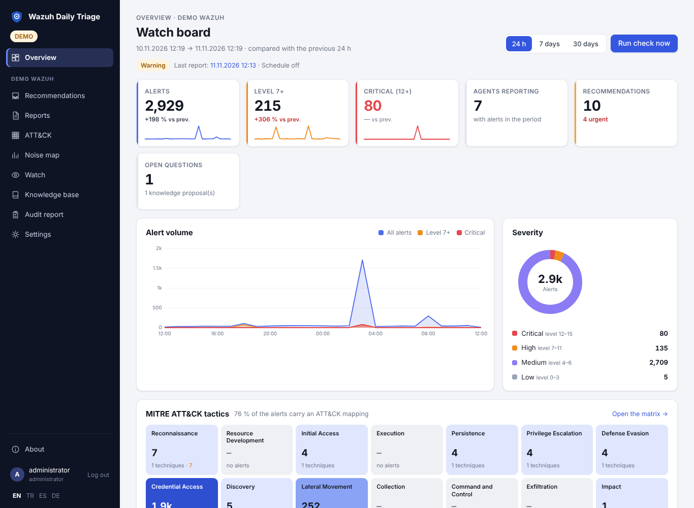
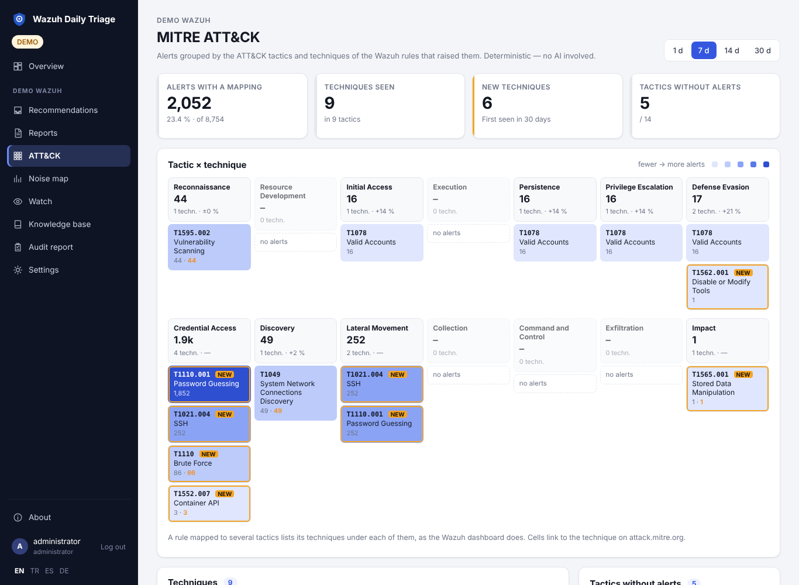
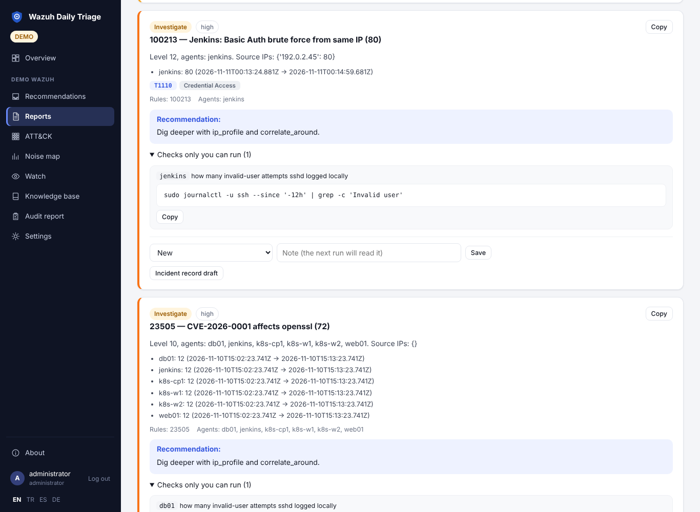

# Wazuh Daily Triage

**Un compañero de guardia para el SIEM [Wazuh](https://wazuh.com).** Una vigilancia basada en reglas le avisa en
minutos cuando ocurre algo urgente, sin llamar a una IA. Una o dos veces al día, una ronda de IA comprueba que el
SIEM sigue realmente vivo, separa el riesgo real del ruido conocido, escribe un informe breve en su propio Wazuh
Indexer y solo le pregunta lo que requiere una decisión humana. Recuerda sus respuestas.

Traiga su propio modelo: Anthropic, OpenAI, Azure OpenAI o cualquier endpoint compatible con OpenAI (Ollama,
vLLM, LM Studio, LiteLLM). Un contenedor Docker, de solo lectura hacia Wazuh por defecto, con los datos
personales enmascarados antes de llegar al modelo.

[English](README.md) · [Türkçe](README.tr.md) · [Deutsch](README.de.md) · [Español](README.es.md) ·
**[Wiki](https://github.com/dururustem68/wazuh-daily-triage/wiki/Home-ES)** ·
[Primeros pasos](https://github.com/dururustem68/wazuh-daily-triage/wiki/Getting-Started) ·
[Modelo de seguridad](https://github.com/dururustem68/wazuh-daily-triage/wiki/Security-Model) ·
[Registro de cambios](CHANGELOG.md)



| MITRE ATT&CK | Informe |
|---|---|
|  |  |

## Por qué

Si sus mañanas empiezan con la misma rutina de Wazuh (¿llegan datos?, ¿están conectados los agentes?, ¿qué hay
en nivel 7 o superior?, ¿qué es el ruido de siempre y qué es real?), esta herramienta hace el trabajo previo y
solo le llama cuando hace falta una decisión. Incorpora hábitos de revisión aprendidos con esfuerzo: la salud
antes que las alertas, distribuciones en lugar de promedios, «el mismo número en todos los agentes es un evento
de la fuente», «cero no significa que la regla funcione», bajar el nivel en lugar de silenciar.

## Qué es y qué no es

| Es | No es |
|---|---|
| una ayuda para la revisión diaria y la guardia, que lee lo que Wazuh ha producido | un sustituto de Wazuh ni de su panel |
| de solo lectura hacia Wazuh por defecto | un SOAR: no bloquea, no aísla, no ejecuta comandos en los agentes |
| un asistente que propone; decide una persona | un sistema de respuesta autónoma |
| un contenedor que guarda sus datos en su propio Wazuh Indexer | un servicio alojado ni otra base de datos que mantener |

## Lo más destacado

- **Panel.** Cifras clave con líneas de tendencia y el cambio respecto al periodo anterior, volumen de alertas en el
  tiempo, bandas de gravedad, reglas, agentes y direcciones de origen más frecuentes — 24 horas, 7 o 30 días, sin IA.
- **MITRE ATT&CK.** Una franja de tácticas en el panel y una matriz táctica × técnica por entorno: técnicas nuevas,
  cambios, tácticas sin alertas; los hallazgos llevan sus identificadores de técnica.
- **La vigilancia.** Reglas locales buscan cada pocos minutos una alerta crítica, una regla vigilada, un inicio
  de sesión correcto tras intentos fallidos, Active Response, un aumento repentino o agentes perdidos, y avisan
  de inmediato. Sin llamar a ningún modelo.
- **La ronda de IA.** Primero la recogida determinista (salud, volumen, reglas nuevas, anomalías); después un
  modelo con herramientas de solo lectura redacta hallazgos con evidencias, hace preguntas y emite un veredicto
  sobre cada evento de la vigilancia.
- **Aprende de usted.** Decisiones, ruido conocido y respuestas pasan a una base de conocimiento que lee cada
  ejecución posterior. Las propuestas de la IA no tienen efecto hasta que usted las aprueba.
- **Bandeja de recomendaciones.** Los hallazgos de uno en uno, sin duplicados entre ejecuciones; una decisión
  resuelve todas las apariciones.
- **Borradores de reglas fiables.** Pruebe un borrador contra 14 días de alertas reales, aplíquelo con comandos
  para copiar o con un despliegue opcional de un clic con validación y reversión automática, y véalo confirmado
  con eventos reales.
- **Los datos personales no salen.** Direcciones de correo, teléfonos, documentos de identidad, IBAN, tarjetas
  y secretos se enmascaran antes de enviar nada al modelo (RGPD). Activado por defecto.
- **Servidor MCP.** Las mismas herramientas de solo lectura para Claude Desktop, Cursor, VS Code o cualquier
  cliente MCP.
- **Notificaciones** por correo, Telegram, Microsoft Teams, Slack, Discord, ntfy o un webhook genérico.
- **Sin base de datos adicional.** El estado vive en índices `daily-triage-*` de su propio Indexer, con copia
  de seguridad cifrada.
- **Informe de auditoría mensual** sin IA, en PDF o Markdown: volumen, decisiones, cambios de reglas,
  interrupciones.
- **Roles.** Administrador y lector, por contraseña o —detrás de Keycloak, Authentik u oauth2-proxy— por grupo SSO.
- **Varios entornos, varios idiomas** (inglés, turco, español, alemán); Docker Compose o Kubernetes.

Cada función se describe en el [wiki](https://github.com/dururustem68/wazuh-daily-triage/wiki/Home-ES)
(las páginas detalladas están en inglés y en turco).

## Inicio rápido

### Pruebe la demo (sin Wazuh ni modelo)

```sh
git clone https://github.com/dururustem68/wazuh-daily-triage.git && cd wazuh-daily-triage
cp .env.demo .env
docker compose up -d --build
# abra http://127.0.0.1:8080 e inicie sesión con: demo-password-change-me
```

La demo usa datos sintéticos y un modelo simulado, y arranca con un informe terminado, eventos de la vigilancia
y sugerencias pendientes.

### Conecte su Wazuh

1. Cree las cuentas de solo lectura de [docs/permissions.md](docs/permissions.md). No use credenciales de
   administrador.
2. Parta del archivo de ejemplo y complete sus valores:

   ```sh
   cp .env.example .env
   openssl rand -hex 32            # APP_SECRET
   vi .env                         # APP_PASSWORD, LLM_*, WAZUH_INDEXER_*, WAZUH_API_*, WAZUH_CA_FILE
   docker compose up -d
   docker compose exec triage python -m app.check
   ```

3. Pulse **Ejecutar comprobación ahora** y revise el primer informe.

La versión paso a paso, con resultados esperados y errores habituales:
**[Getting started](https://github.com/dururustem68/wazuh-daily-triage/wiki/Getting-Started)**. Antes de pasar
a producción, repase la
[lista de comprobación de seguridad](https://github.com/dururustem68/wazuh-daily-triage/wiki/Security-Checklist).

### Kubernetes

Un [chart de Helm](deploy/helm/wazuh-daily-triage) y una [base de Kustomize](deploy/kubernetes/README.md) con
componentes opcionales: una réplica, sin root, sistema de archivos de solo lectura, sin PVC. Guía de producción:
[Kubernetes](https://github.com/dururustem68/wazuh-daily-triage/wiki/Kubernetes).

## Proveedores de IA

| Proveedor | `LLM_PROVIDER` | `LLM_BASE_URL` |
|---|---|---|
| Claude (Anthropic) | `anthropic` | – |
| OpenAI | `openai` | `https://api.openai.com/v1` |
| Google Gemini | `openai` | `https://generativelanguage.googleapis.com/v1beta/openai` |
| DeepSeek | `openai` | `https://api.deepseek.com` |
| Azure OpenAI | `openai` | URL completa del despliegue con `?api-version=` |
| Ollama, vLLM, LM Studio, LiteLLM | `openai` | por ejemplo `http://ollama:11434/v1` |

El modelo debe admitir llamadas a herramientas (funciones). Cada entorno puede usar su propio modelo, por ejemplo
uno local para datos que no deben salir de su red. Nombres de modelos y particularidades de parámetros:
[docs/providers.md](docs/providers.md).

## Seguridad y privacidad en breve

- **Solo lectura hacia Wazuh por defecto.** Sin active response, sin escrituras de configuración, sin comandos a
  agentes. Solo se escribe en los índices propios de la aplicación.
- **El modelo lee y propone.** Sin shell ni peticiones salientes; las consultas están acotadas por una lista de
  campos permitidos y límites de tamaño, de modo que un texto inyectado en una alerta no puede convertirse en una
  consulta arbitraria.
- **El despliegue de reglas es opcional**, usa un usuario de API aparte con privilegios mínimos, escribe un único
  archivo y revierte ante cualquier fallo.
- **Con un modelo alojado, los resúmenes y las líneas de log de ejemplo van a ese proveedor.** Los datos
  personales y los secretos se seudonimizan antes (en la medida de lo posible; no es un DLP); para datos
  regulados use un modelo local.
- **En producción la aplicación se niega a arrancar** con contraseñas de ejemplo, sin `APP_SECRET`, con cookies
  inseguras o con la verificación TLS desactivada. Las peticiones que cambian el estado se anotan en un registro
  de auditoría con cadena de hashes.

Detalles: [Security model](https://github.com/dururustem68/wazuh-daily-triage/wiki/Security-Model) ·
[Privacy](https://github.com/dururustem68/wazuh-daily-triage/wiki/Privacy) ·
[docs/security-exceptions.md](docs/security-exceptions.md). Informe de vulnerabilidades en privado:
[SECURITY.md](SECURITY.md).

## Documentación

Este README es la versión corta. El [wiki](https://github.com/dururustem68/wazuh-daily-triage/wiki/Home-ES) es
el manual (páginas detalladas en inglés y en turco); la carpeta `docs/` contiene los documentos de referencia.

| Tema | Dónde |
|---|---|
| De la demo a un primer informe real | [Getting started](https://github.com/dururustem68/wazuh-daily-triage/wiki/Getting-Started) |
| Instalación y configuración | [Installation](https://github.com/dururustem68/wazuh-daily-triage/wiki/Installation), [Configuration](https://github.com/dururustem68/wazuh-daily-triage/wiki/Configuration), [Kubernetes](https://github.com/dururustem68/wazuh-daily-triage/wiki/Kubernetes) |
| Uso diario | [User guide](https://github.com/dururustem68/wazuh-daily-triage/wiki/User-Guide), [Rule lifecycle](https://github.com/dururustem68/wazuh-daily-triage/wiki/Rule-Lifecycle), [Watch](https://github.com/dururustem68/wazuh-daily-triage/wiki/Watch), [MCP](https://github.com/dururustem68/wazuh-daily-triage/wiki/MCP) |
| Seguridad y privacidad | [Security model](https://github.com/dururustem68/wazuh-daily-triage/wiki/Security-Model), [Privacy](https://github.com/dururustem68/wazuh-daily-triage/wiki/Privacy), [Security checklist](https://github.com/dururustem68/wazuh-daily-triage/wiki/Security-Checklist) |
| Operación | [Troubleshooting](https://github.com/dururustem68/wazuh-daily-triage/wiki/Troubleshooting), [Backup](https://github.com/dururustem68/wazuh-daily-triage/wiki/Backup), [Upgrade](https://github.com/dururustem68/wazuh-daily-triage/wiki/Upgrade) |
| Versiones y límites | [Compatibility](https://github.com/dururustem68/wazuh-daily-triage/wiki/Compatibility) |
| Ejemplos, preguntas frecuentes, glosario | [Scenarios](https://github.com/dururustem68/wazuh-daily-triage/wiki/Scenarios), [FAQ](https://github.com/dururustem68/wazuh-daily-triage/wiki/FAQ) |
| Referencia | [permisos](docs/permissions.md), [despliegue de reglas](docs/rule-deployment.md), [notificaciones](docs/notifications.md), [proveedores](docs/providers.md), [fuentes](docs/sources.md), [arquitectura](docs/architecture.md), [eval](docs/eval.md) |

## Compatibilidad

- Wazuh **4.x**, desarrollado y probado con 4.14; Wazuh Indexer (OpenSearch 2.x) con la plantilla estándar
  `wazuh-alerts-*`.
- La API del servidor Wazuh es opcional; sin ella no hay estado de agentes y daemons, información de reglas ni
  logtest.
- Python **3.11–3.15**.

Qué está probado, qué se espera y qué no se admite:
[Compatibility](https://github.com/dururustem68/wazuh-daily-triage/wiki/Compatibility).

## Desarrollo

```sh
python -m venv .venv && . .venv/bin/activate
pip install -r requirements.txt -r requirements-dev.txt
pytest
ruff check .
WDT_DEMO=true APP_PASSWORD=x uvicorn app.main:app --reload
```

Las pruebas se ejecutan sobre un motor de demostración integrado y no necesitan un clúster. Aquí no hay cifras
de marketing: mida un modelo con días que usted mismo revisó usando `python -m app.eval`
([docs/eval.md](docs/eval.md)). Más:
[Development](https://github.com/dururustem68/wazuh-daily-triage/wiki/Development) ·
[CONTRIBUTING.md](CONTRIBUTING.md) · [ROADMAP.md](ROADMAP.md).

## Agradecimientos

- [Wazuh — Threat hunting with agentic AI](https://wazuh.com/blog/threat-hunting-with-agentic-ai/) (roles de privilegio mínimo, ventana de correlación)
- [gensecaihq/Wazuh-MCP-Server](https://github.com/gensecaihq/Wazuh-MCP-Server), [gbrigandi/mcp-server-wazuh](https://github.com/gbrigandi/mcp-server-wazuh)

## Licencia

Copyright © 2026 Rüstem Duru. Licenciado bajo la **GNU Affero General Public License v3.0**; véanse
[LICENSE](LICENSE) y [NOTICE](NOTICE). Si ejecuta una versión modificada para usuarios a través de una red, debe
ofrecerles su código fuente (ajuste `SOURCE_URL` a su bifurcación).

Wazuh es una marca registrada de Wazuh, Inc. Este proyecto es independiente y no está afiliado a Wazuh, Inc.
