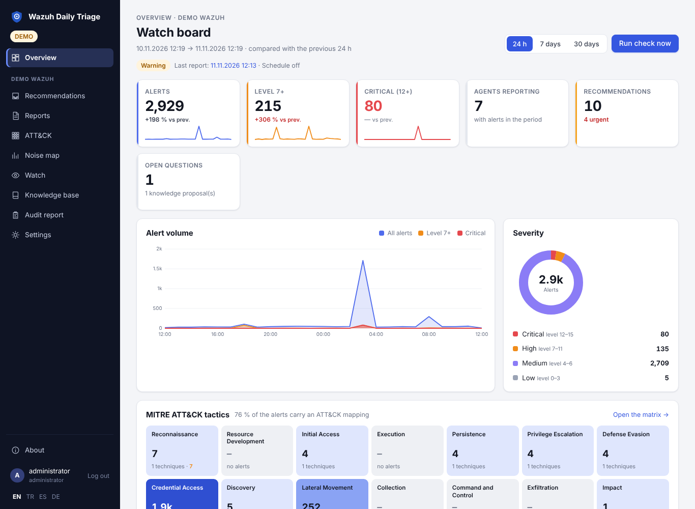
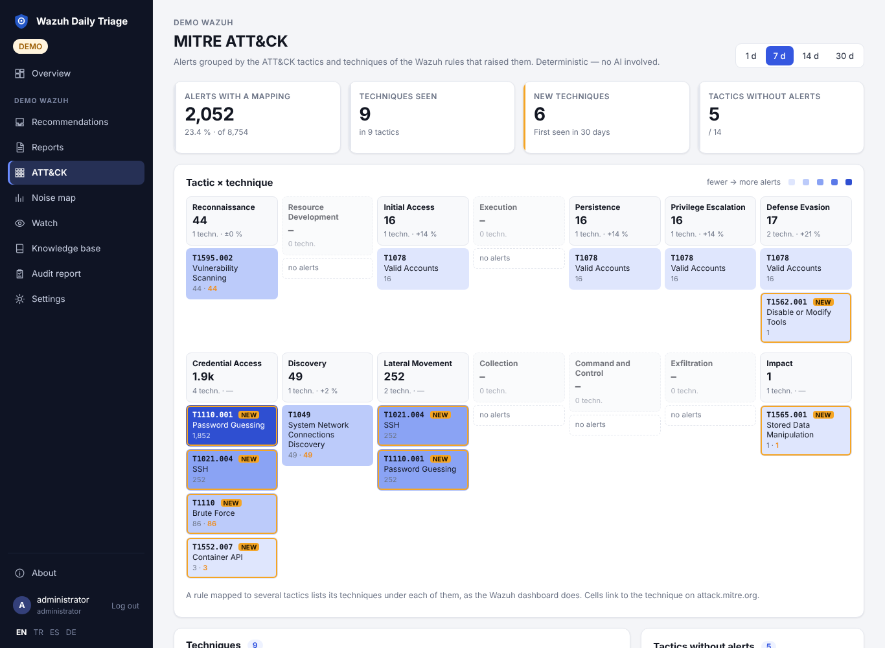
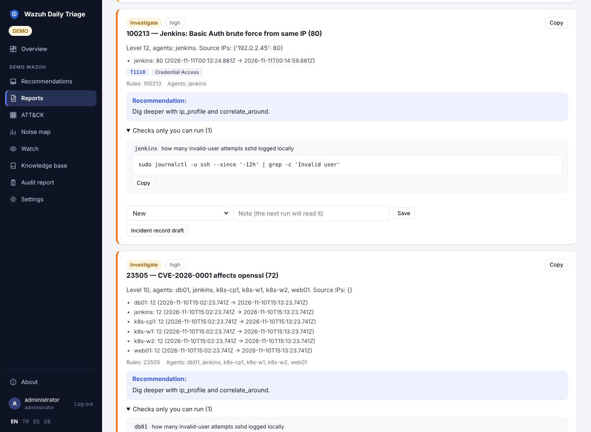

# Wazuh Daily Triage

**An on-call companion for [Wazuh](https://wazuh.com) SIEM.** A rule-based watch tells you within minutes when
something urgent happens, without calling an AI. Once or twice a day an AI round checks that the SIEM is
actually alive, separates real risk from known noise, writes a short report into your own Wazuh Indexer and asks
you only what needs a human decision. It remembers your answers.

Bring your own model: Anthropic, OpenAI, Azure OpenAI or any OpenAI-compatible endpoint (Ollama, vLLM, LM Studio,
LiteLLM). One Docker container, read-only towards Wazuh by default, personal data masked before it reaches the
model.

[English](README.md) · [Türkçe](README.tr.md) · [Deutsch](README.de.md) · [Español](README.es.md) ·
**[Wiki](https://github.com/dururustem68/wazuh-daily-triage/wiki)** ·
[Getting started](https://github.com/dururustem68/wazuh-daily-triage/wiki/Getting-Started) ·
[Security model](https://github.com/dururustem68/wazuh-daily-triage/wiki/Security-Model) ·
[Changelog](CHANGELOG.md)



| MITRE ATT&CK | Report |
|---|---|
|  |  |

## Why

If your mornings start with the same Wazuh routine (is data flowing, are agents connected, what is at level 7
and above, which of it is the usual noise, which of it is real), this tool does the legwork and calls you only
where a decision is needed. It encodes hard-won review habits: health before alerts, distributions instead of
averages, "same count on every agent means a feed event", "zero does not mean the rule works", lowering a level
instead of silencing.

## What it is, and what it is not

| It is | It is not |
|---|---|
| a daily review and on-call aid that reads what Wazuh produced | a replacement for Wazuh or its dashboard |
| read-only towards Wazuh by default | a SOAR: it does not block, isolate or run commands on agents |
| an assistant that proposes; a person decides | an autonomous responder |
| one container that keeps its data in your own Wazuh Indexer | a hosted service, or another database to run |

## Highlights

- **Dashboard.** Key figures with trend lines and the change against the previous period, alert volume over time,
  severity bands, top rules, agents and source addresses — for 24 hours, 7 or 30 days, without AI.
- **MITRE ATT&CK.** A tactic strip on the dashboard and a tactic × technique matrix per environment: new
  techniques, changes, tactics without any alert; findings carry their technique ids.
- **The watch.** Local rules check every few minutes for a critical alert, a watched rule, a successful login
  after failed attempts, Active Response, a sudden increase or lost agents, and notify at once. No model call.
- **The AI round.** Deterministic collection first (health, volume, new rules, anomalies), then a model with
  read-only tools writes findings with evidence, asks questions and judges every watch event.
- **It learns from you.** Decisions, known noise and answers go into a knowledge base that every later run
  reads. Proposals from the AI have no effect until you approve them.
- **Recommendation inbox.** Findings one at a time, without duplicates across runs; one decision settles every
  occurrence.
- **Rule drafts you can trust.** Replay a draft against 14 days of real alerts, apply it with copy-paste
  commands or an optional one-click deployment with validation and automatic rollback, then see it confirmed on
  live events.
- **Personal data stays in.** E-mail addresses, phone numbers, national IDs, IBANs, cards and secrets are
  masked before anything is sent to the model. On by default.
- **MCP server.** The same read-only tools for Claude Desktop, Cursor, VS Code or any MCP client.
- **Notifications** by e-mail, Telegram, Microsoft Teams, Slack, Discord, ntfy or a generic webhook.
- **No extra database.** State lives in `daily-triage-*` indices of your own Indexer, with encrypted backup.
- **Monthly audit report** without AI, as PDF or Markdown: volume, decisions, rule changes, outages.
- **Roles.** Administrator and read-only viewer, by password or — behind Keycloak, Authentik or oauth2-proxy — by
  SSO group.
- **Multi-environment, multi-language** (English, Turkish, Spanish, German), Docker Compose or Kubernetes.

Every feature is described in the [wiki](https://github.com/dururustem68/wazuh-daily-triage/wiki).

## Quick start

### Try the demo (no Wazuh, no model needed)

```sh
git clone https://github.com/dururustem68/wazuh-daily-triage.git && cd wazuh-daily-triage
cp .env.demo .env
docker compose up -d --build
# open http://127.0.0.1:8080 and sign in with: demo-password-change-me
```

The demo uses synthetic data and a mock model, and starts with a finished report, watch events and waiting
suggestions.

### Connect your Wazuh

1. Create the read-only accounts from [docs/permissions.md](docs/permissions.md). Do not use admin credentials.
2. Start from the example file and fill in your values:

   ```sh
   cp .env.example .env
   openssl rand -hex 32            # APP_SECRET
   vi .env                         # APP_PASSWORD, LLM_*, WAZUH_INDEXER_*, WAZUH_API_*, WAZUH_CA_FILE
   docker compose up -d
   docker compose exec triage python -m app.check
   ```

3. Press **Run check now** and check the first report.

The step-by-step version with expected results and common errors is
**[Getting started](https://github.com/dururustem68/wazuh-daily-triage/wiki/Getting-Started)**. Before
production, go through the
[security checklist](https://github.com/dururustem68/wazuh-daily-triage/wiki/Security-Checklist).

### Kubernetes

A [Helm chart](deploy/helm/wazuh-daily-triage) and a [Kustomize base](deploy/kubernetes/README.md) with optional
components: single replica, non-root, read-only filesystem, no PVC. Production guide:
[Kubernetes](https://github.com/dururustem68/wazuh-daily-triage/wiki/Kubernetes).

## AI providers

| Provider | `LLM_PROVIDER` | `LLM_BASE_URL` |
|---|---|---|
| Claude (Anthropic) | `anthropic` | – |
| OpenAI | `openai` | `https://api.openai.com/v1` |
| Google Gemini | `openai` | `https://generativelanguage.googleapis.com/v1beta/openai` |
| DeepSeek | `openai` | `https://api.deepseek.com` |
| Azure OpenAI | `openai` | full deployment URL with `?api-version=` |
| Ollama, vLLM, LM Studio, LiteLLM | `openai` | for example `http://ollama:11434/v1` |

The model must support tool (function) calling. Each environment can use its own model, for example a local one
for data that must not leave your network. Model names and parameter quirks: [docs/providers.md](docs/providers.md).

## Security and privacy in short

- **Read-only towards Wazuh by default.** No active response, no configuration writes, no agent commands. The
  only index writes go to the application's own indices.
- **The model reads and proposes.** No shell, no outbound requests; queries are bounded by a field allow-list
  and size limits, so text injected into an alert cannot become an arbitrary query.
- **Rule deployment is opt-in**, uses a separate least-privilege API user, writes one dedicated file and rolls
  back on any failure.
- **With a hosted model, summaries and sample log lines go to that provider.** Personal data and secrets are
  pseudonymised first (best effort, not a DLP); for regulated data use a local model.
- **Production startup refuses** example passwords, a missing `APP_SECRET`, insecure cookies and disabled TLS
  verification. State-changing requests are written to a hash-chained audit trail.

Details: [Security model](https://github.com/dururustem68/wazuh-daily-triage/wiki/Security-Model) ·
[Privacy](https://github.com/dururustem68/wazuh-daily-triage/wiki/Privacy) ·
[docs/security-exceptions.md](docs/security-exceptions.md). Report vulnerabilities privately: [SECURITY.md](SECURITY.md).

## Documentation

This README is the short version. The [wiki](https://github.com/dururustem68/wazuh-daily-triage/wiki) is the
handbook; the `docs/` folder holds the reference documents the wiki links to.

| Topic | Where |
|---|---|
| From the demo to a first real report | [Getting started](https://github.com/dururustem68/wazuh-daily-triage/wiki/Getting-Started) |
| Installation and configuration | [Installation](https://github.com/dururustem68/wazuh-daily-triage/wiki/Installation), [Configuration](https://github.com/dururustem68/wazuh-daily-triage/wiki/Configuration), [Kubernetes](https://github.com/dururustem68/wazuh-daily-triage/wiki/Kubernetes) |
| Daily use | [User guide](https://github.com/dururustem68/wazuh-daily-triage/wiki/User-Guide), [Rule lifecycle](https://github.com/dururustem68/wazuh-daily-triage/wiki/Rule-Lifecycle), [Watch](https://github.com/dururustem68/wazuh-daily-triage/wiki/Watch), [MCP](https://github.com/dururustem68/wazuh-daily-triage/wiki/MCP) |
| Security and privacy | [Security model](https://github.com/dururustem68/wazuh-daily-triage/wiki/Security-Model), [Privacy](https://github.com/dururustem68/wazuh-daily-triage/wiki/Privacy), [Security checklist](https://github.com/dururustem68/wazuh-daily-triage/wiki/Security-Checklist) |
| Operations | [Troubleshooting](https://github.com/dururustem68/wazuh-daily-triage/wiki/Troubleshooting), [Backup](https://github.com/dururustem68/wazuh-daily-triage/wiki/Backup), [Upgrade](https://github.com/dururustem68/wazuh-daily-triage/wiki/Upgrade) |
| Versions and limits | [Compatibility](https://github.com/dururustem68/wazuh-daily-triage/wiki/Compatibility) |
| Examples, FAQ, glossary | [Scenarios](https://github.com/dururustem68/wazuh-daily-triage/wiki/Scenarios), [FAQ](https://github.com/dururustem68/wazuh-daily-triage/wiki/FAQ) |
| Reference | [permissions](docs/permissions.md), [rule deployment](docs/rule-deployment.md), [notifications](docs/notifications.md), [providers](docs/providers.md), [sources](docs/sources.md), [architecture](docs/architecture.md), [eval](docs/eval.md) |

## Compatibility

- Wazuh **4.x**, developed and tested against 4.14; Wazuh Indexer (OpenSearch 2.x) with the standard
  `wazuh-alerts-*` template.
- The Wazuh server API is optional; without it agent and daemon health, rule information and logtest are off.
- Python **3.11–3.15**.

What is tested, what is expected and what is not supported:
[Compatibility](https://github.com/dururustem68/wazuh-daily-triage/wiki/Compatibility).

## Development

```sh
python -m venv .venv && . .venv/bin/activate
pip install -r requirements.txt -r requirements-dev.txt
pytest
ruff check .
WDT_DEMO=true APP_PASSWORD=x uvicorn app.main:app --reload
```

The test suite runs on a built-in demo engine and needs no cluster. There are no marketing numbers here: measure
a model on days you reviewed yourself with `python -m app.eval` ([docs/eval.md](docs/eval.md)). More:
[Development](https://github.com/dururustem68/wazuh-daily-triage/wiki/Development) ·
[CONTRIBUTING.md](CONTRIBUTING.md) · [ROADMAP.md](ROADMAP.md).

## Acknowledgements

- [Wazuh — Threat hunting with agentic AI](https://wazuh.com/blog/threat-hunting-with-agentic-ai/) (least-privilege roles, correlation window)
- [gensecaihq/Wazuh-MCP-Server](https://github.com/gensecaihq/Wazuh-MCP-Server), [gbrigandi/mcp-server-wazuh](https://github.com/gbrigandi/mcp-server-wazuh)

## License

Copyright © 2026 Rüstem Duru. Licensed under the **GNU Affero General Public License v3.0**; see
[LICENSE](LICENSE) and [NOTICE](NOTICE). If you run a modified version for users over a network, you must
offer them its source code (set `SOURCE_URL` to your fork).

Wazuh is a trademark of Wazuh, Inc. This project is independent and not affiliated with Wazuh, Inc.
