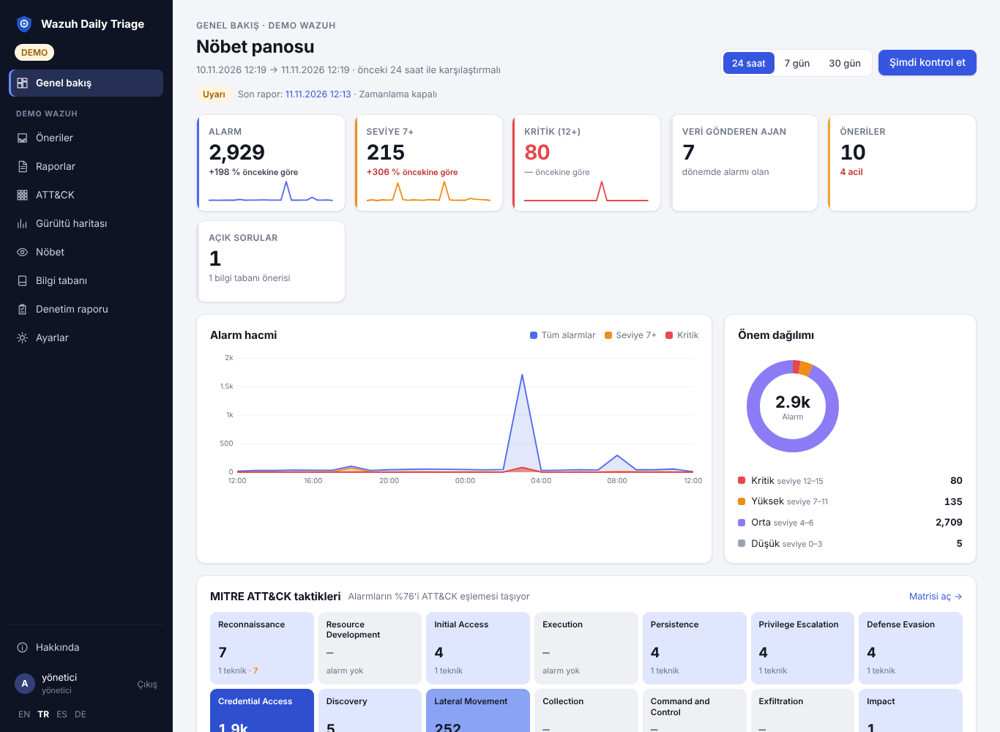
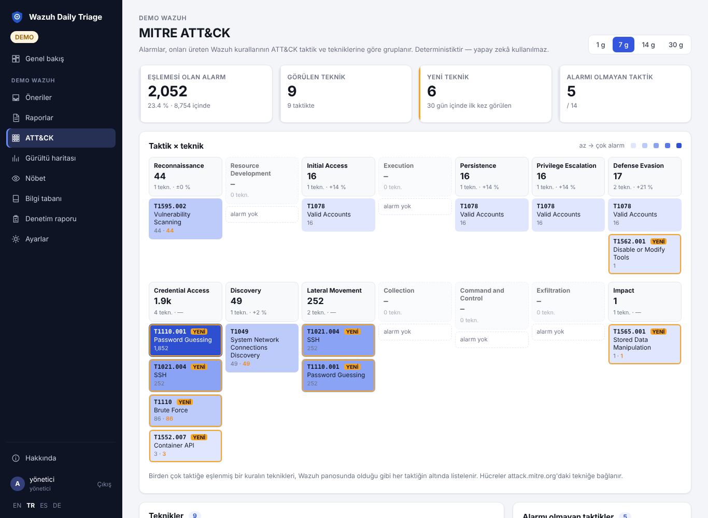
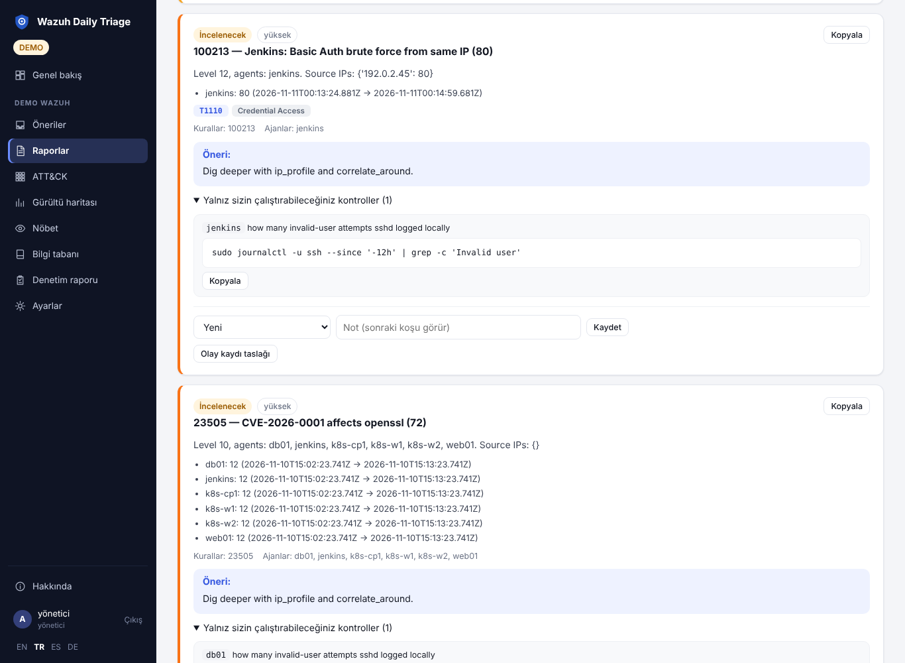

# Wazuh Daily Triage

**[Wazuh](https://wazuh.com) SIEM için nöbet yardımcısı.** Kural tabanlı nöbet, acil bir durum olduğunda
dakikalar içinde ve yapay zekâ çağırmadan haber verir. Günde bir ya da iki kez çalışan AI turu ise SIEM'in
gerçekten ayakta olduğunu denetler, gerçek riski bilinen gürültüden ayırır, kısa bir raporu kendi Wazuh
Indexer'ınıza yazar ve yalnız insan kararı gereken yerde size sorar. Cevaplarınızı hatırlar.

Model sizin: Anthropic, OpenAI, Azure OpenAI ya da OpenAI uyumlu herhangi bir uç nokta (Ollama, vLLM, LM Studio,
LiteLLM). Tek Docker konteyner; varsayılan olarak Wazuh'a karşı salt okunur; kişisel veri modele ulaşmadan önce
maskelenir.

[English](README.md) · [Türkçe](README.tr.md) · [Deutsch](README.de.md) · [Español](README.es.md) ·
**[Wiki](https://github.com/dururustem68/wazuh-daily-triage/wiki/Home-TR)** ·
[Başlangıç](https://github.com/dururustem68/wazuh-daily-triage/wiki/Getting-Started-TR) ·
[Güvenlik modeli](https://github.com/dururustem68/wazuh-daily-triage/wiki/Security-Model-TR) ·
[Değişiklik günlüğü](CHANGELOG.md)



| MITRE ATT&CK | Rapor |
|---|---|
|  |  |

## Neden

Sabahlarınız aynı Wazuh rutiniyle başlıyorsa (veri akıyor mu, ajanlar bağlı mı, seviye 7 ve üstünde ne var,
hangisi bildik gürültü, hangisi gerçek), bu araç ayak işini yapar ve sizi yalnız karar gereken yerde çağırır.
Zor öğrenilmiş inceleme alışkanlıklarını içerir: önce sağlık sonra alarm, ortalama yerine dağılım, "her ajanda
aynı sayı bir besleme olayıdır", "sıfır, kuralın çalıştığını göstermez", susturmak yerine seviye düşürmek.

## Nedir, ne değildir

| Nedir | Ne değildir |
|---|---|
| Wazuh'un ürettiğini okuyan bir günlük inceleme ve nöbet yardımcısı | Wazuh'un ya da panosunun yerine geçen bir araç |
| varsayılan olarak Wazuh'a karşı salt okunur | bir SOAR: engellemez, yalıtmaz, ajanlarda komut çalıştırmaz |
| öneren bir asistan; kararı kişi verir | kendi başına müdahale eden bir sistem |
| verisini sizin Wazuh Indexer'ınızda tutan tek konteyner | barındırılan bir hizmet ya da işletilecek ek bir veritabanı |

## Öne çıkanlar

- **Pano.** Eğilim çizgili ve önceki döneme göre değişimi gösteren ana göstergeler, zamana göre alarm hacmi, önem
  bantları, en sık kurallar, ajanlar ve kaynak adresler — 24 saat, 7 ya da 30 gün için, yapay zekâsız.
- **MITRE ATT&CK.** Panoda taktik şeridi ve ortam başına taktik × teknik matrisi: yeni teknikler, değişimler, hiç
  alarmı olmayan taktikler; bulgular teknik kimliklerini taşır.
- **Nöbet.** Yerel kurallar birkaç dakikada bir kritik alarm, izlenen kural, başarısız denemelerden sonra
  başarılı giriş, Active Response, ani artış ya da kopan ajan arar ve hemen bildirir. Model çağrılmaz.
- **AI turu.** Önce deterministik toplama (sağlık, hacim, yeni kurallar, anomaliler), sonra salt okunur
  araçları olan bir model kanıtlı bulgular yazar, soru sorar ve her nöbet olayına hüküm verir.
- **Sizden öğrenir.** Kararlar, bilinen gürültü ve cevaplar, sonraki her koşunun okuduğu bilgi tabanına girer.
  Yapay zekânın önerileri siz onaylayana kadar etkisizdir.
- **Öneri kutusu.** Bulgular tek tek, koşular arasında yinelenmeden; tek karar bütün tekrarları kapatır.
- **Güvenilir kural taslakları.** Taslağı 14 günlük gerçek alarma karşı yeniden oynatın, kopyala-yapıştır
  komutlarla ya da doğrulama ve otomatik geri alma içeren isteğe bağlı tek tık dağıtımla uygulayın, sonra canlı
  olaylarla doğrulandığını görün.
- **Kişisel veri içeride kalır.** E-posta adresleri, telefon numaraları, kimlik numaraları (TCKN), IBAN'lar,
  kartlar ve sırlar modele bir şey gönderilmeden önce maskelenir (KVKK / GDPR). Varsayılan olarak açık.
- **MCP sunucusu.** Aynı salt okunur araçlar Claude Desktop, Cursor, VS Code ya da herhangi bir MCP istemcisi
  için.
- **Bildirimler:** e-posta, Telegram, Microsoft Teams, Slack, Discord, ntfy ya da genel webhook.
- **Ek veritabanı yok.** Durum kendi Indexer'ınızdaki `daily-triage-*` indekslerinde durur; şifreli yedek alınır.
- **Aylık denetim raporu**, yapay zekâsız, PDF ya da Markdown: hacim, kararlar, kural değişiklikleri, kesintiler.
- **Roller.** Yönetici ve salt okunur görüntüleyici; parolayla ya da Keycloak, Authentik veya oauth2-proxy
  arkasında SSO grubuyla.
- **Çok ortam, çok dil** (İngilizce, Türkçe, İspanyolca, Almanca); Docker Compose ya da Kubernetes.

Her özellik [wiki](https://github.com/dururustem68/wazuh-daily-triage/wiki/Home-TR)'de anlatılır.

## Hızlı başlangıç

### Demoyu deneyin (Wazuh ve model gerekmez)

```sh
git clone https://github.com/dururustem68/wazuh-daily-triage.git && cd wazuh-daily-triage
cp .env.demo .env
docker compose up -d --build
# http://127.0.0.1:8080 adresini açın, parola: demo-password-change-me
```

Demo sentetik veri ve mock model kullanır; bitmiş bir rapor, nöbet olayları ve bekleyen önerilerle açılır.

### Kendi Wazuh'unuzu bağlayın

1. [docs/permissions.md](docs/permissions.md) içindeki salt okunur hesapları oluşturun. Yönetici kimlik
   bilgilerini kullanmayın.
2. Örnek dosyadan başlayıp kendi değerlerinizi girin:

   ```sh
   cp .env.example .env
   openssl rand -hex 32            # APP_SECRET
   vi .env                         # APP_PASSWORD, LLM_*, WAZUH_INDEXER_*, WAZUH_API_*, WAZUH_CA_FILE
   docker compose up -d
   docker compose exec triage python -m app.check
   ```

3. **Şimdi kontrol et** düğmesine basın ve ilk raporu denetleyin.

Beklenen sonuçlar ve sık hatalarla adım adım anlatım:
**[Başlangıç](https://github.com/dururustem68/wazuh-daily-triage/wiki/Getting-Started-TR)**. Üretime almadan
önce [güvenlik kontrol listesi](https://github.com/dururustem68/wazuh-daily-triage/wiki/Security-Checklist-TR)nin
üzerinden geçin.

### Kubernetes

[Helm chart](deploy/helm/wazuh-daily-triage) ve isteğe bağlı bileşenleriyle
[Kustomize base](deploy/kubernetes/README.md): tek replika, root olmayan kullanıcı, salt okunur dosya sistemi,
PVC yok. Üretim rehberi: [Kubernetes](https://github.com/dururustem68/wazuh-daily-triage/wiki/Kubernetes-TR).

## Yapay zekâ sağlayıcıları

| Sağlayıcı | `LLM_PROVIDER` | `LLM_BASE_URL` |
|---|---|---|
| Claude (Anthropic) | `anthropic` | – |
| OpenAI | `openai` | `https://api.openai.com/v1` |
| Google Gemini | `openai` | `https://generativelanguage.googleapis.com/v1beta/openai` |
| DeepSeek | `openai` | `https://api.deepseek.com` |
| Azure OpenAI | `openai` | `?api-version=` içeren tam dağıtım adresi |
| Ollama, vLLM, LM Studio, LiteLLM | `openai` | örneğin `http://ollama:11434/v1` |

Model araç (fonksiyon) çağırmayı desteklemelidir. Her ortam kendi modelini kullanabilir; örneğin ağınızdan
çıkmaması gereken veri için yerel bir model. Model adları ve parametre farkları:
[docs/providers.tr.md](docs/providers.tr.md).

## Kısaca güvenlik ve gizlilik

- **Varsayılan olarak Wazuh'a karşı salt okunur.** Active response yok, yapılandırma yazımı yok, ajan komutu
  yok. İndekse yazma yalnız uygulamanın kendi indekslerine yapılır.
- **Model okur ve önerir.** Kabuk yok, dışarıya istek yok; sorgular alan izin listesi ve boyut sınırlarıyla
  kısıtlıdır, bu yüzden bir alarmın içine yerleştirilmiş metin keyfi bir sorguya dönüşemez.
- **Kural dağıtımı isteğe bağlıdır**; ayrı, en az yetkili bir API kullanıcısı kullanır, tek bir dosyaya yazar
  ve herhangi bir hatada geri alır.
- **Barındırılan modelde özetler ve örnek log satırları o sağlayıcıya gider.** Kişisel veri ve sırlar önce
  takma adla değiştirilir (elden gelen en iyi çaba; DLP değildir); düzenlemeye tabi veri için yerel model
  kullanın.
- **Üretim modunda uygulama** örnek parolayla, eksik `APP_SECRET` ile, güvensiz çerezle ve kapatılmış TLS
  doğrulamasıyla açılmaz. Durum değiştiren istekler özet zincirli bir denetim izine yazılır.

Ayrıntı: [Güvenlik modeli](https://github.com/dururustem68/wazuh-daily-triage/wiki/Security-Model-TR) ·
[Gizlilik](https://github.com/dururustem68/wazuh-daily-triage/wiki/Privacy-TR) ·
[docs/security-exceptions.md](docs/security-exceptions.md). Güvenlik açıklarını özel olarak bildirin:
[SECURITY.md](SECURITY.md).

## Dokümantasyon

Bu README kısa sürümdür. El kitabı [wiki](https://github.com/dururustem68/wazuh-daily-triage/wiki/Home-TR)'dir;
`docs/` dizini wiki'nin bağlantı verdiği başvuru belgelerini tutar.

| Konu | Nerede |
|---|---|
| Demodan ilk gerçek rapora | [Başlangıç](https://github.com/dururustem68/wazuh-daily-triage/wiki/Getting-Started-TR) |
| Kurulum ve yapılandırma | [Kurulum](https://github.com/dururustem68/wazuh-daily-triage/wiki/Installation-TR), [Yapılandırma](https://github.com/dururustem68/wazuh-daily-triage/wiki/Configuration-TR), [Kubernetes](https://github.com/dururustem68/wazuh-daily-triage/wiki/Kubernetes-TR) |
| Günlük kullanım | [Kullanıcı rehberi](https://github.com/dururustem68/wazuh-daily-triage/wiki/User-Guide-TR), [Kural yaşam döngüsü](https://github.com/dururustem68/wazuh-daily-triage/wiki/Rule-Lifecycle-TR), [Nöbet](https://github.com/dururustem68/wazuh-daily-triage/wiki/Watch-TR), [MCP](https://github.com/dururustem68/wazuh-daily-triage/wiki/MCP-TR) |
| Güvenlik ve gizlilik | [Güvenlik modeli](https://github.com/dururustem68/wazuh-daily-triage/wiki/Security-Model-TR), [Gizlilik](https://github.com/dururustem68/wazuh-daily-triage/wiki/Privacy-TR), [Güvenlik kontrol listesi](https://github.com/dururustem68/wazuh-daily-triage/wiki/Security-Checklist-TR) |
| İşletim | [Sorun giderme](https://github.com/dururustem68/wazuh-daily-triage/wiki/Troubleshooting-TR), [Yedekleme](https://github.com/dururustem68/wazuh-daily-triage/wiki/Backup-TR), [Yükseltme](https://github.com/dururustem68/wazuh-daily-triage/wiki/Upgrade-TR) |
| Sürümler ve sınırlar | [Uyumluluk](https://github.com/dururustem68/wazuh-daily-triage/wiki/Compatibility-TR) |
| Örnekler, SSS, sözlük | [Örnek senaryolar](https://github.com/dururustem68/wazuh-daily-triage/wiki/Scenarios-TR), [SSS](https://github.com/dururustem68/wazuh-daily-triage/wiki/FAQ-TR) |
| Başvuru (İngilizce) | [yetkiler](docs/permissions.md), [kural dağıtımı](docs/rule-deployment.md), [bildirimler](docs/notifications.md), [sağlayıcılar](docs/providers.tr.md), [kaynaklar](docs/sources.md), [mimari](docs/architecture.md), [eval](docs/eval.md) |

## Uyumluluk

- Wazuh **4.x**; 4.14'e karşı geliştirilip test edildi. Standart `wazuh-alerts-*` şablonuyla Wazuh Indexer
  (OpenSearch 2.x).
- Wazuh sunucu API'si isteğe bağlıdır; yoksa ajan ve daemon sağlığı, kural bilgisi ve logtest kapalıdır.
- Python **3.11–3.15**.

Neyin test edildiği, neyin beklendiği ve neyin desteklenmediği:
[Uyumluluk](https://github.com/dururustem68/wazuh-daily-triage/wiki/Compatibility-TR).

## Geliştirme

```sh
python -m venv .venv && . .venv/bin/activate
pip install -r requirements.txt -r requirements-dev.txt
pytest
ruff check .
WDT_DEMO=true APP_PASSWORD=x uvicorn app.main:app --reload
```

Test paketi yerleşik bir demo motorunda çalışır ve cluster istemez. Burada pazarlama rakamı yoktur: bir modeli
kendi incelediğiniz günlerde `python -m app.eval` ile ölçün ([docs/eval.md](docs/eval.md)). Devamı:
[Geliştirme](https://github.com/dururustem68/wazuh-daily-triage/wiki/Development-TR) ·
[CONTRIBUTING.md](CONTRIBUTING.md) · [ROADMAP.md](ROADMAP.md).

## Teşekkür

- [Wazuh — Threat hunting with agentic AI](https://wazuh.com/blog/threat-hunting-with-agentic-ai/) (en az yetkili roller, korelasyon penceresi)
- [gensecaihq/Wazuh-MCP-Server](https://github.com/gensecaihq/Wazuh-MCP-Server), [gbrigandi/mcp-server-wazuh](https://github.com/gbrigandi/mcp-server-wazuh)

## Lisans

Telif hakkı © 2026 Rüstem Duru. **GNU Affero General Public License v3.0** ile lisanslanmıştır; bkz.
[LICENSE](LICENSE) ve [NOTICE](NOTICE). Değiştirilmiş bir sürümü ağ üzerinden kullanıcılara sunuyorsanız kaynak
kodunu da sunmanız gerekir (`SOURCE_URL` değerini kendi çatalınıza ayarlayın).

Wazuh, Wazuh, Inc. şirketinin ticari markasıdır. Bu proje bağımsızdır ve Wazuh, Inc. ile bağlantısı yoktur.
