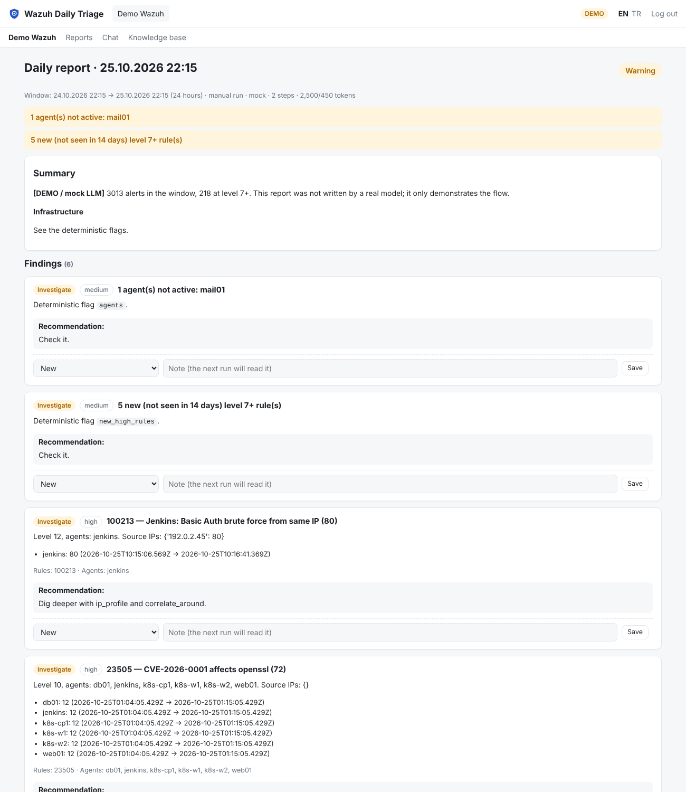

# Wazuh Daily Triage

**[Wazuh](https://wazuh.com) SIEM için yapay zekâ destekli günlük nöbet kontrolü.** Her sabah SIEM'in gerçekten
çalıştığını kontrol eder, gerçek riski bilinen gürültüden ayırır, kısa bir teşhis raporunu Wazuh Indexer'ınıza
geri yazar, yalnızca insan kararı gereken yerde size soru sorar ve cevaplarınızı ertesi gün hatırlar.

Yapay zekâ anahtarınız sizin: Anthropic, OpenAI, Azure OpenAI ya da OpenAI uyumlu herhangi bir uç nokta (Ollama,
vLLM, LM Studio, LiteLLM). Tek Docker konteyner; Wazuh'a karşı salt okunur.

[English README](README.md) · [Yetkiler ve ağ](docs/permissions.md) · [Katkı](CONTRIBUTING.md) · [Güvenlik](SECURITY.md)



## Ne yapar

- **Zamanlanmış günlük kontrol** (ortam başına saat + gün). Pencere "son başarılı koşudan bu yana"; pazartesi
  sabahı hafta sonunu kapsar.
- **Önce deterministik toplama** (yapay zekâdan bağımsız): son alarm zamanı ve boş saatler (kör nokta), indexer
  sağlığı/diski, manager süreçleri, aktif olmayan ajanlar, `ossec.log` hataları, seviye dağılımı, yüksek
  seviye gruplar (kural × ajan × ilk/son × kaynak IP × örnek), önceki pencereyle kıyas, **14 günde ilk kez
  görülen kurallar**, izlenen kurallar, zafiyet özeti.
- **Yapay zekâ teşhisi** — özeti ve bilgi tabanını okur, salt okunur araçlarla derinleşir (zaman dağılımı, IP
  profili, ±30 dk korelasyon, logtest, kural tanımı) ve yapılandırılmış rapor teslim eder. Kural taslağı yazar
  ama **uygulamaz**; XML, OS_Regex tuzakları ve ID çakışması için kontrol eder.
- **Size sorar** — "Bu SSH girişi sizin miydi?" Cevap bilgi tabanına yazılır, sonraki koşuya bağlam olur.
- **Bilgi tabanı** — bilinen gürültü, kararlar, açık maddeler, dersler, "yarın şuna bak" istekleri. Yapay zekâ
  önerileri **siz onaylayana kadar etkisizdir**.
- **Sohbet** — ortam hakkında soru sorun; aynı araçlarla, kanıta dayalı cevap.
- **Kayıtlar Wazuh'un içinde** — her ortamın kendi indexer'ında `daily-triage-runs / -knowledge / -chat`.
- **Çok ortam, çok dil** (İngilizce, Türkçe — sağ üstten seçilir), ortam başına model (ör. düzenlemeye tabi veri
  için yerel model), arayüzde ve komut satırında bağlantı testi.

## Hızlı başlangıç

### 1. Demo (Wazuh gerekmez)

```sh
git clone https://github.com/dururustem68/wazuh-daily-triage.git && cd wazuh-daily-triage
cp .env.example .env
sed -i 's/^WDT_DEMO=.*/WDT_DEMO=true/; s/^LLM_PROVIDER=.*/LLM_PROVIDER=mock/; s/^APP_LANGUAGE=.*/APP_LANGUAGE=tr/' .env
docker compose up -d --build
# http://127.0.0.1:8080 — parola: .env'deki APP_PASSWORD
```

### 2. Tek Wazuh ortamı — YAML gerekmez

[docs/permissions.md](docs/permissions.md)'deki salt okunur hesapları açın, sonra `.env`'de `WAZUH_INDEXER_URL`,
`WAZUH_INDEXER_USER`, `WAZUH_INDEXER_PASSWORD`, isteğe bağlı `WAZUH_API_*`, `WAZUH_CA_FILE` ve `LLM_*`
değişkenlerini doldurun:

```sh
docker compose up -d
docker compose exec triage python -m app.check    # ya da ortam sayfasında "Bağlantıları test et"
```

### 3. Birden çok ortam

```sh
cp config/environments.example.yaml config/environments.yaml
vi config/environments.yaml        # her Wazuh için bir blok; parolalar .env'den ${DEGISKEN} ile
vi config/context/<ortam>.md       # ortamı anlatan birkaç satır
```

`config/environments.yaml`, `config/context/*`, `config/seed/*`, `config/certs/` ve `.env` git'e girmez.

## Güvenlik

- Wazuh'a karşı **salt okunur**: Active Response, kural/konfig yazma, ajan komutu yok.
- Alarm içerikleri saldırgan kontrolündedir (prompt injection); kandırılmış bir model en fazla bilgi tabanına
  *öneri* ekleyebilir, siz onaylamadan etkisizdir.
- Harici bir LLM kullanıyorsanız alarm özetleri o sağlayıcıya gider. Düzenlemeye tabi ortamlarda (BDDK, KVKK,
  GDPR) yerel model ya da `redact: true` kullanın.
- Arayüz: parola + imzalı çerez, deneme sınırı, sıkı CSP; konteyner root olmayan kullanıcıyla ve salt okunur
  dosya sistemiyle çalışır.

## Lisans

Telif hakkı © 2026 Rüstem Duru. **GNU Affero General Public License v3.0** ile lisanslanmıştır — bkz.
[LICENSE](LICENSE) ve [NOTICE](NOTICE). Değiştirilmiş bir sürümü ağ üzerinden kullanıcılara sunarsanız kaynak
kodunu onlara sunmanız gerekir (`SOURCE_URL`'yi kendi fork'unuza yönlendirin).

Wazuh, Wazuh Inc.'in ticari markasıdır; bu proje Wazuh Inc. ile bağlantılı değildir.
