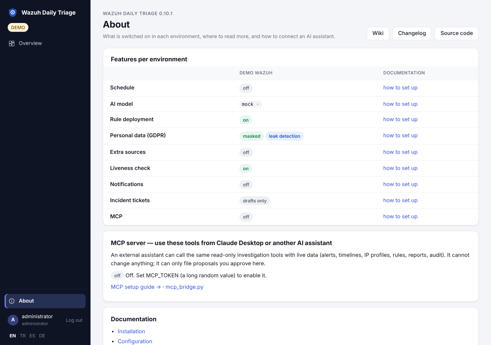

# Özellikler ve günlük işletim

Aşağıdakilerin hepsi `environments.yaml` içinde ortam bazında ayarlanır (bkz. [Yapılandırma](Configuration-TR)).
Gösterilen değerler varsayılandır; bir anahtarı yazmazsanız varsayılan geçerli olur.

Sağ üstteki **Hakkında** sayfası, bu özelliklerden hangisinin hangi ortamda açık olduğunu buraya bağlantılarla gösterir.



## Kural taslakları: onayla ve dağıt

Yapay zekâ gürültü ya da tespit boşluğu gördüğünde kural taslağı (`rule_draft`) önerir. `rule_deploy` açıksa
**Approve and deploy**, taslağı **ayrı** bir Wazuh API kullanıcısıyla tek bir kural dosyasına yazar. Ardından
manager yapılandırmasını doğrular ve manager'ı ya da cluster'ı yeniden başlatır. Yeniden başlatmadan sonra
logtest örnekleri tekrar oynatılır; bir örnek artık eşleşmiyorsa değişiklik geri alınır. `rule_deploy` kapalıyken
taslaklar yalnızca kopyala-yapıştır komutları gösterir; **Deploy** düğmesi pasif görünür ve bu bölüme bağlantı verir.

```yaml
rule_deploy:
  enabled: false
  username: ${PROD_DEPLOY_USER:-}     # salt okunur kullanıcı OLMAMALI — ortak ya da zayıf hesapla uygulama açılmaz
  password: ${PROD_DEPLOY_PASSWORD:-}
  file: wdt_rules.xml                 # etc/rules altındaki dosya adı; başka hiçbir şey yazılmaz
  id_min: 100000                      # aralık dışındaki taslaklar reddedilir
  id_max: 119999
  restart_timeout: 180
  require_tests: false                # true: her taslak logtest örneği ister
  allow_inconclusive: false           # true: yeniden üretilemeyen örnekte de dağıt (uyarıyla)
```

Dağıtım kullanıcısının tam RBAC politikası
[docs/rule-deployment.md](https://github.com/dururustem68/wazuh-daily-triage/blob/main/docs/rule-deployment.md)
belgesindedir. Her dağıtım ve geri alma denetim kaydına yazılır; `notify.on_rule_deploy: true` ise bildirim de
gider. **Verify**, dağıtılan kuralın canlı alarmlarda gerçekten tetiklendiğini sonradan kontrol eder.

## Ne olurdu? (taslağı geçmişe karşı denemek)

Her kural taslağında **Ne olurdu? (14 gün)** düğmesi vardır. Taslağı, üst kurallarının (`if_sid`) son 14 gündeki
gerçek alarmları üzerinde dener ve dağıtmadan önce şunları gösterir:

- kaç alarmı devralacağını (toplam, günlük, üst kuralın alarmlarına oranı) ve yeni seviyeyi,
- bunlardan kaçının yüksek seviyede olduğunu, önce → sonra — gerçek bir alarmın seviyesi düşecekse burada görünür,
- başlıca ajanları, kaynak IP'leri ve log kaynaklarını, eşleşen örnekleri ve **eşleşmeyecek** üst kural alarmlarını.

`<match>` / `<regex>` (OS_Match, OS_Regex ya da `type="pcre2"`), `<field>`, `<srcip>`, `<user>`, `<url>`,
`<location>`, `<decoded_as>` gibi koşullar en fazla 2.000 alarmlık rastgele bir örneklem üzerinde değerlendirilir
(daha azsa birebir). CDB listeleri, zaman pencereleri ve frekans kuralları *değerlendirilmedi* olarak listelenir;
sayılar o zaman üst sınırdır. Yapay zekâ da bir taslak önermeden önce aynı kontrolü (`simulate_rule`, MCP'den de
erişilebilir) çalıştırır ve sayıları öneriye yazar.

## Gürültü haritası

Ortam menüsündeki **Gürültü haritası** (yapay zekâsız) "hacim nereden geliyor?" sorusunu cevaplar:

- son 1 / 7 / 14 / 30 günün en çok alarm üreten kuralları: günlük alarm, tüm alarmlar ve yüksek seviyeli
  alarmlar içindeki payı, önceki döneme göre değişim, baskın ajan ve log kaynağı;
- 28 günlük günlük grafik: tüm alarmlar ve yüksek seviyeli alarmlar — yüksek seviye temizleniyor mu?
- seviye düşürme **adayları**: yüksek seviyede ve yüksek seviyeli alarmların ≥%5'i ya da günde ≥100.

Bir kural için **Yapay zekâdan taslak iste** bir istek bırakır: sonraki koşu rutin kısmı bulur, 3–5 seviyeli bir
çocuk kural yazar, `simulate_rule` ile ölçer ve önerir. **İskelet taslak** hemen düzenlenebilir bir çocuk kural
oluşturur (`rule_deploy` aralığındaki ilk boş numara); daraltıp *Ne olurdu?* ile deneyin.

## Terfi paketi (promotion)

Dağıtılmış bir taslak uygulamanın kendi dosyasında yaşar. **Terfi paketi** onu sizin yapılandırma yönetiminize
taşır. Taslak için şunları üretir:

- kaynak bilgisiyle kural bloğu,
- isteğe bağlı bir alarm kataloğu bölümü,
- bir betik: kural dosyasını yedekler, `wazuh-analysisd -t` çalıştırır, dağıtımı yapar (`kubectl apply -k` ya
  da host'ta yeniden başlatma) ve taslak hâlâ `rule_deploy.file` üzerinden dağıtılmışsa çalışmayı reddeder.

```yaml
promote:
  mode: host                     # host | kubernetes
  repo_dir: ""                   # kubernetes: operatör makinesindeki depo kökü
  rules_file: /var/ossec/etc/rules/local_rules.xml   # kubernetes: repo_dir'e göreli
  catalog_file: ""               # isteğe bağlı markdown katalog
  kubeconfig: ""
  namespace: wazuh
  master_pod: wazuh-manager-master-0
  kustomize_dir: ""              # ör. k8s/wazuh
  manager_label: app=wazuh-manager
```

Paketi görmek yalnızca `read`, taslağı "terfi edildi" diye işaretlemek ise `deploy` yetkisi ister.

## Olay kayıtları, Zammad ve Jira

Herhangi bir bulgudaki **Incident draft** ile yapay zekâ ISO 27001 A.5.24–A.5.28 tarzında bir olay kaydı
doldurur. Kesin saat, ajan ve sayılar için salt okunur araçları kullanır; doğrulayamadığı her şeyi "…" olarak
bırakır. Kayıt bulguyla birlikte saklanır; dahili Zammad bileti ya da Jira kaydı olarak açılabilir.

```yaml
incident:
  id_prefix: INC-
  template_file: null            # kendi markdown şablonunuz; yer tutucular {id} {title} {by}
  zammad: {url: "", token: "", group: Users, customer: "", verify_tls: true}
  jira: {url: "", email: "", token: "", project: "", issue_type: Task, verify_tls: true}
```

## Ek kaynaklar: Prometheus, Loki, Kubernetes

Yapay zekâ, Wazuh'un tek başına açıklayamadığı şeyleri açıklayabilir: pod yeniden başlatmaları, OOM, node baskısı
ve alarm anındaki servis logları gibi.

```yaml
sources:
  prometheus: {url: "", username: "", password: "", bearer_token: "", verify_tls: true, ca_file: null, timeout: 30}
  loki:       {url: "", org_id: ""}          # prometheus ile aynı anahtarlar; org_id = X-Scope-OrgID
  kubernetes:
    enabled: false
    in_cluster: true            # rbac-readonly bileşeni (ya da Helm rbac.create) gerekir
    namespaces: []              # izin listesi; boş = tümü
    pod_logs: true              # k8s_logs aracı
```

Secret ve configmap asla okunmaz. NetworkPolicy'de çıkış izni vermeyi unutmayın. Bkz.
[docs/sources.md](https://github.com/dururustem68/wazuh-daily-triage/blob/main/docs/sources.md).

## Yapay zekâsız sağlık kontrolleri

- **Canlılık (liveness).** LLM kullanmadan birkaç dakikada bir çalışan kontrol. Yeni bir sorunda bildirim
  gönderir (alarm gelmiyor, indexer red ya da erişilemiyor, disk ≥ %90, daemon durmuş, API erişilemiyor, cluster
  durmuş), sorun sürdükçe hatırlatır ve düzelince haber verir. Kesintiler denetim raporunda görünür.
  ```yaml
  liveness: {enabled: true, interval_minutes: 10, silence_minutes: null, repeat_hours: 2, notify_recovery: true}
  ```
- **Anomaliler** (`anomaly: true`). Sıçramalar, 14 günlük günlük ortalamanın çok üstüne çıkan kural × ajan
  sayılarıdır. Yeni eşleşmeler, 14 gündür hiç tetiklenmediği bir ajanda tetiklenen kurallardır.
- **Kapsama.** Wazuh API ile ajanları `inventory` / `inventory_file` (satır başına bir ad) listesiyle karşılaştırır;
  sürüm farkını ve uzun süredir pasif ajanları raporlar.
- **Mail kanalı doygunluğu** (`mail: {alert_level: 7, max_per_hour: 12}`, ayarlanmazsa kapalı). Alarm mail
  kanalının dolduğu saatleri ve hiç mail atılmamış olabilecek alarmları gösterir.
- **Zafiyet SLA'sı** (`vuln_sla: {critical: 15, high: 30, medium: 90, low: 0}` gün; 0 = izlenmez). Bayrak üretir
  ve denetim raporunu besler.
- **Loglarda kişisel veri**: bkz. [Gizlilik (KVKK / GDPR)](Privacy-TR).
- **Bekleyen kararlar.** Hafta içi `notify.pending_time` (varsayılan 09:30) sonrasında her ortam için bir mesaj,
  `notify.pending_days` (varsayılan 7) günden uzun süredir karar bekleyen önerileri yaşı ve kaç koşuda görüldüğüyle
  listeler. Teams kartında önerileri ve en eski üç kaydı doğrudan açan düğmeler vardır. Öneriler sayfası 7 günü
  geçen kayıtları işaretler. Kapatmak için `notify.on_pending: false` (`NOTIFY_ON_PENDING=false`).

Diğer ortam anahtarları:

| Anahtar | Varsayılan |
|---|---|
| `disk_warn_percent` | `75` |
| `required_daemons` | beş temel daemon |
| `max_silence_minutes` | `60` |
| `watch_rules` / `watch_groups` | — |
| `language` | — |
| `run_retention_days` | `0` (sonsuza kadar sakla; bilgi tabanı hiç silinmez) |

## Nöbet: yapay zekâsız acil uyarılar

Varsayılan olarak kapalıdır; **Ayarlar → Nöbet** bölümünden açılır. Yerel kurallar alarmları birkaç dakikada
bir denetler — kritik seviyede alarm, izlenen kural ya da grup, Active Response, aynı kaynaktan başarısız
denemelerden sonra başarılı giriş, ani artış, veri göndermeyi kesen ajanlar — ve hemen "kural tabanlı uyarı —
yapay zekâ incelemedi" diye bildirir. Model çağrılmaz. Sıradaki planlı **AI turu** (günde bir ya da iki kez,
saatler Ayarlar'dan) tüm olayları tek istekte alır; olay başına hüküm ve eşik önerisi döner. Öneri, yönetici
kabul edene kadar hiçbir şeyi değiştirmez. Kanallar tanımlı olanlar arasından seçilir; sessiz saatlerde kritik
olaylar dışındakiler bekletilir. Ayrıntı: [docs/watch.md](https://github.com/dururustem68/wazuh-daily-triage/blob/main/docs/watch.md).

## Ayarlar, maskeleme profili, yedekleme

`/e/<ortam>/settings` (yalnızca yönetici) yeniden kurulum gerektirmeyen ayarları tutar: nöbet, AI turu
saatleri, maskeleme profili (kendi `x_…` algılayıcılarınız, istisnalar, önizleme, YAML içe/dışa aktarım; sır
algılayıcıları kapatılamaz) ve yedekleme. **Yedekleme**, bilgi tabanı, raporlar, nöbet olayları ve ayarların
şifreli arşivini indirir, isterseniz S3'e de gönderir; içe aktarımda önce önizleme gösterir. **Depolama
güvenliği**, bir indeks silme politikasının uygulamanın kendi indekslerini silip silmeyeceğini gösterir ve
bir indeks kaybolduğunda kritik bayrak kaldırır. Ayrıntı: [docs/backup.md](https://github.com/dururustem68/wazuh-daily-triage/blob/main/docs/backup.md).

## Aylık denetim raporu

`/e/<ortam>/audit` LLM kullanmadan deterministik bir rapor üretir: hacim, koşular, bulgular ve kararlar, kural
değişiklikleri, canlılık kesintileri, kapsama ve zafiyet SLA'sı. Rapor Markdown (`/api/e/<ortam>/audit.md`),
PDF (`audit.pdf`) ve MCP (`audit_report`, `month: YYYY-MM`) olarak alınabilir.

## Bilgi tabanı içe / dışa aktarma

- Arayüz: bilgi sayfası → **İçe / dışa aktar**. Şablonu indirin (**TXT**, **Excel CSV** ya da YAML), Not Defteri
  ya da Excel ile doldurun, yükleyin, önizleyin ve içe aktarın. TXT'de her kayıt bir bloktur:
  ```text
  [gürültü] 31101 web tarayıcı gürültüsü, günde ~6.000
  kurallar: 31101, 100211
  Neden normal olduğu ve neyin anormal sayılacağı.
  ---
  [karar] Jenkins'in internete kapatılması önerilmesin
  Kabul edilmiş risk; bulgular telafi edici kontrollere göre değerlendirilsin.
  ```
  Türler: `bağlam`, `gürültü`, `karar`, `açık`, `istek`, `ders` (İngilizce adlar da geçer). CSV sütunları:
  `kind;title;body;rule_ids`. Dışa aktarma YAML'dır (`?kind=&status=`).
- Komut satırı:
  ```sh
  python -m app.kb import seed.yaml -e prod --dry-run      # sonra --dry-run olmadan; --update üzerine yazar
  python -m app.kb export -e prod --kind decision --status active > kararlar.yaml
  ```
- `seed_file` yalnızca bir kez içe aktarılır (bir işaret belgesi ikinci kez aktarılmasını engeller).

## Değerlendirme (eval): model ve prompt karşılaştırma

```sh
python -m app.eval cases.yaml --model deepseek-v4-pro --repeat 2 --out eval.json
kubectl exec -i deploy/wazuh-daily-triage -- python -m app.eval - < cases.yaml
```

Eval geçmiş pencereleri yeniden oynatır; `expect` vakalarına göre yakalama oranını (recall), `forbid` vakalarına
göre gürültüyü puanlar. Hiçbir şey yazılmaz. Çalışan bir örnek `config/eval/demo.yaml` dosyasındadır. Bkz.
[docs/eval.md](https://github.com/dururustem68/wazuh-daily-triage/blob/main/docs/eval.md).

## Sorgu koruması

Yapay zekânın ya da bir MCP istemcisinin tetiklediği her sorgu sınırlıdır:

| Sınır | Varsayılan |
|---|---|
| `max_range_hours` | 336 |
| `max_buckets` | 200 |
| `max_terms_size` | 50 |
| `max_size` | 25 |
| `min_interval` | `1m` |
| `max_concurrent` | 8 |

Alanlar yerleşik bir izin listesine göre denetlenir. Kendi decoder'larınızın alanlarını `query.extra_fields` ile
ekleyin, örneğin `data.remote_addr` ya da `data.objectRef.namespace`.

---

[English](Features) · [Türkçe](Features-TR)
