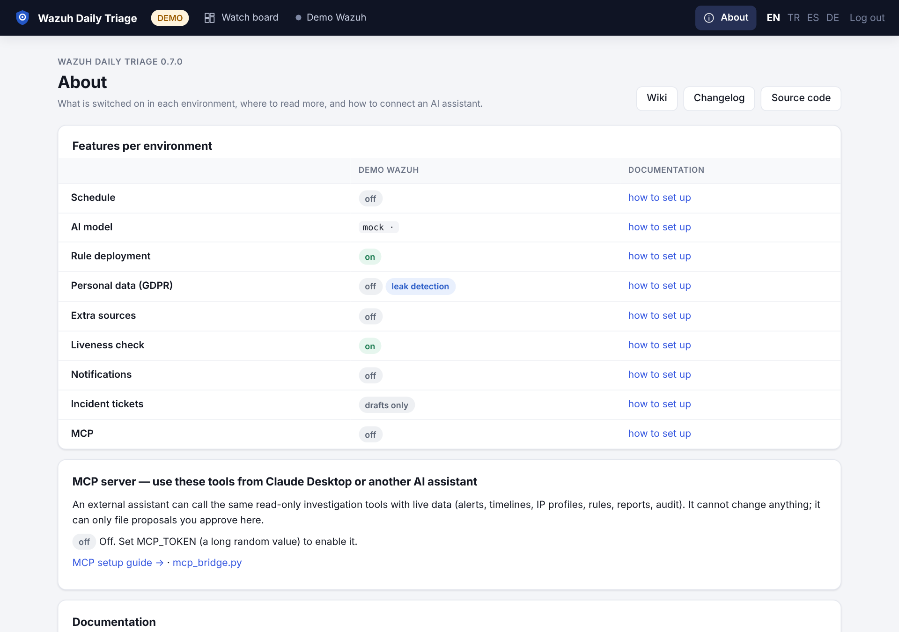

# Features and day-2 operations

Everything below is configured per environment in `environments.yaml` (see [Configuration](Configuration)).
Defaults are shown; omit a key to keep the default.

The **About** page (top right) shows, per environment, which of these features are on, with links here.



## Rule drafts: approve and deploy

The AI proposes rule drafts (`rule_draft`) when it sees noise or a detection gap. With `rule_deploy` enabled,
**Approve and deploy** writes the draft into one dedicated rules file through a **separate** Wazuh API user. It
then validates the manager configuration and restarts the manager or cluster. Logtest samples are replayed after
the restart, and the change is rolled back if a sample no longer matches. Without `rule_deploy`, drafts show
copy-paste commands only, and the **Deploy** button is shown disabled with a link to this section.

```yaml
rule_deploy:
  enabled: false
  username: ${PROD_DEPLOY_USER:-}     # NOT the read-only user — startup refuses a shared or weak account
  password: ${PROD_DEPLOY_PASSWORD:-}
  file: wdt_rules.xml                 # plain file name in etc/rules; nothing else is written
  id_min: 100000                      # drafts outside the range are refused
  id_max: 119999
  restart_timeout: 180
  require_tests: false                # true: every draft needs logtest samples
  allow_inconclusive: false           # true: deploy even if a sample cannot be reproduced (with a warning)
```

The deploy user's exact RBAC policy is in
[docs/rule-deployment.md](https://github.com/dururustem68/wazuh-daily-triage/blob/main/docs/rule-deployment.md).
Every deploy and undeploy is audited and, with `notify.on_rule_deploy: true`, notified. **Verify** later
checks live alerts to confirm that a deployed rule really fires.

## Promotion package

A deployed draft lives in the app's own file. A **promotion package** moves it into your configuration
management. For the draft it generates:

- the rule block with provenance,
- an optional alert-catalogue section,
- a script that backs up the rules file, runs `wazuh-analysisd -t`, rolls out (`kubectl apply -k` or a host
  restart) and refuses to run while the draft is still deployed through `rule_deploy.file`.

```yaml
promote:
  mode: host                     # host | kubernetes
  repo_dir: ""                   # kubernetes: repository root on the operator's machine
  rules_file: /var/ossec/etc/rules/local_rules.xml   # kubernetes: relative to repo_dir
  catalog_file: ""               # optional markdown catalogue
  kubeconfig: ""
  namespace: wazuh
  master_pod: wazuh-manager-master-0
  kustomize_dir: ""              # e.g. k8s/wazuh
  manager_label: app=wazuh-manager
```

Viewing the package needs only `read`. Marking a draft as promoted needs `deploy`.

## Incident records, Zammad and Jira

From any finding, **Incident draft** lets the AI fill an incident record in ISO 27001 A.5.24–A.5.28 style. It
uses read-only tools for exact times, agents and counts, and leaves "…" for anything it cannot establish. The
record is saved with the finding and can be opened as an internal Zammad ticket or a Jira issue.

```yaml
incident:
  id_prefix: INC-
  template_file: null            # your markdown skeleton; placeholders {id} {title} {by}
  zammad: {url: "", token: "", group: Users, customer: "", verify_tls: true}
  jira: {url: "", email: "", token: "", project: "", issue_type: Task, verify_tls: true}
```

## Extra sources: Prometheus, Loki, Kubernetes

The AI can explain what Wazuh alone cannot, such as pod restarts, OOM kills, node pressure and service logs
around an alert.

```yaml
sources:
  prometheus: {url: "", username: "", password: "", bearer_token: "", verify_tls: true, ca_file: null, timeout: 30}
  loki:       {url: "", org_id: ""}          # same keys as prometheus; org_id = X-Scope-OrgID
  kubernetes:
    enabled: false
    in_cluster: true            # needs the rbac-readonly component (or Helm rbac.create)
    namespaces: []              # allow-list; empty = all
    pod_logs: true              # k8s_logs tool
```

Secrets and configmaps are never read. Also allow the egress in your NetworkPolicy. See
[docs/sources.md](https://github.com/dururustem68/wazuh-daily-triage/blob/main/docs/sources.md).

## Health without the AI

- **Liveness.** A check every few minutes, without the LLM. It notifies on a new problem (no alerts, indexer
  red or unreachable, disk ≥ 90 %, daemon down, API down, cluster stopped), reminds while the problem persists and notifies on recovery. Outages appear in the
  audit report.
  ```yaml
  liveness: {enabled: true, interval_minutes: 10, silence_minutes: null, repeat_hours: 2, notify_recovery: true}
  ```
- **Anomalies** (`anomaly: true`). Spikes are rule × agent counts far above the 14-day daily mean. New pairs are
  rules firing on an agent where they never fired in 14 days.
- **Coverage.** With the Wazuh API, the app reconciles agents against `inventory` / `inventory_file` (one name
  per line). It also reports version drift and agents inactive for a long time.
- **Mail saturation** (`mail: {alert_level: 7, max_per_hour: 12}`, off unless set). Shows the hours in which the
  alert-mail channel was full, and the alerts that may never have been mailed.
- **Vulnerability SLA** (`vuln_sla: {critical: 15, high: 30, medium: 90, low: 0}` days; 0 = not tracked).
  Raises a flag and feeds the audit report.
- **Personal data in logs**: see [Privacy (GDPR / KVKK)](Privacy).

Other per-environment keys:

| Key | Default |
|---|---|
| `disk_warn_percent` | `75` |
| `required_daemons` | five core daemons |
| `max_silence_minutes` | `60` |
| `watch_rules` / `watch_groups` | — |
| `language` | — |
| `run_retention_days` | `0` (keep forever; knowledge is never pruned) |

## Monthly audit report

`/e/<env>/audit` produces a deterministic report with no LLM involved: volume, runs, findings and decisions, rule
changes, liveness outages, coverage and vulnerability SLA. It is available as Markdown (`/api/e/<env>/audit.md`),
as PDF (`audit.pdf`) and through MCP (`audit_report`, `month: YYYY-MM`).

## Knowledge base import / export

- UI: knowledge page → **Import / export**. Download a template (**TXT**, **Excel CSV** or YAML), fill it in with
  Notepad or Excel, upload it, run the preview, then import. TXT is one entry per block:
  ```text
  [baseline] 31101 web scanner noise, about 6,000 a day
  rules: 31101, 100211
  Why it is normal, and what would make it abnormal.
  ---
  [decision] Do not recommend closing Jenkins to the Internet
  Accepted risk; judge findings by the compensating controls.
  ```
  Kinds: `context`, `baseline`, `decision`, `open_item`, `request`, `lesson` (Turkish names such as `karar`,
  `gürültü`, `ders` work too). CSV columns: `kind;title;body;rule_ids`. Export is YAML (`?kind=&status=`).
- CLI:
  ```sh
  python -m app.kb import seed.yaml -e prod --dry-run      # then without --dry-run; --update overwrites
  python -m app.kb export -e prod --kind decision --status active > decisions.yaml
  ```
- `seed_file` is imported once (a marker document prevents a second import).

## Evaluation: compare models and prompts

```sh
python -m app.eval cases.yaml --model deepseek-v4-pro --repeat 2 --out eval.json
kubectl exec -i deploy/wazuh-daily-triage -- python -m app.eval - < cases.yaml
```

Eval replays past windows and scores recall against `expect` cases and noise against `forbid` cases. Nothing is
written. `config/eval/demo.yaml` is a worked example. See [docs/eval.md](https://github.com/dururustem68/wazuh-daily-triage/blob/main/docs/eval.md).

## Query guard

Every query the AI or an MCP client triggers is bounded:

| Limit | Default |
|---|---|
| `max_range_hours` | 336 |
| `max_buckets` | 200 |
| `max_terms_size` | 50 |
| `max_size` | 25 |
| `min_interval` | `1m` |
| `max_concurrent` | 8 |

Fields are checked against a built-in allow-list. Add your own decoders' fields with `query.extra_fields`, for
example `data.remote_addr` or `data.objectRef.namespace`.

---

[English](Features) · [Türkçe](Features-TR)
