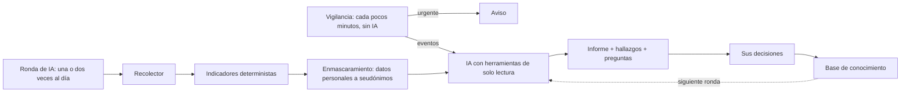

# Wazuh Daily Triage — Wiki (Español)

[English](Home) · [Türkçe](Home-TR) · **Español** · [Français](Home-FR)

**Un compañero de guardia para Wazuh.** Vigila sus alertas día y noche y le avisa en minutos cuando ocurre algo
urgente — sin preguntar a una IA. Una o dos veces al día, una ronda de IA revisa todo lo que vio la vigilancia,
lo explica y propone qué ajustar. Usted decide; nada cambia en Wazuh sin su aprobación.

> **Los datos personales no llegan a la IA.** Direcciones de correo, teléfonos, números de identificación,
> IBAN, tarjetas, contraseñas, tokens y claves se sustituyen por seudónimos como `<email:3f9a…>` **antes** de
> enviar nada al modelo — activado por defecto desde la 0.10.1 (RGPD / KVKK). Los secretos no se pueden
> recuperar en ningún caso. Las direcciones IP se mantienen para el análisis salvo que elija `ips: public` o
> `ips: all`. Sus informes conservan los valores reales, dentro de su instalación. → [Privacy](Privacy) (en inglés)

> **Hable con su Wazuh desde cualquier agente compatible con MCP.** El servidor MCP integrado ofrece a todo
> agente o asistente que hable el Model Context Protocol — Claude Desktop, Claude Code, Cursor, VS Code y otros — las mismas herramientas de investigación de solo lectura que usa la IA — búsqueda de
> alertas, líneas de tiempo, perfiles de IP, agentes, reglas, logtest, informes, base de conocimiento — con los
> mismos límites de consulta, el mismo enmascaramiento y un límite de peticiones por cliente. Pregunte «¿qué pasó
> anoche en el servidor web?» y obtenga respuestas con datos en vivo. → [MCP server](MCP) (en inglés)


**Versión:** 0.11.1 · **Licencia:** AGPL-3.0-only · **Python:** 3.11–3.15 · **Wazuh:** 4.x

## Qué es y qué no es

| Es | No es |
|---|---|
| una ayuda para la revisión diaria y la guardia, que lee lo que Wazuh ha producido | un sustituto de Wazuh ni de su panel |
| de solo lectura hacia Wazuh por defecto | un SOAR: no bloquea, no aísla, no ejecuta comandos en los agentes |
| un asistente que propone; decide una persona | un sistema de respuesta autónoma |
| un contenedor que guarda sus datos en su propio Wazuh Indexer | un servicio alojado ni otra base de datos que mantener |
| una fuente de evidencias de apoyo para revisiones de la supervisión | un certificado de ISO 27001 ni de ninguna otra conformidad |

## Para qué se usa

1. **La revisión de la mañana.** ¿Llegan datos, están conectados los agentes, qué hay en nivel alto, qué es el
   ruido de siempre? Un informe en lugar de una hora de consultas.
2. **Enterarse de noche.** Un inicio de sesión correcto tras intentos fallidos, o un SIEM en silencio, llega a
   una persona en minutos, sin esperar al siguiente informe y sin llamar a un modelo.
3. **Reducir ruido con seguridad.** Los borradores de reglas se prueban contra dos semanas de alertas reales, se
   despliegan con reversión automática y después se comprueban con eventos reales.
4. **Preguntar en lenguaje natural.** Cualquier asistente compatible con MCP consulta alertas, agentes e informes
   con los mismos límites y el mismo enmascaramiento.
5. **Demostrar el trabajo.** Decisiones, cambios de reglas e interrupciones quedan en un informe mensual.

## Dos ciclos

| | La vigilancia | La ronda de IA |
|---|---|---|
| Cuándo | cada pocos minutos | una o dos veces al día, a las horas que usted elija |
| Cómo | reglas locales — **no se llama a ningún modelo** | su modelo, con herramientas de solo lectura |
| Qué recibe | un aviso inmediato «basado en reglas» por Teams, Telegram, Slack, correo … | un informe: hallazgos con evidencias, preguntas, un veredicto para cada evento de la vigilancia, borradores de reglas y sugerencias de ajuste |

Urgente significa: una alerta de nivel crítico, una regla o un grupo vigilado, un inicio de sesión correcto tras
intentos fallidos, Active Response, un aumento repentino del volumen, agentes que dejan de informar. El horario
silencioso retiene todo salvo los eventos críticos. La vigilancia se activa en **Ajustes → Vigilancia**.
→ [Watch](Watch) (en inglés)

## Qué más hace

- Recoge alertas, vulnerabilidades, estado de los agentes e información de reglas del Wazuh Indexer y la API.
- Mantiene una base de conocimiento (ruido conocido, decisiones, temas abiertos) que recibe el modelo en cada
  ronda, y aprende de sus decisiones.
- Nunca escribe en Wazuh: solo escribe en sus propios índices `daily-triage-*` y, si usted lo aprueba, despliega
  borradores de reglas.
- Detecta datos personales guardados en claro en sus logs y lo convierte en una recomendación.
- Copias de seguridad cifradas de sus propios datos (descarga o S3) y un aviso si una política de retención de
  índices los fuera a borrar.
- Un panel con gráficos de tendencia, bandas de gravedad y las reglas, agentes y orígenes más frecuentes, y una
  vista **MITRE ATT&CK** de las alertas (franja de tácticas, matriz de técnicas, técnicas nuevas, tácticas sin
  alertas), todo sin IA.
- Página de ajustes, rol de solo lectura (por contraseña o por grupo SSO con Keycloak/Authentik), informe de
  auditoría mensual. Interfaz en
  inglés, turco, español y alemán.

## Demo en cinco minutos (sin Wazuh)

```sh
git clone https://github.com/dururustem68/wazuh-daily-triage.git
cd wazuh-daily-triage
cp .env.demo .env
docker compose up -d --build
```

Abra <http://127.0.0.1:8080>, entre con `demo-password-change-me` y cambie el idioma abajo en la barra lateral (ES).
La demo usa datos sintéticos y el proveedor `mock`, que escribe un informe de ejemplo sin llamar a un modelo;
arranca con un informe terminado, eventos de la vigilancia con veredicto y sugerencias pendientes.

## Cómo funciona



## Documentación

Las páginas detalladas del wiki están en inglés y en turco.

| Quiero… | Página (en inglés) |
|---|---|
| Ir de la demo a un primer informe real, paso a paso | [Getting started](Getting-Started) |
| Instalar y configurar | [Installation](Installation), [Kubernetes](Kubernetes), [Configuration](Configuration) |
| Usarlo a diario | [User guide](User-Guide), [Rule lifecycle](Rule-Lifecycle), [Watch](Watch), [MCP](MCP), [Features](Features) |
| Saber qué puede hacer y adónde van los datos | [Security model](Security-Model), [Privacy](Privacy), [Security checklist](Security-Checklist) |
| Operarlo | [Troubleshooting](Troubleshooting), [Backup](Backup), [Upgrade](Upgrade), [Compatibility](Compatibility) |
| Ver ejemplos, respuestas rápidas y glosario | [Scenarios](Scenarios), [FAQ](FAQ) |
| Contribuir | [Development](Development) |

El README del repositorio está también en español: [README.es.md](https://github.com/dururustem68/wazuh-daily-triage/blob/main/README.es.md).
Preguntas y errores: [GitHub issues](https://github.com/dururustem68/wazuh-daily-triage/issues). Problemas de seguridad, en privado:
[security advisories](https://github.com/dururustem68/wazuh-daily-triage/security/advisories/new).

---

[English](Home) · [Türkçe](Home-TR) · [Español](Home-ES) · [Français](Home-FR)
