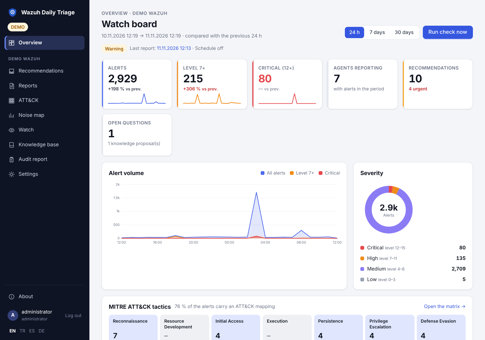
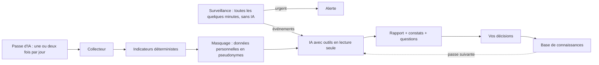

# Wazuh Daily Triage — Wiki (Français)

[English](Home) · [Türkçe](Home-TR) · [Español](Home-ES) · **Français**

**Un compagnon d'astreinte pour Wazuh.** Il surveille vos alertes jour et nuit et vous prévient en quelques
minutes quand quelque chose d'urgent se produit — sans interroger d'IA. Une ou deux fois par jour, une passe d'IA
examine tout ce que la surveillance a vu, l'explique et propose quoi ajuster. Vous décidez ; rien ne change dans
Wazuh sans votre accord.

> **Les données personnelles n'atteignent pas l'IA.** Adresses e-mail, numéros de téléphone, numéros
> d'identification nationaux, IBAN, cartes, mots de passe, jetons et clés sont remplacés par des pseudonymes
> comme `<email:3f9a…>` **avant** tout envoi au modèle — activé par défaut depuis la 0.10.1 (RGPD / KVKK). Les
> secrets ne peuvent jamais être restitués. Les adresses IP restent visibles pour l'analyse, sauf avec
> `ips: public` ou `ips: all`. Vos rapports gardent les vraies valeurs, dans votre installation.
> → [Privacy](Privacy) (en anglais)

> **Interrogez votre Wazuh depuis n'importe quel agent compatible MCP.** Le serveur MCP intégré donne à tout agent
> ou assistant qui parle le Model Context Protocol — Claude Desktop, Claude Code, Cursor, VS Code et d'autres — les mêmes outils d'investigation en lecture seule que l'IA — recherche d'alertes, chronologies,
> profils d'IP, agents, règles, logtest, rapports, base de connaissances — avec les mêmes limites de requêtes, le
> même masquage et une limite de débit par client. Demandez « que s'est-il passé cette nuit sur le serveur web ? »
> et obtenez des réponses issues des données en direct. → [MCP server](MCP) (en anglais)



**Version :** 0.10 · **Licence :** AGPL-3.0-only · **Python :** 3.11–3.15 · **Wazuh :** 4.x

## Deux boucles

| | La surveillance | La passe d'IA |
|---|---|---|
| Quand | toutes les quelques minutes | une ou deux fois par jour, aux heures choisies |
| Comment | règles locales — **aucun modèle n'est appelé** | votre modèle, avec des outils en lecture seule |
| Ce que vous recevez | une alerte immédiate « basée sur des règles » via Teams, Telegram, Slack, e-mail … | un rapport : constats étayés, questions, un verdict pour chaque événement de la surveillance, brouillons de règles et suggestions de réglage |

Urgent signifie : une alerte de niveau critique, une règle ou un groupe surveillé, une connexion réussie après des
échecs, Active Response, une hausse soudaine du volume, des agents qui ne répondent plus. Les heures de silence
retiennent tout sauf les événements critiques. La surveillance s'active dans **Settings → Watch**.
→ [Watch](Watch) (en anglais)

## Ce qu'il fait encore

- Collecte alertes, vulnérabilités, état des agents et informations sur les règles depuis le Wazuh Indexer et l'API.
- Tient une base de connaissances (bruit connu, décisions, points ouverts) transmise au modèle à chaque passe, et
  apprend de vos décisions.
- N'écrit jamais dans Wazuh : il n'écrit que dans ses propres index `daily-triage-*` et, avec votre accord,
  déploie des brouillons de règles.
- Repère les données personnelles stockées en clair dans vos journaux et en fait une recommandation.
- Sauvegardes chiffrées de ses propres données (téléchargement ou S3) et un avertissement si une politique de
  rétention d'index allait les supprimer.
- Page de réglages, rôle en lecture seule, SSO derrière Keycloak/Authentik, rapport d'audit mensuel.

## Démo en cinq minutes (sans Wazuh)

```sh
git clone https://github.com/dururustem68/wazuh-daily-triage.git
cd wazuh-daily-triage
cp .env.demo .env
docker compose up -d --build
```

Ouvrez <http://127.0.0.1:8080> et connectez-vous avec `demo-password-change-me`. La démo utilise des données
synthétiques et le fournisseur `mock`, qui écrit un rapport d'exemple sans appeler de modèle ; elle démarre avec
un rapport terminé, des événements de surveillance jugés et des suggestions en attente. L'interface est en
anglais, turc, espagnol et allemand.

## Fonctionnement



## Documentation

Les pages détaillées du wiki sont en anglais et en turc : [Installation](Installation),
[Configuration](Configuration), [Watch](Watch), [Backup](Backup), [Privacy](Privacy), [MCP](MCP), [Features](Features).

---

[English](Home) · [Türkçe](Home-TR) · [Español](Home-ES) · [Français](Home-FR)
