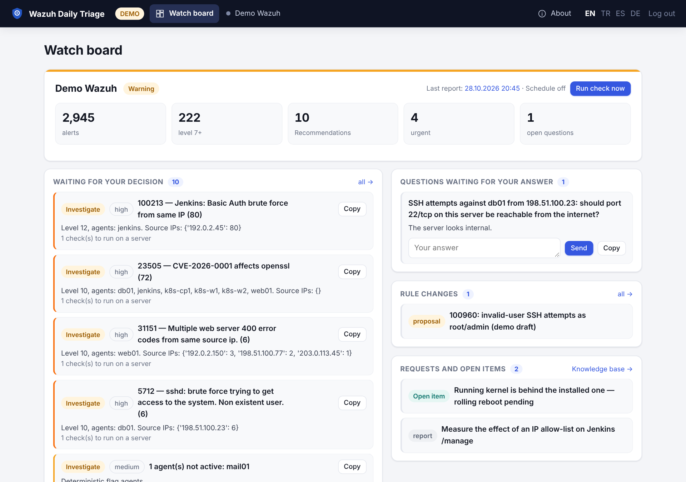
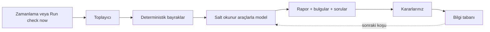

# Wazuh Daily Triage — Wiki (Türkçe)

Wazuh SIEM için yapay zekâ destekli günlük inceleme: son pencerenin alarmlarını toplar, deterministik sağlık
bayrakları ekler, modelden salt okunur araştırma araçlarıyla rapor ister ve sonucu insanın karar verdiği
bulgulara, sorulara ve kural taslaklarına dönüştürür.



**Sürüm:** 0.7.0 · **Lisans:** AGPL-3.0-only · **Python:** 3.11–3.13 · **Wazuh:** 4.x

## Neler yapar?

- Wazuh Indexer ve API'den alarm, zafiyet, ajan sağlığı ve kural bilgisi toplar.
- Günlük rapor üretir: özet, kanıtlı bulgular, size sorulan sorular ve isteğe bağlı kural taslakları.
- Her koşuda modele verilen bir bilgi tabanı tutar (bilinen gürültü, kararlar, açık maddeler).
- Wazuh'a **yazmaz**: tek yazma işlemi kendi `daily-triage-*` indekslerine ve açıkça onayladığınız kural
  dağıtımına gider.
- Zamanlanmış koşu, kritik bildirim, salt okunur görüntüleyici rolü ve harici asistanlar için MCP sunucusu sunar.

## Hangi sayfadan başlamalı?

| Amacım | Sayfa |
|---|---|
| Docker Compose ile kurmak (veya demoyu denemek) | [Kurulum](Installation-TR) |
| Tüm `.env` değişkenlerini ve YAML dosyasını öğrenmek | [Yapılandırma](Configuration-TR) |
| Keycloak veya Authentik'i öne koymak (SSO proxy) | [SSO proxy kimlik doğrulama](SSO-Proxy-Auth-TR) |
| Bir meslektaşa salt okunur erişim vermek | [Görüntüleyici modu](Viewer-Mode-TR) |
| Claude Desktop'tan araştırma araçlarını kullanmak | [MCP sunucusu](MCP-TR) |
| Kural dağıtımı, terfi, olay kaydı, ek kaynaklar, denetim raporu, eval | [Özellikler](Features-TR) |
| Kişisel veriyi LLM'den uzak tutmak ve loglarda bulmak (KVKK / GDPR) | [Gizlilik](Privacy-TR) |
| Güvenlik modelini anlamak | [docs/permissions.md](https://github.com/dururustem68/wazuh-daily-triage/blob/main/docs/permissions.md), [docs/security-exceptions.md](https://github.com/dururustem68/wazuh-daily-triage/blob/main/docs/security-exceptions.md) |
| Kubernetes'e kurmak | [deploy/kubernetes/README.md](https://github.com/dururustem68/wazuh-daily-triage/blob/main/deploy/kubernetes/README.md), [Helm chart](https://github.com/dururustem68/wazuh-daily-triage/blob/main/deploy/helm/wazuh-daily-triage/README.md) |

## Beş dakikalık demo (Wazuh gerekmez)

```sh
git clone https://github.com/dururustem68/wazuh-daily-triage.git
cd wazuh-daily-triage
cp .env.example .env
# .env içinde WDT_DEMO=true ve LLM_PROVIDER=mock yapın, sonra:
docker compose up -d --build
```

<http://127.0.0.1:8080> adresini açın ve `.env` içindeki `APP_PASSWORD` ile giriş yapın. Demo sentetik veri
kullanır (Jenkins brute force, SSH denemeleri, bağlantısı kopmuş ajan, zafiyet patlaması) ve `mock` sağlayıcısı
model çağırmadan yer tutucu bir rapor yazar.

## Bir koşu nasıl işler?



## Belgeler nerede?

- Bu wiki: kurulum, yapılandırma, özellikler, gizlilik, SSO, görüntüleyici modu, MCP.
- Depo belgeleri: [mimari](https://github.com/dururustem68/wazuh-daily-triage/blob/main/docs/architecture.md), [izinler](https://github.com/dururustem68/wazuh-daily-triage/blob/main/docs/permissions.md),
  [kural dağıtımı](https://github.com/dururustem68/wazuh-daily-triage/blob/main/docs/rule-deployment.md), [bildirimler](https://github.com/dururustem68/wazuh-daily-triage/blob/main/docs/notifications.md),
  [sağlayıcılar](https://github.com/dururustem68/wazuh-daily-triage/blob/main/docs/providers.md), [kaynaklar](https://github.com/dururustem68/wazuh-daily-triage/blob/main/docs/sources.md), [uyumluluk](https://github.com/dururustem68/wazuh-daily-triage/blob/main/docs/compatibility.md),
  [güvenlik istisnaları](https://github.com/dururustem68/wazuh-daily-triage/blob/main/docs/security-exceptions.md).
- Dört dilli README: [English](https://github.com/dururustem68/wazuh-daily-triage/blob/main/README.md), [Türkçe](https://github.com/dururustem68/wazuh-daily-triage/blob/main/README.tr.md),
  [Deutsch](https://github.com/dururustem68/wazuh-daily-triage/blob/main/README.de.md), [Español](https://github.com/dururustem68/wazuh-daily-triage/blob/main/README.es.md).

> Sayfaların altındaki dil bağlantıları İngilizce ve Türkçe wiki sürümleri arasında geçiş yapar.
