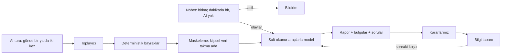

# Wazuh Daily Triage — Wiki (Türkçe)

[English](Home) · **Türkçe** · [Español](Home-ES) · [Français](Home-FR)

**Wazuh için bir nöbet programı.** Alarmlarınızı gece gündüz izler, acil bir şey olduğunda dakikalar içinde
haber verir — yapay zekâya sormadan. Günde bir ya da iki kez bir AI turu, nöbetin gördüğü her şeyi inceler,
açıklar ve neyin ayarlanması gerektiğini önerir. Kararı siz verirsiniz; onayınız olmadan Wazuh'ta hiçbir şey değişmez.

> **Kişisel veri yapay zekâya gitmez.** E-posta adresleri, telefon numaraları, TC kimlik numaraları, IBAN'lar,
> kart numaraları, parolalar, belirteçler ve anahtarlar, modele herhangi bir şey gönderilmeden **önce**
> `<email:3f9a…>` gibi takma adlarla değiştirilir — 0.10.1'den beri varsayılan olarak açık (KVKK / GDPR). Sırlar
> hiçbir şekilde geri açılamaz. IP adresleri, `ips: public` ya da `ips: all` seçmediğiniz sürece analiz için açık
> kalır. Raporlarınız gerçek değerleri, kendi kurulumunuzun içinde tutar. → [Gizlilik](Privacy-TR)

> **Wazuh'unuzla MCP destekleyen her ajandan konuşun.** Yerleşik MCP sunucusu, Model Context Protocol'ü
> destekleyen her ajana ve asistana — Claude Desktop, Claude Code, Cursor, VS Code ve diğerleri — yapay zekânın kullandığı salt okunur araştırma araçlarının aynısını verir — alarm arama, zaman
> çizelgesi, IP profili, ajanlar, kural bilgisi, logtest, raporlar, bilgi tabanı — aynı sorgu sınırları, maskeleme
> ve istemci başına hız sınırıyla. "Dün gece webserver'da ne oldu?" diye sorun, cevabı canlı veriden alın.
> → [MCP sunucusu](MCP-TR)


**Sürüm:** 0.11.0 · **Lisans:** AGPL-3.0-only · **Python:** 3.11–3.15 · **Wazuh:** 4.x

## Nedir, ne değildir

| Nedir | Ne değildir |
|---|---|
| Wazuh'un ürettiğini okuyan bir günlük inceleme ve nöbet yardımcısı | Wazuh'un ya da panosunun yerine geçen bir araç |
| varsayılan olarak Wazuh'a karşı salt okunur | bir SOAR: engellemez, yalıtmaz, ajanlarda komut çalıştırmaz |
| öneren bir asistan; kararı kişi verir | kendi başına müdahale eden bir sistem |
| verisini sizin Wazuh Indexer'ınızda tutan tek konteyner | barındırılan bir hizmet ya da işletilecek ek bir veritabanı |
| izleme gözden geçirmeleri için destekleyici kanıt kaynağı | ISO 27001 ya da başka bir uygunluk belgesi |

## Ne için kullanılır

1. **Sabah kontrolü.** Veri akıyor mu, ajanlar bağlı mı, yüksek seviyede ne var, hangisi bildik gürültü. Bir
   saatlik pano sorgusu yerine tek rapor.
2. **Gece haber almak.** Başarısız denemelerden sonra başarılı giriş ya da susan bir SIEM, bir sonraki raporu
   beklemeden ve model çağrılmadan dakikalar içinde bir kişiye ulaşır.
3. **Gürültüyü güvenle azaltmak.** Kural taslakları iki haftalık gerçek alarma karşı yeniden oynatılır, geri
   alma güvencesiyle dağıtılır ve sonra canlı olaylarla denetlenir.
4. **Düz dille soru sormak.** MCP destekleyen her asistan alarmları, ajanları ve raporları aynı sınırlar ve
   maskelemeyle sorgulayabilir.
5. **Yapılan işi göstermek.** Kararlar, kural değişiklikleri ve kesintiler gözden geçirme toplantısı için aylık
   bir raporda toplanır.

## İki döngü

| | Nöbet | AI turu |
|---|---|---|
| Ne zaman | birkaç dakikada bir | günde bir ya da iki kez, sizin belirlediğiniz saatlerde |
| Nasıl | yerel kurallarla — **model çağrılmaz** | kendi modelinizle, salt okunur araçlarla |
| Size gelen | Teams, Telegram, Slack, e-posta … üzerinden anında "kural tabanlı uyarı" | rapor: kanıtlı bulgular, sorular, her nöbet olayı için hüküm, kural taslakları ve eşik önerileri |

Acil demek: kritik seviyede bir alarm, izlenen bir kural ya da grup, başarısız denemelerden sonra başarılı giriş,
Active Response, ani hacim artışı, veri göndermeyi kesen ajanlar. Sessiz saatlerde kritik olaylar dışındakiler
bekletilir. Nöbet **Ayarlar → Nöbet** bölümünden açılır. → [Nöbet](Watch-TR)

## Başka neler yapar?

- Wazuh Indexer ve API'den alarm, zafiyet, ajan sağlığı ve kural bilgisi toplar.
- Her turda modele verilen bir bilgi tabanı tutar (bilinen gürültü, kararlar, açık maddeler) ve kararlarınızdan öğrenir.
- Wazuh'a **yazmaz**: tek yazma işlemi kendi `daily-triage-*` indekslerine ve açıkça onayladığınız kural
  dağıtımına gider.
- Loglarınızda açık duran kişisel veriyi bulur ve öneriye dönüştürür.
- Kendi verisinin şifreli yedeği (indirme ya da S3) ve bir indeks silme politikası onu silecekse uyarı.
- Eğilim grafikleri, önem bantları, en sık kural, ajan ve kaynaklarla bir pano ve alarmların **MITRE ATT&CK**
  görünümü (taktik şeridi, teknik matrisi, yeni teknikler, alarmı olmayan taktikler) — hepsi yapay zekâsız.
- Ayarlar sayfası, salt okunur görüntüleyici rolü (parolayla ya da Keycloak/Authentik arkasında SSO grubuyla),
  aylık denetim raporu.

## Dokümantasyon haritası

| Amacım | Sayfa |
|---|---|
| **Başlamak** | |
| Demodan ilk gerçek rapora adım adım gitmek | [Başlangıç](Getting-Started-TR) |
| Parçaların birlikte nasıl çalıştığını örneklerle görmek | [Örnek senaryolar](Scenarios-TR) |
| Hızlı bir cevap almak ya da bir terime bakmak | [SSS ve sözlük](FAQ-TR) |
| **Kurmak ve yapılandırmak** | |
| Docker Compose, Kubernetes ya da yerel Python ile kurmak | [Kurulum](Installation-TR) |
| Üretim için cluster'da çalıştırmak | [Kubernetes](Kubernetes-TR) |
| Tüm `.env` değişkenlerini ve YAML dosyasını öğrenmek | [Yapılandırma](Configuration-TR) |
| Keycloak veya Authentik'i öne koymak (SSO proxy) | [SSO proxy kimlik doğrulama](SSO-Proxy-Auth-TR) |
| Bir meslektaşa salt okunur erişim vermek | [Görüntüleyici modu](Viewer-Mode-TR) |
| **Kullanmak** | |
| Raporları okumak, öneri kutusunu işlemek, bilgi tabanını tutmak | [Kullanıcı rehberi](User-Guide-TR) |
| Bir kuralı taslaktan canlıda kanıtlanmış hâle getirmek | [Kural yaşam döngüsü](Rule-Lifecycle-TR) |
| Acil durumlarda dakikalar içinde, yapay zekâsız uyarı almak | [Nöbet](Watch-TR) |
| Wazuh'uma MCP destekleyen herhangi bir ajandan soru sormak | [MCP sunucusu](MCP-TR) |
| Kalıcı hâle getirme, olay kaydı, ek kaynaklar, denetim raporu, eval | [Özellikler](Features-TR) |
| **Güvenlik ve gizlilik** | |
| Aracın ne yapabildiğini ve verinin nereye gittiğini bilmek | [Güvenlik modeli](Security-Model-TR) |
| AI sağlayıcısına hiç kişisel veri gitmediğinden emin olmak (KVKK / GDPR) | [Gizlilik](Privacy-TR) |
| Bir kurulumu üretim öncesi onaylamak | [Güvenlik kontrol listesi](Security-Checklist-TR) |
| **İşletmek** | |
| Bir hata iletisinin nedenini bulmak | [Sorun giderme](Troubleshooting-TR) |
| Bilgi tabanını yedeklemek, indeks silme kurallarından korumak | [Yedekleme](Backup-TR) |
| Yükseltmek ya da geri dönmek | [Yükseltme](Upgrade-TR) |
| Sürümleri ve bilinen sınırları denetlemek | [Uyumluluk](Compatibility-TR) |
| **Katkı vermek** | |
| Geliştirme ortamı kurmak, test çalıştırmak, entegrasyon eklemek | [Geliştirme](Development-TR) |

## Beş dakikalık demo (Wazuh gerekmez)

```sh
git clone https://github.com/dururustem68/wazuh-daily-triage.git
cd wazuh-daily-triage
cp .env.demo .env
docker compose up -d --build
```

<http://127.0.0.1:8080> adresini açın ve `demo-password-change-me` ile (`.env.demo` içindeki `APP_PASSWORD`) giriş
yapın. Arayüz dilini kenar çubuğunun en altından TR seçerek değiştirebilirsiniz. Demo sentetik veri
kullanır (Jenkins brute force, SSH denemeleri, bağlantısı kopmuş ajan, zafiyet patlaması) ve `mock` sağlayıcısı
model çağırmadan yer tutucu bir rapor yazar. Demo tamamlanmış bir raporla, AI hükmü verilmiş nöbet olaylarıyla
ve bekleyen önerilerle açılır; her sayfada görülecek bir şey vardır.

## Nasıl işler?



## Belgeler nerede?

- **Bu wiki** el kitabıdır: aracın kurulması, kullanılması, güvenliği ve işletimi.
- **README** kısa sürümdür: ne olduğu ve nasıl başlanacağı
  ([English](https://github.com/dururustem68/wazuh-daily-triage/blob/main/README.md), [Türkçe](https://github.com/dururustem68/wazuh-daily-triage/blob/main/README.tr.md),
  [Deutsch](https://github.com/dururustem68/wazuh-daily-triage/blob/main/README.de.md), [Español](https://github.com/dururustem68/wazuh-daily-triage/blob/main/README.es.md)).
- **Depodaki başvuru belgeleri**, wiki'nin bağlantı verdiği kesin ayrıntıları tutar:
  [izinler](https://github.com/dururustem68/wazuh-daily-triage/blob/main/docs/permissions.md), [kural dağıtımı](https://github.com/dururustem68/wazuh-daily-triage/blob/main/docs/rule-deployment.md),
  [bildirimler](https://github.com/dururustem68/wazuh-daily-triage/blob/main/docs/notifications.md), [sağlayıcılar](https://github.com/dururustem68/wazuh-daily-triage/blob/main/docs/providers.md),
  [kaynaklar](https://github.com/dururustem68/wazuh-daily-triage/blob/main/docs/sources.md), [mimari](https://github.com/dururustem68/wazuh-daily-triage/blob/main/docs/architecture.md),
  [güvenlik istisnaları](https://github.com/dururustem68/wazuh-daily-triage/blob/main/docs/security-exceptions.md).

## Yardım ve hata bildirimi

- Sorular ve hatalar: [GitHub kayıtları](https://github.com/dururustem68/wazuh-daily-triage/issues). Önce sunucu adlarını, IP adreslerini ve belirteçleri
  çıkarın.
- Güvenlik sorunları: özel olarak, [güvenlik bildirimleri](https://github.com/dururustem68/wazuh-daily-triage/security/advisories/new) üzerinden.
- Neler değişti: [CHANGELOG](https://github.com/dururustem68/wazuh-daily-triage/blob/main/CHANGELOG.md) · neler planlanıyor: [ROADMAP](https://github.com/dururustem68/wazuh-daily-triage/blob/main/ROADMAP.md).

> Sayfaların altındaki dil bağlantıları İngilizce ve Türkçe wiki sürümleri arasında geçiş yapar; ana sayfa
> ayrıca [Español](Home-ES) ve [Français](Home-FR) dillerinde de var.

---

[English](Home) · [Türkçe](Home-TR) · [Español](Home-ES) · [Français](Home-FR)
