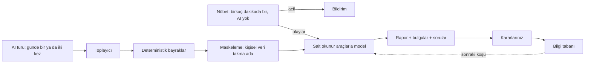

# Wazuh Daily Triage — Wiki (Türkçe)

[English](Home) · **Türkçe** · [Español](Home-ES) · [Français](Home-FR)

**Wazuh için bir nöbet programı.** Alarmlarınızı gece gündüz izler, acil bir şey olduğunda dakikalar içinde
haber verir — yapay zekâya sormadan. Günde bir ya da iki kez bir AI turu, nöbetin gördüğü her şeyi inceler,
açıklar ve neyin ayarlanması gerektiğini önerir. Kararı siz verirsiniz; onayınız olmadan Wazuh'ta hiçbir şey değişmez.

> **Kişisel veri yapay zekâya gitmez.** E-posta adresleri, telefon numaraları, TC kimlik numaraları, IBAN'lar,
> kart numaraları, parolalar, belirteçler ve anahtarlar, modele herhangi bir şey gönderilmeden **önce**
> `<email:3f9a…>` gibi takma adlarla değiştirilir — 0.10.1'den beri varsayılan olarak açık (KVKK / GDPR). Sırlar
> hiçbir şekilde geri açılamaz. IP adresleri, `ips: public` ya da `ips: all` seçmediğiniz sürece analiz için açık
> kalır. Raporlarınız gerçek değerleri, kendi kurulumunuzun içinde tutar. → [Gizlilik](Privacy-TR)

> **Wazuh'unuzla MCP destekleyen her ajandan konuşun.** Yerleşik MCP sunucusu, Model Context Protocol'ü
> destekleyen her ajana ve asistana — Claude Desktop, Claude Code, Cursor, VS Code ve diğerleri — yapay zekânın kullandığı salt okunur araştırma araçlarının aynısını verir — alarm arama, zaman
> çizelgesi, IP profili, ajanlar, kural bilgisi, logtest, raporlar, bilgi tabanı — aynı sorgu sınırları, maskeleme
> ve istemci başına hız sınırıyla. "Dün gece webserver'da ne oldu?" diye sorun, cevabı canlı veriden alın.
> → [MCP sunucusu](MCP-TR)


**Sürüm:** 0.10 · **Lisans:** AGPL-3.0-only · **Python:** 3.11–3.15 · **Wazuh:** 4.x

## İki döngü

| | Nöbet | AI turu |
|---|---|---|
| Ne zaman | birkaç dakikada bir | günde bir ya da iki kez, sizin belirlediğiniz saatlerde |
| Nasıl | yerel kurallarla — **model çağrılmaz** | kendi modelinizle, salt okunur araçlarla |
| Size gelen | Teams, Telegram, Slack, e-posta … üzerinden anında "kural tabanlı uyarı" | rapor: kanıtlı bulgular, sorular, her nöbet olayı için hüküm, kural taslakları ve eşik önerileri |

Acil demek: kritik seviyede bir alarm, izlenen bir kural ya da grup, başarısız denemelerden sonra başarılı giriş,
Active Response, ani hacim artışı, veri göndermeyi kesen ajanlar. Sessiz saatlerde kritik olaylar dışındakiler
bekletilir. Nöbet **Ayarlar → Nöbet** bölümünden açılır. → [Nöbet](Watch-TR)

## Başka neler yapar?

- Wazuh Indexer ve API'den alarm, zafiyet, ajan sağlığı ve kural bilgisi toplar.
- Her turda modele verilen bir bilgi tabanı tutar (bilinen gürültü, kararlar, açık maddeler) ve kararlarınızdan öğrenir.
- Wazuh'a **yazmaz**: tek yazma işlemi kendi `daily-triage-*` indekslerine ve açıkça onayladığınız kural
  dağıtımına gider.
- Loglarınızda açık duran kişisel veriyi bulur ve öneriye dönüştürür.
- Kendi verisinin şifreli yedeği (indirme ya da S3) ve bir indeks silme politikası onu silecekse uyarı.
- Ayarlar sayfası, salt okunur görüntüleyici rolü, Keycloak/Authentik arkasında SSO, aylık denetim raporu.

## Hangi sayfadan başlamalı?

| Amacım | Sayfa |
|---|---|
| Wazuh'uma MCP destekleyen herhangi bir ajandan soru sormak | [MCP sunucusu](MCP-TR) |
| AI sağlayıcısına hiç kişisel veri gitmediğinden emin olmak (KVKK / GDPR) | [Gizlilik](Privacy-TR) |
| Docker Compose ile kurmak (veya demoyu denemek) | [Kurulum](Installation-TR) |
| Tüm `.env` değişkenlerini ve YAML dosyasını öğrenmek | [Yapılandırma](Configuration-TR) |
| Keycloak veya Authentik'i öne koymak (SSO proxy) | [SSO proxy kimlik doğrulama](SSO-Proxy-Auth-TR) |
| Bir meslektaşa salt okunur erişim vermek | [Görüntüleyici modu](Viewer-Mode-TR) |
| Acil durumlarda dakikalar içinde, yapay zekâsız uyarı almak | [Nöbet](Watch-TR) |
| Bilgi tabanını yedeklemek, indeks silme kurallarından korumak | [Yedekleme](Backup-TR) |
| Kural dağıtımı, terfi, olay kaydı, ek kaynaklar, denetim raporu, eval | [Özellikler](Features-TR) |
| Güvenlik modelini anlamak | [docs/permissions.md](https://github.com/dururustem68/wazuh-daily-triage/blob/main/docs/permissions.md), [docs/security-exceptions.md](https://github.com/dururustem68/wazuh-daily-triage/blob/main/docs/security-exceptions.md) |
| Kubernetes'e kurmak | [deploy/kubernetes/README.md](https://github.com/dururustem68/wazuh-daily-triage/blob/main/deploy/kubernetes/README.md), [Helm chart](https://github.com/dururustem68/wazuh-daily-triage/blob/main/deploy/helm/wazuh-daily-triage/README.md) |

## Beş dakikalık demo (Wazuh gerekmez)

```sh
git clone https://github.com/dururustem68/wazuh-daily-triage.git
cd wazuh-daily-triage
cp .env.demo .env
docker compose up -d --build
```

<http://127.0.0.1:8080> adresini açın ve `demo-password-change-me` ile (`.env.demo` içindeki `APP_PASSWORD`) giriş
yapın. Arayüz dilini sağ üstten TR seçerek değiştirebilirsiniz. Demo sentetik veri
kullanır (Jenkins brute force, SSH denemeleri, bağlantısı kopmuş ajan, zafiyet patlaması) ve `mock` sağlayıcısı
model çağırmadan yer tutucu bir rapor yazar. Demo tamamlanmış bir raporla, AI hükmü verilmiş nöbet olaylarıyla
ve bekleyen önerilerle açılır; her sayfada görülecek bir şey vardır.

## Nasıl işler?



## Belgeler nerede?

- Bu wiki: kurulum, yapılandırma, nöbet, yedekleme, özellikler, gizlilik, SSO, görüntüleyici modu, MCP.
- Depo belgeleri: [mimari](https://github.com/dururustem68/wazuh-daily-triage/blob/main/docs/architecture.md), [izinler](https://github.com/dururustem68/wazuh-daily-triage/blob/main/docs/permissions.md),
  [kural dağıtımı](https://github.com/dururustem68/wazuh-daily-triage/blob/main/docs/rule-deployment.md), [bildirimler](https://github.com/dururustem68/wazuh-daily-triage/blob/main/docs/notifications.md),
  [sağlayıcılar](https://github.com/dururustem68/wazuh-daily-triage/blob/main/docs/providers.md), [kaynaklar](https://github.com/dururustem68/wazuh-daily-triage/blob/main/docs/sources.md), [uyumluluk](https://github.com/dururustem68/wazuh-daily-triage/blob/main/docs/compatibility.md),
  [güvenlik istisnaları](https://github.com/dururustem68/wazuh-daily-triage/blob/main/docs/security-exceptions.md).
- Dört dilli README: [English](https://github.com/dururustem68/wazuh-daily-triage/blob/main/README.md), [Türkçe](https://github.com/dururustem68/wazuh-daily-triage/blob/main/README.tr.md),
  [Deutsch](https://github.com/dururustem68/wazuh-daily-triage/blob/main/README.de.md), [Español](https://github.com/dururustem68/wazuh-daily-triage/blob/main/README.es.md).

> Sayfaların altındaki dil bağlantıları İngilizce ve Türkçe wiki sürümleri arasında geçiş yapar; ana sayfa
> ayrıca [Español](Home-ES) ve [Français](Home-FR) dillerinde de var.

---

[English](Home) · [Türkçe](Home-TR) · [Español](Home-ES) · [Français](Home-FR)
