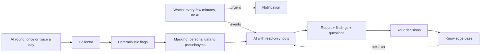

# Wazuh Daily Triage — Wiki

**English** · [Türkçe](Home-TR) · [Español](Home-ES) · [Français](Home-FR)

**An on-call companion for Wazuh.** It watches your alerts around the clock and tells you within minutes when
something urgent happens — without asking an AI. Once or twice a day an AI round reviews everything the watch
saw, explains it and suggests what to tune. You decide; nothing changes in Wazuh without your approval.

> **Personal data does not reach the AI.** E-mail addresses, phone numbers, national ID numbers (TCKN …), IBANs,
> card numbers, passwords, tokens and keys are replaced by pseudonyms such as `<email:3f9a…>` **before** anything
> is sent to the model — on by default since 0.10.1 (KVKK / GDPR). Secrets cannot be unmasked at all. IP
> addresses are kept for the analysis unless you set `ips: public` or `ips: all`. Your reports keep the real
> values, inside your installation. → [Privacy](Privacy)

> **Talk to your Wazuh from any MCP-capable agent.** The built-in MCP server gives every agent or assistant that
> speaks the Model Context Protocol — Claude Desktop, Claude Code, Cursor, VS Code and others — the same
> read-only investigation tools the AI uses — alert search, timelines, IP profiles, agents,
> rule info, logtest, reports, the knowledge base — with the same query limits, masking and a per-client rate
> limit. Ask "what happened on webserver last night?" and get answers from live data. → [MCP server](MCP)


**Current release:** 0.11.1 · **Licence:** AGPL-3.0-only · **Python:** 3.11–3.15 · **Wazuh:** 4.x

## What it is, and what it is not

| It is | It is not |
|---|---|
| a daily review and on-call aid that reads what Wazuh produced | a replacement for Wazuh or its dashboard |
| read-only towards Wazuh by default | a SOAR: it does not block, isolate or run commands on agents |
| an assistant that proposes; a person decides | an autonomous responder |
| one container that keeps its data in your own Wazuh Indexer | a hosted service, or another database to run |
| a source of supporting evidence for monitoring reviews | a certificate of ISO 27001 or any other conformity |

## What people use it for

1. **The morning check.** Is data flowing, are agents connected, what is at a high level, which of it is the
   usual noise. One report instead of an hour of dashboard queries.
2. **Being told at night.** A successful login after failed attempts, or a silent SIEM, reaches a person within
   minutes, without waiting for the next report and without a model call.
3. **Reducing noise safely.** Rule drafts are replayed against two weeks of real alerts, deployed with rollback,
   and then checked against live events.
4. **Asking questions in plain language.** Any MCP-capable assistant can query alerts, agents and reports with
   the same limits and masking.
5. **Showing the work.** Decisions, rule changes and outages end up in a monthly report for the review meeting.

## Two loops

| | The watch | The AI round |
|---|---|---|
| When | every few minutes | once or twice a day, at the times you set |
| How | local rules — **no model is called** | your model, with read-only tools |
| You get | an immediate "rule-based alert" on Teams, Telegram, Slack, e-mail … | a report: findings with evidence, questions, a verdict on every watch event, rule drafts and tuning suggestions |

Urgent means: an alert at a critical level, a watched rule or group, a successful login after failed attempts,
Active Response, a sudden increase in volume, agents that stop reporting. Quiet hours hold everything but critical
events. The watch is switched on in **Settings → Watch**. → [Watch](Watch)

## What else it does

- Collects alerts, vulnerabilities, agent health and rule information from the Wazuh Indexer and API.
- Keeps a knowledge base (known noise, decisions, open items) that is given to the model on every round, and
  learns from your decisions.
- Never writes to Wazuh: the only writes go to its own `daily-triage-*` indices, plus the optional rule
  deployment you explicitly approve.
- Finds personal data stored in clear text in your logs and turns it into a recommendation.
- Encrypted backups of its own data (download or S3), and a warning when an index retention policy would delete it.
- A dashboard with trend charts, severity bands and top rules, agents and sources, and a **MITRE ATT&CK** view of
  the alerts (tactic strip, technique matrix, new techniques, tactics without alerts) — all without AI.
- A settings page, a read-only viewer role (by password, or by SSO group behind Keycloak/Authentik), a monthly
  audit report.

## Documentation map

| I want to… | Read |
|---|---|
| **Start** | |
| Go from the demo to a first real report, step by step | [Getting started](Getting-Started) |
| See how the pieces work together on examples | [Scenarios](Scenarios) |
| Get a quick answer, or look up a term | [FAQ and glossary](FAQ) |
| **Install and configure** | |
| Install with Docker Compose, Kubernetes or local Python | [Installation](Installation) |
| Run it in a cluster for production | [Kubernetes](Kubernetes) |
| Learn every `.env` variable and the YAML file | [Configuration](Configuration) |
| Put Keycloak or Authentik in front (SSO proxy) | [SSO proxy authentication](SSO-Proxy-Auth) |
| Give a colleague read-only access | [Viewer mode](Viewer-Mode) |
| **Use it** | |
| Read reports, work the inbox, keep the knowledge base | [User guide](User-Guide) |
| Take a rule from draft to proven live | [Rule lifecycle](Rule-Lifecycle) |
| Get urgent alerts within minutes, without the AI | [Watch](Watch) |
| Ask my Wazuh questions from any MCP-capable agent | [MCP server](MCP) |
| Promotion, incident records, extra sources, audit report, eval | [Features](Features) |
| **Security and privacy** | |
| Know what the tool can do and where data goes | [Security model](Security-Model) |
| Be sure no personal data goes to the AI provider (KVKK / GDPR) | [Privacy](Privacy) |
| Sign off an installation before production | [Security checklist](Security-Checklist) |
| **Operate** | |
| Find the cause of an error message | [Troubleshooting](Troubleshooting) |
| Back up the knowledge base, protect it from index retention rules | [Backup](Backup) |
| Upgrade or roll back | [Upgrade](Upgrade) |
| Check versions and known limits | [Compatibility](Compatibility) |
| **Contribute** | |
| Set up a development environment, run tests, add an integration | [Development](Development) |

## Five-minute demo (no Wazuh needed)

```sh
git clone https://github.com/dururustem68/wazuh-daily-triage.git
cd wazuh-daily-triage
cp .env.demo .env
docker compose up -d --build
```

Open <http://127.0.0.1:8080> and sign in with `demo-password-change-me` (the `APP_PASSWORD` in `.env.demo`). The demo uses synthetic data
(a Jenkins brute force, SSH attempts, a disconnected agent, a vulnerability burst) and the `mock` provider,
which writes a placeholder report without calling a model. It starts with a finished report, watch events with
AI verdicts and waiting suggestions, so every page has something to show. To continue from here to your own
Wazuh, follow [Getting started](Getting-Started).

## How it flows



## Where the documentation lives

- **This wiki** is the handbook: installing, using, securing and operating the tool.
- **The README** is the short version: what it is and how to start
  ([English](https://github.com/dururustem68/wazuh-daily-triage/blob/main/README.md), [Türkçe](https://github.com/dururustem68/wazuh-daily-triage/blob/main/README.tr.md),
  [Deutsch](https://github.com/dururustem68/wazuh-daily-triage/blob/main/README.de.md), [Español](https://github.com/dururustem68/wazuh-daily-triage/blob/main/README.es.md)).
- **Reference documents in the repository** hold the exact details the wiki links to:
  [permissions](https://github.com/dururustem68/wazuh-daily-triage/blob/main/docs/permissions.md), [rule deployment](https://github.com/dururustem68/wazuh-daily-triage/blob/main/docs/rule-deployment.md),
  [notifications](https://github.com/dururustem68/wazuh-daily-triage/blob/main/docs/notifications.md), [providers](https://github.com/dururustem68/wazuh-daily-triage/blob/main/docs/providers.md),
  [sources](https://github.com/dururustem68/wazuh-daily-triage/blob/main/docs/sources.md), [architecture](https://github.com/dururustem68/wazuh-daily-triage/blob/main/docs/architecture.md),
  [security exceptions](https://github.com/dururustem68/wazuh-daily-triage/blob/main/docs/security-exceptions.md).

## Help and bug reports

- Questions and bugs: [GitHub issues](https://github.com/dururustem68/wazuh-daily-triage/issues). Remove host names, IP addresses and tokens first.
- Security problems: privately, through [security advisories](https://github.com/dururustem68/wazuh-daily-triage/security/advisories/new).
- What changed: [CHANGELOG](https://github.com/dururustem68/wazuh-daily-triage/blob/main/CHANGELOG.md) · what is planned: [ROADMAP](https://github.com/dururustem68/wazuh-daily-triage/blob/main/ROADMAP.md).

> The language links at the bottom of each page switch between the English and Turkish wiki versions; the home
> page is also in [Español](Home-ES) and [Français](Home-FR).

---

[English](Home) · [Türkçe](Home-TR) · [Español](Home-ES) · [Français](Home-FR)
