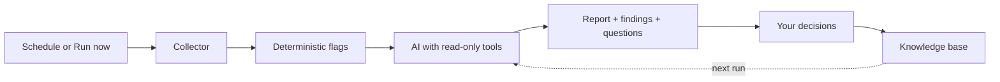

# Wazuh Daily Triage — Wiki

AI-assisted daily review for the Wazuh SIEM: it collects the alerts of the last window, adds deterministic
health flags, asks your model for a report with read-only investigation tools, and turns the result into
findings, questions and rule drafts that a human decides on.


**Current release:** 0.7.0 · **Licence:** AGPL-3.0-only · **Python:** 3.11–3.13 · **Wazuh:** 4.x

## What it does

- Collects alerts, vulnerabilities, agent health and rule information from the Wazuh Indexer and API.
- Produces a daily report: summary, findings with evidence, questions for you, and optional rule drafts.
- Keeps a knowledge base (known noise, decisions, open items) that is given to the model on every run.
- Never writes to Wazuh: the only writes go to its own `daily-triage-*` indices, plus the optional rule
  deployment you explicitly approve.
- Runs one triage per schedule, notifies on critical items, and has a read-only viewer role and an MCP server
  for external assistants.

## Pick your path

| I want to… | Read |
|---|---|
| Install with Docker Compose (or try the demo) | [Installation](Installation) |
| Learn every `.env` variable and the YAML file | [Configuration](Configuration) |
| Put Keycloak or Authentik in front (SSO proxy) | [SSO proxy authentication](SSO-Proxy-Auth) |
| Give a colleague read-only access | [Viewer mode](Viewer-Mode) |
| Use the investigation tools from Claude Desktop or another MCP client | [MCP server](MCP) |
| Rule deploy, promotion, incident records, extra sources, audit report, eval | [Features](Features) |
| Keep personal data away from the LLM and find it in your logs (GDPR / KVKK) | [Privacy](Privacy) |
| Understand the security model | [docs/security-exceptions.md](https://github.com/dururustem68/wazuh-daily-triage/blob/main/docs/security-exceptions.md), [docs/permissions.md](https://github.com/dururustem68/wazuh-daily-triage/blob/main/docs/permissions.md) |
| Deploy to Kubernetes | [deploy/kubernetes/README.md](https://github.com/dururustem68/wazuh-daily-triage/blob/main/deploy/kubernetes/README.md), [Helm chart](https://github.com/dururustem68/wazuh-daily-triage/blob/main/deploy/helm/wazuh-daily-triage/README.md) |

## Five-minute demo (no Wazuh needed)

```sh
git clone https://github.com/dururustem68/wazuh-daily-triage.git
cd wazuh-daily-triage
cp .env.example .env
# set WDT_DEMO=true and LLM_PROVIDER=mock in .env, then:
docker compose up -d --build
```

Open <http://127.0.0.1:8080> and sign in with the `APP_PASSWORD` from `.env`. The demo uses synthetic data
(a Jenkins brute force, SSH attempts, a disconnected agent, a vulnerability burst) and the `mock` provider,
which writes a placeholder report without calling a model.

## How a run flows



## Where the documentation lives

- This wiki: installation, configuration, features, privacy, SSO, viewer mode, MCP.
- Repository docs: [architecture](https://github.com/dururustem68/wazuh-daily-triage/blob/main/docs/architecture.md), [permissions](https://github.com/dururustem68/wazuh-daily-triage/blob/main/docs/permissions.md),
  [rule deployment](https://github.com/dururustem68/wazuh-daily-triage/blob/main/docs/rule-deployment.md), [notifications](https://github.com/dururustem68/wazuh-daily-triage/blob/main/docs/notifications.md),
  [providers](https://github.com/dururustem68/wazuh-daily-triage/blob/main/docs/providers.md), [sources](https://github.com/dururustem68/wazuh-daily-triage/blob/main/docs/sources.md), [compatibility](https://github.com/dururustem68/wazuh-daily-triage/blob/main/docs/compatibility.md),
  [security exceptions](https://github.com/dururustem68/wazuh-daily-triage/blob/main/docs/security-exceptions.md).
- Four-language READMEs: [English](https://github.com/dururustem68/wazuh-daily-triage/blob/main/README.md), [Türkçe](https://github.com/dururustem68/wazuh-daily-triage/blob/main/README.tr.md),
  [Deutsch](https://github.com/dururustem68/wazuh-daily-triage/blob/main/README.de.md), [Español](https://github.com/dururustem68/wazuh-daily-triage/blob/main/README.es.md).

> The language links at the bottom of each page switch between the English and Turkish wiki versions.
