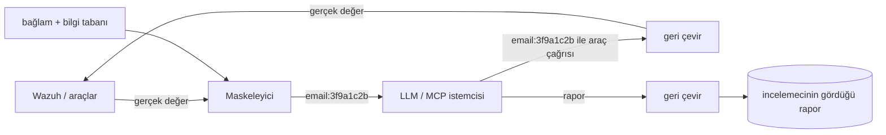

# Gizlilik (KVKK / GDPR)

*0.7.0'dan sonraki sürümle gelir.* `privacy:` altında ortam bazında ayarlanan iki özellik vardır:

| Özellik | Cevapladığı soru | Varsayılan |
|---|---|---|
| **Maskeleme** (`mode: mask`) | "Kişisel veri LLM'e gidiyor mu?" — gitmez; model yalnızca takma adları görür. | kapalı |
| **Tespit** (`detect: true`) | "Loglarımızda olmaması gereken kişisel veri var mı?" — işaretlenir ve öneriye dönüştürülür. | açık |

```yaml
privacy:
  mode: mask            # off | mask
  ips: keep             # keep | public | all
  kinds: []             # boş = tümü; ör. [email, password, national_id_tr, iban, card]
  allow: ['noreply@example\.com']   # asla maskelenmeyen / raporlanmayan değerler (regex)
  detect: true
  detect_sample: 1000   # koşu başına taranan alarm sayısı (0 = kapalı, en fazla 5000)
```

Tek ortam modunda değişkenler: `PRIVACY_MODE=mask`, `PRIVACY_IPS=public` ve `PRIVACY_DETECT=false`. Eski
sürümlerdeki `redact: true` / `REDACT=true` hâlâ çalışır ve `mode: mask` anlamına gelir.

## Maskeleme: modelin gördüğü



| Tür | Örnek | Modele giden | Doğrulama |
|---|---|---|---|
| e-posta | `betul@example.com` | `<email:3f9a1c2b>` | — |
| telefon | `+90 532 123 45 67`, `0532 123 45 67` | `<phone:…>` | 10–15 hane |
| TCKN | 11 hane | `<national_id_tr:…>` | iki kontrol hanesi |
| Belçika ulusal no | `85.07.30-033.28` | `<national_id_be:…>` | mod 97 |
| Fransa NIR | 15 hane | `<national_id_fr:…>` | anahtar mod 97 |
| IBAN | `TR33 0006 …` | `<iban:…>` | mod 97 |
| kart | `4539 1488 0343 6467` | `<card:…>` | Luhn + kart veren öneki |
| IP (`ips: public/all`) | `203.0.113.7` | `<ip:…>` | `public` iç ağ adreslerini korur |
| parola, token, Bearer, JWT, AWS anahtarı, özel anahtar | `password=…` | `<password>` | silinir — **geri döndürülemez** |

- **Kararlı.** Aynı değer her zaman aynı takma adı alır (`APP_SECRET` ile HMAC). Model, aynı hesabın üç ülkeden
  40 başarısız giriş yaptığını yine görür, ama kim olduğunu bilmez.
- **Yalnızca uygulama içinde geri çevrilebilir.** Model bir aracı takma adla çağırdığında, Wazuh sorgulanmadan
  önce gerçek değer yerine konur. Modelin raporu da saklanmadan önce geri çevrilir; incelemeci gerçek değerleri
  görür, model hiçbir zaman görmez.
- **MCP** çıktısı da aynı şekilde maskelenir; Claude Desktop gibi harici bir asistan da sonuçta bir LLM'dir.
- **IP adresleri** GDPR'a göre kişisel veridir, ama analizin çoğu IP'ler üzerinedir; bu yüzden varsayılan `keep`.
  `public` dış IP'leri gizler, iç IP'leri okunur bırakır.
- **Dokunulmayanlar:** run id, zaman damgası, epoch değeri, sürüm ve port. Bir tanımlayıcıya bitişik sayılar
  atlanır ve her sayı türü geçerli bir kontrol hanesi ister.

Sınırlar: bu bir takma adlandırmadır, DLP değildir. Serbest metindeki adlar ("Betül Eser") ve e-posta olmayan
kullanıcı adları tespit edilmez. Düzenlemeye tabi veride (BDDK, KVKK) bunu veri işleme sözleşmesi olan bir
sağlayıcıyla ya da yerel bir modelle birlikte kullanın.

## Tespit: loglarınızdaki kişisel veri

Her koşu, penceredeki alarmlardan bir örneklemi aynı türler için tarar. Örneklem en yeni `detect_sample` alarm
artı en yoğun 40 log kaynağının her birinden beşer alarmdır. `full_log`, `data.*` ve `rule.description` alanları
taranır; yalnızca sayılar ve tamamen maskelenmiş örnekler saklanır.

- **`personal_data` bayrağı** başlıca kaynakları adlandırır. Örneklemde parola/token, kimlik numarası, IBAN ya da
  kart varsa uyarı, yalnızca e-posta ya da telefon varsa bilgi düzeyindedir.
- **Rapor bölümü** kural × ajan × konum bazında bulunan türleri ve maskelenmiş bir örneği listeler.
  `in_rule_description`, `<description>` içinde `$(alan)` ile değeri kopyalayan bir kuralı işaretler; bu değer o
  kural yüzünden her indekse, her maile ve her panoya düşer.
- **Öneri.** Yapay zekâ gerçek sızıntıları, kaynağında düzeltme önerisiyle bir bulguya dönüştürür ve GDPR Md.
  5(1)(c) ile 32'ye ya da KVKK Md. 12'ye dayanır. Olası düzeltmeler: uygulama logunda maskeleme, log
  göndericide alanı düşürme ya da alanı saklamayan bir decoder/kural; ayrıca zaten indekslenmiş veri için
  saklama süresini kısaltmak. Kimlik doğrulama loglarındaki e-postalar genelde meşrudur; yalnızca URL, sorgu
  dizesi ya da gövde gibi olmaması gereken yerlerde görünürse raporlanır.

Tipik bulgular:

- URL sorgu dizesinde `password=`
- özel bir kuralın açıklamasında müşteri e-postası
- bir uygulamanın debug logunda TCKN

Yanlış pozitifleri `allow` ya da `kinds` ile ayarlayın.

---

[English](Privacy) · [Türkçe](Privacy-TR)
