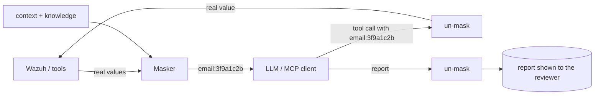

# Privacy (GDPR / KVKK)

*Since the release after 0.7.0.* Two features, set per environment under `privacy:`.

| Feature | Question it answers | Default |
|---|---|---|
| **Masking** (`mode: mask`) | "Does personal data reach the LLM?" — it does not; the model sees pseudonyms. | off |
| **Detection** (`detect: true`) | "Is there personal data in our logs that should not be there?" — flagged and turned into a recommendation. | on |

```yaml
privacy:
  mode: mask            # off | mask
  ips: keep             # keep | public | all
  kinds: []             # empty = all; e.g. [email, password, national_id_tr, iban, card]
  allow: ['noreply@example\.com']   # regexes never masked / reported
  detect: true
  detect_sample: 1000   # alerts scanned per run (0 = off, max 5000)
```

Variables, for single-environment mode: `PRIVACY_MODE=mask`, `PRIVACY_IPS=public` and `PRIVACY_DETECT=false`.
`redact: true` / `REDACT=true` from older versions still work and mean `mode: mask`.

## Masking: what the model sees



| Kind | Example | Sent as | Validated by |
|---|---|---|---|
| e-mail | `betul@example.com` | `<email:3f9a1c2b>` | — |
| phone | `+90 532 123 45 67` | `<phone:…>` | 10–15 digits |
| Turkish ID (TCKN) | 11 digits | `<national_id_tr:…>` | both check digits |
| Belgian national number | `85.07.30-033.28` | `<national_id_be:…>` | mod 97 |
| French NIR | 15 digits | `<national_id_fr:…>` | key mod 97 |
| IBAN | `TR33 0006 …` | `<iban:…>` | mod 97 |
| card | `4539 1488 0343 6467` | `<card:…>` | Luhn + issuer prefix |
| IP (`ips: public/all`) | `203.0.113.7` | `<ip:…>` | `public` keeps private ranges |
| password, token, Bearer, JWT, AWS key, private key | `password=…` | `<password>` | removed — **irreversible** |

- **Stable.** The same value always gets the same pseudonym (HMAC with `APP_SECRET`). The model can still see that
  one account failed 40 logins from three countries, without knowing who it is.
- **Reversible only inside the app.** When the model calls a tool with a pseudonym, the real value is substituted
  before Wazuh is queried. The model's report is mapped back before it is stored, so reviewers see real values
  and the model never does.
- **MCP** is masked the same way. An external assistant such as Claude Desktop is an LLM too.
- **IP addresses** are personal data under GDPR, but most analysis is about them, so `keep` is the default.
  `public` hides public addresses and keeps internal ones readable.
- **Not touched:** run ids, timestamps, epoch values, versions and ports. Numbers glued to identifiers are
  skipped, and every number kind needs a valid check digit.

Limits: this is pseudonymisation, not DLP. Names in free text ("Betül Eser") and usernames that are not e-mail
addresses are not detected. For regulated data, combine it with a provider under a data-processing agreement, or
use a local model.

## Detection: personal data in your logs

Every run scans a sample of the window's alerts for the same kinds. The sample is the newest `detect_sample`
alerts plus five from each of the 40 busiest log locations. The scan covers `full_log`, `data.*` and
`rule.description`. Only counts and fully masked examples are kept.

- **Flag `personal_data`** names the top sources. It is a warning when the sample contains secrets, national IDs,
  IBANs or cards, and info when it contains only e-mail addresses or phone numbers.
- **Report section** lists rule × agent × location with the kinds found and a masked example.
  `in_rule_description` marks a rule whose `<description>` copies the value via `$(field)`. That puts the value
  into every index, mail and dashboard.
- **Recommendation.** The AI turns real leaks into a finding with the fix at the source and cites GDPR Art.
  5(1)(c) and 32, or KVKK Art. 12. Possible fixes are masking in the application log, dropping the field in the
  shipper, or a decoder/rule that does not store it, plus shorter retention for what is already indexed. E-mail
  addresses in authentication logs are usually legitimate, so they are reported only when they appear in URLs,
  query strings or payloads.

Typical finds:

- `password=` in a URL query string
- a customer e-mail in a custom rule's description
- national IDs in an application's debug log

Tune false positives with `allow` or `kinds`.

---

[English](Privacy) · [Türkçe](Privacy-TR)
