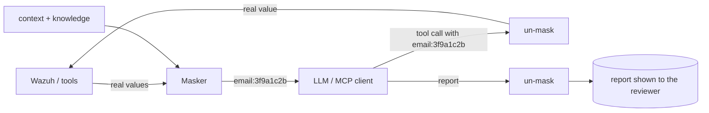

# Privacy (GDPR / KVKK)

> **In short:** personal data is replaced by pseudonyms before anything is sent to the AI provider, and
> secrets are removed for good. **On by default since 0.10.1** — an installation without a `privacy:` block
> masks. Switching it off takes an explicit `privacy.mode: off`.

| Leaves your installation (to the AI provider / MCP clients) | Stays inside your installation |
|---|---|
| pseudonyms: `<email:3f9a…>`, `<national_id_tr:…>`, `<iban:…>`, `<phone:…>`, your own `x_…` kinds | the real values, in reports, the inbox and the watch page |
| `<password>`, `<jwt>`, `<private_key>` … — removed, never reversible | the mapping pseudonym → value (memory only, per environment) |
| IP addresses — **kept by default** (`ips: keep`) because the analysis needs them; `ips: public` masks external ones, `ips: all` every one | the data in Wazuh, which is never changed |

Notifications (Teams, Telegram, e-mail …) carry real values such as IPs, agent names and finding titles: choose
channels you trust for that.

*Since 0.8.0.* Two features, set per environment under `privacy:`.

| Feature | Question it answers | Default |
|---|---|---|
| **Masking** (`mode: mask`) | "Does personal data reach the LLM?" — it does not; the model sees pseudonyms. | **on** (since 0.10.1) |
| **Detection** (`detect: true`) | "Is there personal data in our logs that should not be there?" — flagged and turned into a recommendation. | on |

```yaml
privacy:
  mode: mask            # off | mask
  ips: keep             # keep | public | all
  kinds: []             # empty = all; e.g. [email, password, national_id_tr, iban, card]
  allow: ['noreply@example\.com']   # regexes never masked / reported
  detect: true
  detect_sample: 1000   # alerts scanned per run (0 = off, max 5000)
```

Variables, for single-environment mode: `PRIVACY_MODE=mask`, `PRIVACY_IPS=public` and `PRIVACY_DETECT=false`.
`redact: true` / `REDACT=true` from older versions still work and mean `mode: mask`.

## Masking: what the model sees



| Kind | Example | Sent as | Validated by |
|---|---|---|---|
| e-mail | `betul@example.com` | `<email:3f9a1c2b7d4e9a10>` | — |
| phone | `+90 532 123 45 67` | `<phone:…>` | 10–15 digits |
| Turkish ID (TCKN) | 11 digits | `<national_id_tr:…>` | both check digits |
| Belgian national number | `85.07.30-033.28` | `<national_id_be:…>` | mod 97 |
| French NIR | 15 digits | `<national_id_fr:…>` | key mod 97 |
| IBAN | `TR33 0006 …` | `<iban:…>` | mod 97 |
| card | `4539 1488 0343 6467` | `<card:…>` | Luhn + issuer prefix |
| IP (`ips: public/all`) | `203.0.113.7` | `<ip:…>` | `public` keeps private ranges |
| password, token, Bearer, JWT, AWS key, private key | `password=…` | `<password>` | removed — **irreversible** |

- **Stable.** The same value always gets the same pseudonym (HMAC with `PRIVACY_SALT`, else `APP_SECRET`; 64 bit). The model can still see that
  one account failed 40 logins from three countries, without knowing who it is.
- **Reversible only inside the app.** When the model calls a tool with a pseudonym, the real value is substituted
  before Wazuh is queried. The model's report is mapped back before it is stored, so reviewers see real values
  and the model never does.
- **MCP** is masked the same way. An external assistant such as Claude Desktop is an LLM too.
- **IP addresses** are personal data under GDPR, but most analysis is about them, so `keep` is the default.
  `public` hides public addresses and keeps internal ones readable.
- **Not touched:** run ids, timestamps, epoch values, versions and ports. Numbers glued to identifiers are
  skipped, and every number kind needs a valid check digit.

Limits: this is pseudonymisation, not DLP. Names in free text ("Betül Eser") and usernames that are not e-mail
addresses are not detected. For regulated data, combine it with a provider under a data-processing agreement, or
use a local model.

## Masking profile (0.10)

The detectors above are the **standard profile**: built in, the same on every installation, not editable.
**Settings → Personal data masking** (admin only) adds what a site needs on top:

| | What it is | Rules |
|---|---|---|
| Your detectors | a name and a pattern, e.g. `x_customer_no` = `CUST-\d{6}` → `<x_customer_no:…>` | names start with `x_`; at most 20; patterns up to 200 characters, compiled with RE2 when `google-re2` is installed, otherwise limited to forms that cannot stall a run (no look-around, back-references or nested repetition) and timed on repetitive input |
| Never mask | patterns for values that stay readable (service accounts, your own domain) | added to `privacy.allow` from the YAML |
| Switch off | a non-secret standard detector (e.g. `phone`) | asks for confirmation, written to the audit trail; **secret detectors (password, token, JWT, keys) cannot be switched off** |

**Preview** shows what the model would receive for a pasted log line, with the unsaved form, without sending or
storing anything. The profile can be exported and imported as YAML. Every change raises the profile version and
every run records the version it used (`run.privacy`), so a report can be tied to the rules in force.

The profile only applies when `privacy.mode: mask` is set for the environment; the mode itself stays in the YAML.

## Pseudonym key and scope

Pseudonyms are an HMAC of the value with `PRIVACY_SALT` (else `APP_SECRET`). There is no built-in key: without
either, a random key is drawn at every start — safe, but pseudonyms change on restart (a startup warning says so).
Tokens are 64 bit and, since 0.10, **per environment**: `<email:…>` created in one environment does not resolve
in another.

## Detection: personal data in your logs

Every run scans a sample of the window's alerts for the same kinds. The sample is the newest `detect_sample`
alerts plus five from each of the 40 busiest log locations. The scan covers `full_log`, `data.*` and
`rule.description`. Only counts and fully masked examples are kept.

- **Flag `personal_data`** names the top sources. It is a warning when the sample contains secrets, national IDs,
  IBANs or cards, and info when it contains only e-mail addresses or phone numbers.
- **Report section** lists rule × agent × location with the kinds found and a masked example.
  `in_rule_description` marks a rule whose `<description>` copies the value via `$(field)`. That puts the value
  into every index, mail and dashboard.
- **Recommendation.** The AI turns real leaks into a finding with the fix at the source and cites GDPR Art.
  5(1)(c) and 32, or KVKK Art. 12. Possible fixes are masking in the application log, dropping the field in the
  shipper, or a decoder/rule that does not store it, plus shorter retention for what is already indexed. E-mail
  addresses in authentication logs are usually legitimate, so they are reported only when they appear in URLs,
  query strings or payloads.

Typical finds:

- `password=` in a URL query string
- a customer e-mail in a custom rule's description
- national IDs in an application's debug log

Tune false positives with `allow` or `kinds`.

---

[English](Privacy) · [Türkçe](Privacy-TR)
