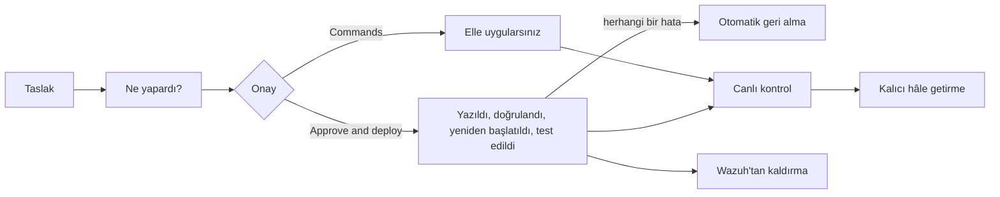

# Kural yaşam döngüsü: taslaktan canlıda kanıtlanmış kurala

**Kimin için:** kural değişikliklerini onaylayan yöneticiler. API yetkilerinin tam listesiyle başvuru belgesi:
[docs/rule-deployment.md](https://github.com/dururustem68/wazuh-daily-triage/blob/main/docs/rule-deployment.md).

Kural taslağı, bir modelin (ya da sizin) yazdığı XML'dir. Onaylamak bir insan kararıdır. Aşağıdaki denetimler
sözdizimi hatalarını, ID çakışmalarını ve susturmayı yakalar; yanlış mantığı yakalamaz. Taslağı okuyun.

Düğme adları arayüz dilinize göre değişir; bu sayfada İngilizce adlarıyla anılır.

## 1. Taslak ortaya çıkar

**Nereden gelir.** Model, tekrarlayan gürültü ya da tespit boşluğu gördüğünde önerir. [Gürültü
haritası](User-Guide-TR)ndan isteyebilir ya da bir iskelet oluşturup düzenleyebilirsiniz. Taslaklar bilgi
tabanında *Kural taslağı* olarak durur.

**Baştan denetlenenler.** XML sözdizimi, bilinen OS_Regex tuzakları, kural ID'lerinin izin verilen aralıkta ve
başka yerde kullanılmamış olması, üst kuralların varlığı. `<srcip>` ve `<dstip>` bir IP adresi ya da CIDR
olmalıdır.

**Wazuh'a etkisi.** Yok. Rapor bunu uygulanmamış kural taslağı olarak gösterir.

## 2. Ne yapardı?

**What would it do? (14 days)** düğmesi taslağı, üst kurallarının son 14 gündeki gerçek alarmlarına karşı
yeniden oynatır ve şunları gösterir: kaç alarmı devralacağı, yeni seviye, bunların kaçının öncesinde ve
sonrasında yüksek seviyeli olduğu, en çok görülen ajanlar ve kaynak IP'ler, eşleşen örnekler ve eşleşmeyeceği
üst kural alarmları.

**Sınırlar.** CDB listeleri, zaman pencereleri ve frekans kuralları *değerlendirilmedi* olarak listelenir; o
zaman sayılar bir üst sınırdır. 2.000 alarmın üstünde rastgele örneklem üzerinde çalışır.

Her onaydan önce kullanın. Gerçek bir alarmın seviyesini düşüren taslak, "yüksek seviye önce → sonra"
satırında kendini gösterir.

## 3. Onay

| Düğme | Ne olur | Gerekli |
|---|---|---|
| **Commands** | manager için kopyala-yapıştır blok: yedekle, ekle, `wazuh-analysisd -t` (başarısızsa yedeği geri yükler), yeniden başlat, doğrula, geri al | hiçbir şey; her zaman vardır |
| **Approve (do not deploy)** | taslağı kabul edilmiş işaretler; model bunu bir karar sayar | yönetici rolü |
| **Approve and deploy** | uygulama kuralı kendisi uygular (sonraki bölüm) | `rule_deploy.enabled: true` ve ayrı dağıtım kullanıcısı |

Alarmı susturan ya da seviyesini düşüren taslaklar (seviye 0, `overwrite="yes"`, `no_log` ve benzeri
seçenekler ya da üst kuralın seviyesinin altında bir alt kural) ikinci bir onay ister: kural ID'sini
yazarsınız. Bu bilinçli bir tercihtir. Bir alarmın içindeki metinle yanıltılmış model, tek tıkla SIEM'i kör
edememelidir.

## 4. Approve and deploy: uygulama ne yapar

Varsayılan olarak kapalıdır. Ön koşullar: [Güvenlik kontrol listesi](Security-Checklist-TR), *Kural dağıtımı*
bölümü.

1. Taslağı yeniden denetler.
2. Taslağı tek bir dosyaya, `etc/rules/<file>` (varsayılan `wdt_rules.xml`), işaretli bir blok olarak yazar.
   Kendi kural dosyalarınıza hiç dokunulmaz.
3. Manager'dan yapılandırmayı doğrulamasını ister. Başarısızsa önceki dosya geri yüklenir ve **yeniden
   başlatma yapılmaz**.
4. Manager'ı ya da cluster'ı yeniden başlatır. Olay işleme yaklaşık 20–60 saniye durur.
5. `wazuh-analysisd` çalışana ve yeni kural ID'leri yüklenene kadar bekler.
6. Taslağın logtest örneklerini çalıştırır: en az bir eşleşmesi gereken ve bir eşleşmemesi gereken örnek.
7. Kimin yaptığını, her adımı ve geri alma sonucunu bilgi tabanı kaydına ve denetim izine yazar.

### Ne zaman geri alır

| Durum | Sonuç |
|---|---|
| Doğrulama başarısız | önceki dosya geri yüklenir, yeniden başlatma yok |
| Manager geri gelmiyor ya da kural ID'leri yüklenmemiş | geri alınır |
| Bir örnek başka kuralla eşleşiyor ya da eşleşmesi beklenirken hiçbiriyle eşleşmiyor | geri alınır |
| Bir örnek hiçbir kuralla eşleşmiyor (*inconclusive*) | geri alınır (`allow_inconclusive: true` değilse) |
| Taslağın örneği yok ve `require_tests: true` | hiçbir şey yazılmadan reddedilir |
| Manager içi olaylar (rootcheck, FIM, SCA, zafiyet) | dağıtılır, logtest *çalıştırılmadı*; bir sonraki gerçek olayda doğrulayın |
| Geri almanın kendisi başarısız | başarısız olarak kaydedilir ve kritik olarak loglanır: manager'a bir kişinin bakması gerekir |

*Inconclusive* geçti demek değildir. "Hiçbir kural eşleşmedi" çoğunlukla örneğin decoder'a ya da üst kurala
hiç ulaşmadığını gösterir; yani yeni kural hakkında hiçbir şey kanıtlamaz.

**Güvenlik etkisi.** Uygulamanın Wazuh'u değiştirdiği tek yol budur. Ayrı bir API kullanıcısı kullanır; Wazuh
kısıtı nedeniyle o kullanıcı herhangi bir özel kural dosyasının üzerine yazabilir, uygulama ise yalnız kendi
dosyasına yazar. Her dağıtım denetim izine yazılır ve varsayılan olarak bildirilir.

## 5. Canlı kontrol

Logtest'in geçmesi, kuralın üretimde çalıştığının kanıtı değildir. Dağıtılmış, onaylanmış ya da kalıcı hâle
getirilmiş bir kural her koşudan sonra gerçek olaylara karşı denetlenir: canlıda 12 kez doğrulandı ya da
5 gündür görülmedi gibi. **Check live** aynı denetimi istek üzerine çalıştırır.

Hiç görülmeyen kural ya doğrudur ve sessizdir, ya da yanlıştır. *What would it do?* ile karşılaştırın: yeniden
oynatma günde 400 eşleşme öngördüyse ve canlı sayı sıfırsa, kural yüklenmiyor ya da eşleşmiyordur.

## 6. Kalıcı hâle getirme

Dağıtılmış taslak uygulamanın kendi dosyasında durur. **Make permanent**, kendi yapılandırma yönetiminiz için
bir paket üretir: kökeniyle birlikte kural bloğu, bir betik (yedekle, ekle, `wazuh-analysisd -t`, yayına al,
yüklendiğini denetle) ve yapılandırılmışsa alarm kataloğunuz için bir bölüm. `promote:` ayarını sunucu ya da
Kubernetes/GitOps düzenine göre yapın ([Özellikler](Features-TR)). Betik, taslak hâlâ uygulamanın dosyası
üzerinden dağıtılmış durumdayken çalışmayı reddeder; böylece bir kural asla iki kez yüklenmez.

Kuralları GitOps ya da ConfigMap ile yönetiyorsanız dağıtımı kapalı tutun: **Commands** ya da paket ile
ilerleyin, yayına almayı kendi hattınız yapsın.

## 7. Wazuh'tan kaldırma

**Remove from Wazuh**, o taslağın bloğunu dosyadan siler, doğrular ve yeniden başlatır; dağıtımla aynı
yoldan. Uygulamanın yazdığı her şey o tek dosyadadır; manager üzerinde
`grep wdt:begin /var/ossec/etc/rules/wdt_rules.xml` hepsini listeler.

## Çalışmazsa

| Belirti | Neden |
|---|---|
| **Approve and deploy** pasif | ortam için `rule_deploy` açık değil |
| `Permission denied: Resource type: rule:file` | dağıtım kullanıcısının `rules:delete` politikası `rule_deploy.file` değerinden farklı bir dosyayı gösteriyor |
| Denetim üst kuralın bilinmediğini söylüyor | yükleme sırası: Wazuh `etc/rules` dizinini alfabetik yükler; dosya, üst kuralı taşıyan dosyadan sonra sıralanmalıdır. İleti `zz_wdt_rules.xml` gibi bir ad önerir |
| Taslak ID'si yüzünden reddediliyor | `id_min`–`id_max` aralığının dışında |
| Pod yeniden başlayınca kural kayboluyor | manager'daki `etc/rules` kalıcı bir birimde değil |

Devamı: [Sorun giderme](Troubleshooting-TR).

*0.11.0 için geçerlidir · gözden geçirme: 2026-11-11*

---

[English](Rule-Lifecycle) · [Türkçe](Rule-Lifecycle-TR)
