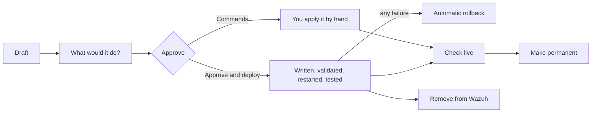

# Rule lifecycle: from draft to a rule that is proven live

**For:** administrators who approve rule changes. The reference with the exact API permissions is
[docs/rule-deployment.md](https://github.com/dururustem68/wazuh-daily-triage/blob/main/docs/rule-deployment.md).

A rule draft is XML written by a model (or by you). Approving it is a human decision. The checks below catch
syntax errors, ID collisions and silencing; they do not catch wrong logic. Read the draft.

## 1. A draft appears

**Where it comes from.** The model proposes one when it sees repeating noise or a detection gap. You can ask for
one from the [noise map](User-Guide), or create a skeleton and edit it. Drafts live in the knowledge base as
*Rule draft*.

**What is already checked.** XML syntax, known OS_Regex pitfalls, rule IDs inside the allowed range and not
used elsewhere, existing parent rules. `<srcip>` and `<dstip>` must be an IP address or a CIDR.

**Effect on Wazuh.** None. The report says *Rule draft (not applied)*.

## 2. What would it do?

**What would it do? (14 days)** replays the draft against the last 14 days of real alerts of its parent rules
and shows how many alerts it would take over, the new level, how many of them were high-level before and after,
the top agents and source IPs, matching examples, and parent alerts it would not match.

**Limits.** CDB lists, time windows and frequency rules are listed as *not evaluated*; the numbers are then an
upper bound. Above 2,000 alerts it works on a random sample.

Use it before every approval. A draft that lowers a real alert shows up in the "high-level before → after" line.

## 3. Approve

| Button | What happens | Needs |
|---|---|---|
| **Commands** | a copy-paste block for the manager: back up, append, `wazuh-analysisd -t` (restores the backup if it fails), restart, verify, roll back | nothing; always available |
| **Approve (do not deploy)** | marks the draft accepted; the model treats it as a decision | admin role |
| **Approve and deploy** | the application applies it itself (next section) | `rule_deploy.enabled: true` and the separate deploy user |

Drafts that silence or lower alerts (level 0, `overwrite="yes"`, `no_log` and similar options, or a child rule
below its parent's level) need a second confirmation: you type the rule ID. This is deliberate. A model misled
by text inside an alert must not be able to blind the SIEM through one click.

## 4. Approve and deploy: what the application does

Off by default. Prerequisites: [Security checklist](Security-Checklist), section *Rule deployment*.

1. Checks the draft again.
2. Writes it into one dedicated file, `etc/rules/<file>` (default `wdt_rules.xml`), as a marked block. Your own
   rule files are never touched.
3. Asks the manager to validate the configuration. On failure the previous file is restored and **no restart
   happens**.
4. Restarts the manager, or the cluster. Event processing pauses for roughly 20–60 seconds.
5. Waits until `wazuh-analysisd` runs and the new rule IDs are loaded.
6. Runs the draft's logtest samples: at least one that must match and one that must not.
7. Records who did it, every step, and the rollback outcome on the knowledge entry and in the audit trail.

### When it rolls back

| Situation | Result |
|---|---|
| Validation fails | previous file restored, no restart |
| Manager does not come back, or the rule IDs are not loaded | rolled back |
| A sample matches a different rule, or none when one was expected | rolled back |
| A sample matches no rule at all (*inconclusive*) | rolled back, unless `allow_inconclusive: true` |
| Draft has no samples and `require_tests: true` | refused before anything is written |
| Manager-internal events (rootcheck, FIM, SCA, vulnerability) | deployed, logtest *not run*; confirm on the next real event |
| The rollback itself fails | recorded as failed and logged as critical: the manager needs a person |

*Inconclusive* is not a pass. "No rule matched" usually means the sample never reached the decoder or the parent
rule, so it proves nothing about the new rule.

**Security effect.** This is the only path on which the application changes Wazuh. It uses a separate API user;
because of a Wazuh limit that user could overwrite any custom rules file, although the application writes only
its own. Every deployment is audited and, by default, notified.

## 5. Check live

`logtest passed` is not proof that a rule works in production. After every run, a deployed, approved or
promoted rule is checked against real events: *confirmed live 12× (last …)* or *not seen for 5 days*.
**Check live** runs the same check on demand.

A rule that is never seen is either correct and quiet, or wrong. Compare with *What would it do?*: if the replay
predicted 400 matches a day and the live count is zero, the rule does not load or does not match.

## 6. Make permanent

A deployed draft lives in the application's own file. **Make permanent** produces a package for your own
configuration management: the rule block with its origin, a script (back up, append, `wazuh-analysisd -t`, roll
out, check it loaded) and, if configured, a section for your alert catalogue. Configure `promote:` for a host or
a Kubernetes/GitOps layout ([Features](Features)). The script refuses to run while the draft is still deployed
through the application's file, so a rule is never loaded twice.

If you manage rules through GitOps or ConfigMaps, keep deployment off: use **Commands** or the promotion
package, and let your pipeline do the rollout.

## 7. Remove from Wazuh

**Remove from Wazuh** deletes that draft's block from the file, validates and restarts, the same way as a
deployment. Everything the application ever wrote is in the one file; on the manager,
`grep wdt:begin /var/ossec/etc/rules/wdt_rules.xml` lists it.

## If it does not work

| Symptom | Cause |
|---|---|
| **Approve and deploy** is greyed out | `rule_deploy` is not enabled for the environment |
| `Permission denied: Resource type: rule:file` | the deploy user's `rules:delete` policy names a different file than `rule_deploy.file` |
| The check says the parent rule is unknown | load order: Wazuh loads `etc/rules` alphabetically; the file must sort after the file holding the parent. The message suggests a name such as `zz_wdt_rules.xml` |
| The draft is refused for its ID | it is outside `id_min`–`id_max` |
| The rule is gone after a pod restart | `etc/rules` on the manager is not on a persistent volume |

More: [Troubleshooting](Troubleshooting).

*Applies to 0.11.0 · reviewed 2026-11-11*

---

[English](Rule-Lifecycle) · [Türkçe](Rule-Lifecycle-TR)
