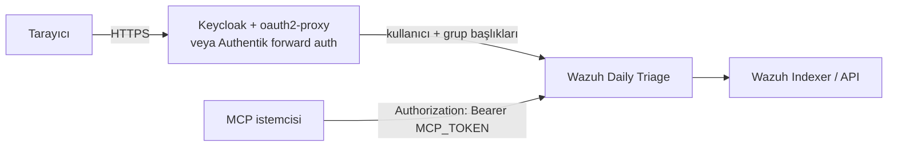

# SSO proxy kimlik doğrulama (Keycloak, Authentik, oauth2-proxy)

Uygulama kendi parola girişini içerir, ancak **kimlik doğrulayan bir ters vekilin arkasında** da çalışabilir.
Bu modda kullanıcının kim olduğunu vekil kanıtlar, kullanıcı adını ve gruplarını başlıklarda iletir ve uygulama
artık parola sormaz. 0.11'den beri **rolü gruplar belirler**: `SSO_ADMIN_GROUPS` üyeleri yönetici,
`SSO_VIEWER_GROUPS` üyeleri salt okunur görüntüleyicidir, diğer herkes `SSO_DEFAULT_ROLE` alır (bkz. aşağıdaki
*Gruplardan rol* bölümü).

> **Bu bir güven sınırıdır, özellik anahtarı değil.** `AUTH_DISABLED=true` iken uygulama, kendisine ulaşan her
> isteğin kullanıcı ve grup başlıklarına inanır. Vekil atlatılabiliyorsa poda erişebilen herkes kendine bir ad ve
> bir yönetici grubu seçebilir. SSO'yu her zaman yalnızca vekile izin veren bir NetworkPolicy veya güvenlik
> duvarıyla birlikte kullanın, ayrıca `TRUSTED_PROXIES` ya da `PROXY_SECRET` ayarlayın.



## Uygulamada ne değişir?

| Ayar | Değer | Neden |
|---|---|---|
| `AUTH_DISABLED` | `true` | Uygulama oturumu isteme; vekile güven. |
| `COOKIE_SECURE` | `true` | Üretimde yine kontrol edilir; giriş çerezi HTTPS'e özel olmalı. |
| `FORWARDED_ALLOW_IPS` | vekil IP'si veya pod CIDR'ı | Uvicorn yalnızca vekilden gelen yönlendirme başlıklarına güvenmeli. Asla `*`. |
| `USER_HEADER` | isteğe bağlı | Kullanıcı adının okunacağı başlık sırası. Varsayılan: `X-authentik-username,X-Forwarded-User,Remote-User,X-Auth-Request-User`. |
| `SSO_ADMIN_GROUPS` | örn. `wazuh-admins` | Üyeleri yönetici olan gruplar. Tanımlı değilse kimse yönetici değildir (açılışta uyarı verilir). |
| `SSO_VIEWER_GROUPS` | örn. `soc,auditors` | Üyeleri salt okunur görüntüleyici olan gruplar. |
| `SSO_DEFAULT_ROLE` | `viewer`, `deny` ya da `admin` | İki listede de olmayanlar. Varsayılan: `viewer`; `SSO_VIEWER_GROUPS` tanımlıysa `deny`. |
| `GROUP_HEADER` | isteğe bağlı | Grupların okunacağı başlıklar. Varsayılan: `X-authentik-groups,X-Forwarded-Groups,X-Auth-Request-Groups,Remote-Groups`. |
| `APP_PASSWORD` | boş olabilir | Bu modda yetkilendirme için kullanılmaz. |
| `APP_SECRET` | yine de ayarlayın | Varsa uygulama oturumunu yeniden başlatmalar arasında korur; SSO arkasında zararsızdır. |

Üretimde `AUTH_DISABLED=true` bir **uyarı** üretir (hata değil) ve `APP_PASSWORD`/`APP_SECRET` kontrollerini
atlar. Ağ kısıtlaması sizin sorumluluğunuzdadır.

Denetim kaydı, vekilden gelen kullanıcıyı aktör, gruplarının verdiği rolü (`admin` ya da `viewer`) rol olarak
yazar; her durum değiştiren istek, ret ve kural dağıtımı bu adla kaydedilir.

## Gruplardan rol (0.11)

| Kullanıcı şu gruptaysa | Rol | Yapabildikleri |
|---|---|---|
| `SSO_ADMIN_GROUPS` içindeki bir grup | yönetici | her şey: kontrol başlatma, karar, bilgi tabanı, kural dağıtımı, ayarlar |
| `SSO_VIEWER_GROUPS` içindeki bir grup (yönetici grubu yok) | görüntüleyici | `VIEWER_ENVS`'in izin verdiği ortamların bütün sayfalarını okur; değişiklik yapan hiçbir düğme çalışmaz |
| hiçbiri | `SSO_DEFAULT_ROLE` | `viewer` (varsayılan), `admin` ya da `deny`: istek 403 "rol yok" ile reddedilir |

```sh
AUTH_DISABLED=true
SSO_ADMIN_GROUPS=wazuh-admins
SSO_VIEWER_GROUPS=soc,auditors        # bu tanımlıyken diğer herkes reddedilir (SSO_DEFAULT_ROLE=deny)
TRUSTED_PROXIES=10.42.0.0/16          # ingress denetleyicisinin pod CIDR'ı
```

- Grup adları büyük/küçük harf ayrımı olmadan karşılaştırılır ve baştaki `/` yok sayılır; böylece Keycloak'ın tam
  yolu `/wazuh-admins`, `wazuh-admins` ile eşleşir. Tek başlıktaki birden çok grup `|` (Authentik) ya da `,`
  (oauth2-proxy) ile ayrılabilir.
- Yönetici grubu, görüntüleyici grubuna üstün gelir.
- Rol her istekte yeniden belirlenir; kimlik sağlayıcıdaki grup değişikliği vekil onu ilettiği anda geçerli olur
  (oauth2-proxy'de: bir sonraki oturum yenilemesinde).
- Kenar çubuğu kullanıcı adını ve rolü gösterir; görüntüleyiciler **salt okunur** etiketi görür ve sunucuda
  [Görüntüleyici modu](Viewer-Mode-TR) ile aynı yetki matrisi uygulanır.

> **0.10'dan yükseltirken:** 0.11 öncesinde her SSO kullanıcısı yöneticiydi. Artık yönetici grubunda olmayan SSO
> kullanıcısı görüntüleyicidir. Yükseltmeden önce `SSO_ADMIN_GROUPS` ayarlayın ya da eski davranışı bir süre korumak
> için `SSO_DEFAULT_ROLE=admin` yazın (açılışta uyarı verilir).

### Grupları hangi başlık taşır

| Vekil | Başlık | Vekil yapılandırmasında gereken |
|---|---|---|
| Authentik forward auth (Traefik, nginx outpost) | `X-authentik-groups` (`a|b|c`) | `authResponseHeaders` içinde `X-authentik-groups` (hazır bileşende var) |
| oauth2-proxy, reverse-proxy modu (`--pass-user-headers`) | `X-Forwarded-Groups` | token'da `groups` claim'i |
| ingress-nginx / Traefik forward auth arkasında oauth2-proxy (`--set-xauthrequest`) | `X-Auth-Request-Groups` | `auth-response-headers` / `authResponseHeaders` içinde `X-Auth-Request-Groups` |
| Diğer vekiller | `Remote-Groups` ya da `GROUP_HEADER`'da adı geçen başlık | – |

Vekil, istemci bu başlıkları gönderdiğinde kullanıcı başlığında olduğu gibi üzerine yazmalı ya da silmelidir.

## Ön koşullar (atlamayın)

1. **Ağ izolasyonu.** 8080 portuna yalnızca ingress denetleyicisi/vekil erişebilmeli. Kubernetes'te
   `networkpolicy` bileşenini, Docker'da yalnızca vekilin bağlı olduğu bir ağı veya ana makine güvenlik
   duvarını kullanın.
2. **İstemciden gelen kimlik başlıklarını silin.** Vekil, istemciden gelen kullanıcı başlıklarını
   (`X-authentik-username`, `X-Forwarded-User`, `Remote-User`, `X-Auth-Request-User`) ve grup başlıklarını
   (`X-authentik-groups`, `X-Forwarded-Groups`, `X-Auth-Request-Groups`, `Remote-Groups`) **üzerine yazmalı veya
   kaldırmalı**. Aksi halde istemci kendine bir ad ve yönetici grubu seçebilir.
3. **Her yerde TLS.** `COOKIE_SECURE=true`; uygulamayı asla düz HTTP ile dışarı açmayın.
4. **Probe'ları açık tutun.** `/healthz` ve `/readyz` uygulamada kimlik doğrulaması istemez, ancak vekil de
   kubelet'in bu yollara erişmesine izin vermeli; ya da doğrudan poda giden `httpGet` probe'ları kullanın.
5. **`/login` kararı.** Erişilebilir kalır; SSO tek yol olacaksa vekilde bu yolu kapatabilirsiniz.

## Seçenek 1 — Keycloak + oauth2-proxy

Keycloak bir OIDC sağlayıcısıdır; forward-auth katmanı **oauth2-proxy**'dir (veya eşdeğeri). Hem ingress-nginx
hem Traefik ile çalışır.

### 1. Keycloak istemcisi

Gizli (confidential) istemci oluşturun:

- Client ID: `wazuh-triage`
- Client authentication: **açık**
- Standard flow: **açık**
- Geçerli yönlendirme URI'si: `https://triage.example.com/oauth2/callback`
- Web origins: `https://triage.example.com`

Uygulamanın yöneticiyi görüntüleyiciden ayırabilmesi için bir **grup claim'i** ekleyin: *Client scopes →
wazuh-triage-dedicated → Add mapper → By configuration → Group Membership*, token claim adı `groups`,
"Full group path" açık ya da kapalı (ikisi de çalışır), "Add to ID token" ve "Add to userinfo" açık.

### 2. oauth2-proxy

```yaml
# Deployment argümanları (kısaltılmış)
- --provider=keycloak-oidc
- --oidc-issuer-url=https://keycloak.example.com/realms/REALM
- --client-id=wazuh-triage
- --client-secret=$(OAUTH2_PROXY_CLIENT_SECRET)
- --redirect-url=https://triage.example.com/oauth2/callback
- --cookie-secret=$(OAUTH2_PROXY_COOKIE_SECRET)   # 32 rastgele bayt, base64
- --cookie-secure=true
- --email-domain=*
- --reverse-proxy=true
- --set-xauthrequest=true          # X-Auth-Request-User ve X-Auth-Request-Groups üretir
- --oidc-groups-claim=groups       # Keycloak mapper'ının yazdığı claim
- --skip-auth-route=POST=^/mcp$    # yalnızca MCP sunucusunu kullanıyorsanız
- --upstream-timeout=120s          # oauth2-proxy ≥ 7.6; varsayılan 30s (aşağıda "Uzun işlemler")
```

`--set-xauthrequest=true`, `<proxy>/oauth2/auth` yanıtına `X-Auth-Request-User` ve `X-Auth-Request-Groups`
ekler; olmadan uygulama aktör adını (`proxy-user`) ve grupları göremez (herkes `SSO_DEFAULT_ROLE` alır).

### 3. ingress-nginx

```yaml
metadata:
  annotations:
    nginx.ingress.kubernetes.io/auth-url: "https://oauth2.example.com/oauth2/auth"
    nginx.ingress.kubernetes.io/auth-signin: "https://oauth2.example.com/oauth2/start?rd=$scheme://$host$escaped_request_uri"
    nginx.ingress.kubernetes.io/auth-response-headers: "X-Auth-Request-User,X-Auth-Request-Email,X-Auth-Request-Groups"
```

`auth-response-headers` zorunludur; olmadan nginx isteği doğrular ama kullanıcı adını ve grupları uygulamaya geçirmez.

### 3′. nginx yerine Traefik

```yaml
apiVersion: traefik.io/v1alpha1
kind: Middleware
metadata:
  name: oauth2-proxy
spec:
  forwardAuth:
    address: http://oauth2-proxy.auth.svc.cluster.local/oauth2/auth
    trustForwardHeader: true
    authResponseHeaders:
      - X-Auth-Request-User
      - X-Auth-Request-Email
      - X-Auth-Request-Groups
```

Middleware'i uygulamanın `IngressRoute`'una bağlayın. `Path('/mcp')` için bu middleware **olmadan**, daha yüksek
öncelikli ikinci bir kural ekleyin ([MCP](MCP-TR)).

### 4. Uygulama

```sh
AUTH_DISABLED=true
COOKIE_SECURE=true
FORWARDED_ALLOW_IPS=10.0.0.0/8        # ingress denetleyicisinin pod CIDR'ı
TRUSTED_PROXIES=10.0.0.0/8
SSO_ADMIN_GROUPS=wazuh-admins         # Keycloak grup adları, baştaki / ile ya da olmadan
SSO_VIEWER_GROUPS=soc
```

Yeniden başlatın, Keycloak oturumunu kapatıp yeniden açın: kenar çubuğu adınızı ve rolünüzü gösterir.

## Seçenek 2 — Authentik forward auth (Traefik)

Authentik'in **gömülü outpost**'u forward-auth sunucusu olarak çalışabilir. Depoda hazır bileşen var:
[`deploy/kubernetes/components/ingress-traefik-authentik`](https://github.com/dururustem68/wazuh-daily-triage/blob/main/deploy/kubernetes/components/ingress-traefik-authentik).

### 1. Authentik

1. Dış adresi `https://triage.example.com` olan bir **Proxy provider** (forward auth / tek uygulama) oluşturun.
2. Bu provider'a bağlı bir **Application** oluşturun. Arayüzü kullanacak bütün gruplara (yöneticiler ve
   görüntüleyiciler) bağlayın ve adlarını `SSO_ADMIN_GROUPS` / `SSO_VIEWER_GROUPS` içine yazın.
3. Uygulamayı, Traefik ile aynı namespace'teki gömülü outpost'a (veya ayrı bir outpost'a) atayın.

### 2. Traefik middleware ve rotalar

Bileşen tam dosyayı içerir; önemli kısımlar:

```yaml
apiVersion: traefik.io/v1alpha1
kind: Middleware
metadata:
  name: authentik
spec:
  forwardAuth:
    address: http://authentik-server.authentik.svc.cluster.local/outpost.goauthentik.io/auth/traefik
    trustForwardHeader: true
    authResponseHeaders:
      - X-authentik-username
      - X-authentik-groups
      - X-authentik-email
      - X-authentik-name
      - X-authentik-uid
---
apiVersion: traefik.io/v1alpha1
kind: IngressRoute
metadata:
  name: wazuh-daily-triage
spec:
  routes:
    - kind: Rule
      match: Host(`triage.example.com`)
      middlewares:
        - name: authentik
      services:
        - name: wazuh-daily-triage
          port: 8080
    # Authentik'in kendi giriş / callback uçları
    - kind: Rule
      match: Host(`triage.example.com`) && PathPrefix(`/outpost.goauthentik.io/`)
      priority: 1000
      services:
        - name: authentik-server
          namespace: authentik
          port: 80
    # MCP'nin kendi bearer token'ı var; Authentik middleware yok
    - kind: Rule
      match: Host(`triage.example.com`) && Path(`/mcp`)
      priority: 900
      services:
        - name: wazuh-daily-triage
          port: 8080
  tls:
    secretName: triage-tls
```

Overlay'de etkinleştirin:

```yaml
components:   # uzak ve sürümü sabit — host adlarını düzenlemek için klasörleri overlay'in yanına kopyalayın
  - https://github.com/dururustem68/wazuh-daily-triage//deploy/kubernetes/components/networkpolicy?ref=v0.11.1
  - https://github.com/dururustem68/wazuh-daily-triage//deploy/kubernetes/components/ingress-traefik-authentik?ref=v0.11.1
```

Bileşen `AUTH_DISABLED=true`, `COOKIE_SECURE=true` ve `NOTIFY_UI_URL` değerlerini zaten ayarlar (host'u
düzenleyin). `FORWARDED_ALLOW_IPS` (Traefik pod CIDR'ı) değerini overlay'in ortam ConfigMap'ine siz ekleyin.
Namespace'ler arası servis referansları için Traefik'in
`--providers.kubernetescrd.allowCrossNamespace=true` ayarı gerekir; yoksa uygulama namespace'ine bir
`ExternalName` servisi ekleyin.

> Authentik ayrıca bir **nginx proxy outpost**'u sunar. Başlık adları aynıdır (`X-authentik-username`, …);
> onu kullanırsanız adın uygulamaya ulaşması için nginx yapılandırmasında `auth-response-headers` tutun.

## Kurulumu doğrulama

```sh
# 1. Kimlik doğrulanmamış istek IdP'ye yönlenmeli
curl -sI https://triage.example.com/ | head -n 3

# 2. Tarayıcıdan giriş yapın, uygulamayı açın ve bir koşu başlatın.

# 3. Denetim kaydı proxy kullanıcısını yazmalı, "ui" değil
tail -n 5 logs/audit.jsonl

# 4. Poda doğrudan erişim OLMAMALI (başka namespace / ana makineden çalıştırın)
curl -m 3 http://<pod-ip>:8080/healthz     # zaman aşımı veya bağlantı reddi
```

Doğrudan istek başarılı oluyorsa — veya istemci kendi `X-authentik-username` başlığını koyabiliyorsa — kurulum
fiilen kimlik doğrulamasızdır. Dışarı açmadan önce ağ politikasını düzeltin.

## Sorun giderme

| Belirti | Neden ve çözüm |
|---|---|
| Vekil ile IdP arasında yönlendirme döngüsü | Yanlış `--redirect-url` / Keycloak yönlendirme URI'si, düz HTTP üzerinde `--cookie-secure=true` veya vekil `X-Forwarded-Proto` göndermiyor. |
| Uygulama hâlâ kendi giriş sayfasını gösteriyor | `AUTH_DISABLED` `true` değil (yalnızca `true`, `1`, `yes` kabul edilir) veya ortam değişikliği çalışan poda uygulanmadı. |
| Uygulama `401 not authenticated` dönüyor | Yukarıdakiyle aynı: `AUTH_DISABLED` kapalı olduğu için uygulama hâlâ oturum istiyor. |
| Denetim aktörü `proxy-user` | Kimlik başlığı yok veya adı farklı. `USER_HEADER` ayarlayın ya da `X-Auth-Request-User` / `X-authentik-username` geçirin. |
| Yükseltmeden sonra herkes salt okunur | Grup başlığı gelmiyor ya da `SSO_ADMIN_GROUPS` tanımlı değil. `X-authentik-groups` / `X-Auth-Request-Groups` iletin ve grup adlarını yazın. |
| `403` "rolü yok" | `SSO_VIEWER_GROUPS` tanımlı ve kullanıcı listelenen grupların hiçbirinde değil (`SSO_DEFAULT_ROLE=deny`). Kullanıcıyı bir gruba ekleyin ya da `SSO_DEFAULT_ROLE=viewer` yapın. |
| Bir yönetici salt okunur etiketi görüyor | Grup adı farklı (yazım, önek). Vekilin gönderdiği başlıkla karşılaştırın; büyük/küçük harf ve baştaki `/` önemli değildir. |
| Vekil arkasında `/mcp` `401` dönüyor | Vekil `Authorization` başlığını siliyor; atlama rotası (`POST=^/mcp$`) veya middleware'siz `/mcp` rotası ekleyin. |
| `/mcp` `404` dönüyor | `MCP_TOKEN` ayarlı değil; amaçlanan “kapalı” yanıtı budur. [MCP](MCP-TR). |
| SSO'dan sonra probe'lar başarısız | Vekil `/healthz`/`/readyz` yollarını yakalıyor. Bu yolları geçirin veya probe'u poda yönlendirin. |
| Çıkış SSO oturumunu bitirmiyor | Uygulamanın `/logout` yalnızca kendi çerezini siler. IdP/vekil çıkışını kullanın veya uygulama çıkış düğmesini gizleyin. |

## Uzun işlemler ve vekil zaman aşımları (0.11.1)

oauth2-proxy varsayılan olarak arka uçtan **30 sn** sonra vazgeçer ve `502` döner; ingress-nginx, Traefik ve
Kong'un kendi okuma zaman aşımları vardır (çoğunlukla 60 sn). Bir kural dağıtımı (manager yeniden başlatma +
doğrulama + logtest) yaklaşık bir dakika sürer. 0.11.1'den beri uygulama bu tür istekleri hemen `202` ile yanıtlar
ve sayfa bir arka plan işini yoklar (kural dağıtma ve kaldırma, bağlantı testi, olay kaydı taslağı, *Ne yapardı?*);
böylece bu zaman aşımları arayüz için artık önemli değildir. Betikler ve yavaş sayfalar için güvenlik payı olarak
yine de önerilir:

| Vekil | Ayar |
|---|---|
| oauth2-proxy | `--upstream-timeout=120s` (ya da `OAUTH2_PROXY_UPSTREAM_TIMEOUT=120s`) |
| ingress-nginx | `nginx.ingress.kubernetes.io/proxy-read-timeout: "120"` |
| Traefik | `serversTransport` → `forwardingTimeouts.responseHeaderTimeout: 120s` |
| Kong | servis `read_timeout: 120000` |

Eski eşzamanlı yanıtı isteyen API istemcileri `?wait=true` ekler — yalnız zaman aşımı yeterince uzun bir vekil
üzerinden.

## Planlanması gereken sınırlar

- **Yalnız iki rol.** Bir grup yönetici ya da görüntüleyiciye eşlenir; daha ince bir rol yoktur (örneğin "karar
  verebilir ama dağıtamaz").
- **Ortam kapsamı rol bazlıdır, kullanıcı bazlı değil.** `ADMIN_ENVS` tüm SSO yöneticileri, `VIEWER_ENVS` tüm SSO
  görüntüleyicileri için geçerlidir.
- **Uygulama IdP oturumunu görmez.** Her istekte yalnızca başlığı görür; IdP'de iptal edilen oturum ancak
  vekil bunu kontrol ettiği sürece dikkate alınır; vekil kontrol etmezse uygulama oturumu kapatmaz.
- **Kimlik, başlığın kendisidir.** İmza yoktur — kontrol ağ yoludur.

---

[English](SSO-Proxy-Auth) · [Türkçe](SSO-Proxy-Auth-TR)

## İsteklerin proxy'den geldiğini doğrulama (0.10)

`AUTH_DISABLED=true` iken uygulama kendisine ulaşan herkese güvenir. Üç ayar bunu "proxy" anlamına getirir:

| Değişken | Etki |
|---|---|
| `SSO_REQUIRE_USER` (varsayılan `true`) | `USER_HEADER` başlıklarından biri olmayan istek 401 ile reddedilir. |
| `TRUSTED_PROXIES` | Proxy'nin adresleri/CIDR'leri. Başka adresler 403 alır; bu adreslerden gelen `X-Forwarded-For` denetim kaydında kullanılır. |
| `PROXY_SECRET` | Proxy, `X-WDT-Proxy-Secret` başlığını bu değerle eklemelidir. |

`/healthz`, `/readyz`, `/mcp` (kendi belirteci) ve `METRICS_TOKEN` tanımlıyken `/metrics` etkilenmez.
NetworkPolicy'yi koruyun: bu denetimler onu tamamlar, yerini almaz.
