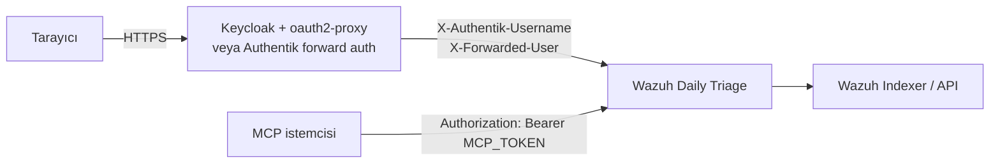

# SSO proxy kimlik doğrulama (Keycloak, Authentik, oauth2-proxy)

Uygulama kendi parola girişini içerir, ancak **kimlik doğrulayan bir ters vekilin arkasında** da çalışabilir.
Bu modda kullanıcının kim olduğunu vekil kanıtlar, kullanıcı adını bir başlıkta iletir ve uygulama artık parola
sormaz.

> **Bu bir güven sınırıdır, özellik anahtarı değil.** `AUTH_DISABLED=true` iken uygulamaya ulaşan her istek
> **admin**'dir. Vekil atlatılabiliyorsa poda erişebilen herkes tam admin erişimine sahiptir. SSO'yu her zaman
> yalnızca vekile izin veren bir NetworkPolicy veya güvenlik duvarıyla birlikte kullanın.



## Uygulamada ne değişir?

| Ayar | Değer | Neden |
|---|---|---|
| `AUTH_DISABLED` | `true` | Uygulama oturumu isteme; vekile güven. |
| `COOKIE_SECURE` | `true` | Üretimde yine kontrol edilir; giriş çerezi HTTPS'e özel olmalı. |
| `FORWARDED_ALLOW_IPS` | vekil IP'si veya pod CIDR'ı | Uvicorn yalnızca vekilden gelen yönlendirme başlıklarına güvenmeli. Asla `*`. |
| `USER_HEADER` | isteğe bağlı | Kullanıcı adının okunacağı başlık sırası. Varsayılan: `X-authentik-username,X-Forwarded-User,Remote-User,X-Auth-Request-User`. |
| `APP_PASSWORD` | boş olabilir | Bu modda yetkilendirme için kullanılmaz. |
| `APP_SECRET` | yine de ayarlayın | Varsa uygulama oturumunu yeniden başlatmalar arasında korur; SSO arkasında zararsızdır. |

Üretimde `AUTH_DISABLED=true` bir **uyarı** üretir (hata değil) ve `APP_PASSWORD`/`APP_SECRET` kontrollerini
atlar. Ağ kısıtlaması sizin sorumluluğunuzdadır.

Denetim kaydı, vekilden gelen kullanıcıyı aktör, rolü `proxy` olarak yazar; her durum değiştiren istek, ret ve
kural dağıtımı yine bu adla kaydedilir.

## Ön koşullar (atlamayın)

1. **Ağ izolasyonu.** 8080 portuna yalnızca ingress denetleyicisi/vekil erişebilmeli. Kubernetes'te
   `networkpolicy` bileşenini, Docker'da yalnızca vekilin bağlı olduğu bir ağı veya ana makine güvenlik
   duvarını kullanın.
2. **İstemciden gelen kimlik başlıklarını silin.** Vekil, istemciden gelen `X-authentik-username`,
   `X-Forwarded-User`, `Remote-User` ve `X-Auth-Request-User` başlıklarını **üzerine yazmalı veya kaldırmalı**.
   Aksi halde istemci kendi admin adını seçebilir.
3. **Her yerde TLS.** `COOKIE_SECURE=true`; uygulamayı asla düz HTTP ile dışarı açmayın.
4. **Probe'ları açık tutun.** `/healthz` ve `/readyz` uygulamada kimlik doğrulaması istemez, ancak vekil de
   kubelet'in bu yollara erişmesine izin vermeli; ya da doğrudan poda giden `httpGet` probe'ları kullanın.
5. **`/login` kararı.** Erişilebilir kalır; SSO tek yol olacaksa vekilde bu yolu kapatabilirsiniz.

## Seçenek 1 — Keycloak + oauth2-proxy

Keycloak bir OIDC sağlayıcısıdır; forward-auth katmanı **oauth2-proxy**'dir (veya eşdeğeri). Hem ingress-nginx
hem Traefik ile çalışır.

### 1. Keycloak istemcisi

Gizli (confidential) istemci oluşturun:

- Client ID: `wazuh-triage`
- Client authentication: **açık**
- Standard flow: **açık**
- Geçerli yönlendirme URI'si: `https://triage.example.com/oauth2/callback`
- Web origins: `https://triage.example.com`

İsteğe bağlı olarak, erişimi vekilde sınırlamak isterseniz bir grup claim'i ekleyin.

### 2. oauth2-proxy

```yaml
# Deployment argümanları (kısaltılmış)
- --provider=keycloak-oidc
- --oidc-issuer-url=https://keycloak.example.com/realms/REALM
- --client-id=wazuh-triage
- --client-secret=$(OAUTH2_PROXY_CLIENT_SECRET)
- --redirect-url=https://triage.example.com/oauth2/callback
- --cookie-secret=$(OAUTH2_PROXY_COOKIE_SECRET)   # 32 rastgele bayt, base64
- --cookie-secure=true
- --email-domain=*
- --reverse-proxy=true
- --set-xauthrequest=true          # X-Auth-Request-User üretir
- --skip-auth-route=POST=^/mcp$    # yalnızca MCP sunucusunu kullanıyorsanız
```

`--set-xauthrequest=true`, `<proxy>/oauth2/auth` yanıtına `X-Auth-Request-User` ekler; olmadan uygulama aktör
adını göremez ve `proxy-user` kaydeder.

### 3. ingress-nginx

```yaml
metadata:
  annotations:
    nginx.ingress.kubernetes.io/auth-url: "https://oauth2.example.com/oauth2/auth"
    nginx.ingress.kubernetes.io/auth-signin: "https://oauth2.example.com/oauth2/start?rd=$scheme://$host$escaped_request_uri"
    nginx.ingress.kubernetes.io/auth-response-headers: "X-Auth-Request-User,X-Auth-Request-Email"
```

`auth-response-headers` zorunludur; olmadan nginx isteği doğrular ama kullanıcı adını uygulamaya geçirmez.

### 3′. nginx yerine Traefik

```yaml
apiVersion: traefik.io/v1alpha1
kind: Middleware
metadata:
  name: oauth2-proxy
spec:
  forwardAuth:
    address: http://oauth2-proxy.auth.svc.cluster.local/oauth2/auth
    trustForwardHeader: true
    authResponseHeaders:
      - X-Auth-Request-User
      - X-Auth-Request-Email
```

Middleware'i uygulamanın `IngressRoute`'una bağlayın. `Path('/mcp')` için bu middleware **olmadan**, daha yüksek
öncelikli ikinci bir kural ekleyin ([MCP](MCP-TR)).

### 4. Uygulama

```sh
AUTH_DISABLED=true
COOKIE_SECURE=true
FORWARDED_ALLOW_IPS=10.0.0.0/8        # ingress denetleyicisinin pod CIDR'ı
```

Yeniden başlatın, Keycloak oturumunu kapatıp yeniden açarak başlığın geldiğini doğrulayın.

## Seçenek 2 — Authentik forward auth (Traefik)

Authentik'in **gömülü outpost**'u forward-auth sunucusu olarak çalışabilir. Depoda hazır bileşen var:
[`deploy/kubernetes/components/ingress-traefik-authentik`](https://github.com/dururustem68/wazuh-daily-triage/blob/main/deploy/kubernetes/components/ingress-traefik-authentik).

### 1. Authentik

1. Dış adresi `https://triage.example.com` olan bir **Proxy provider** (forward auth / tek uygulama) oluşturun.
2. Bu provider'a ve triage arayüzünü kullanabilecek gruba bağlı bir **Application** oluşturun.
3. Uygulamayı, Traefik ile aynı namespace'teki gömülü outpost'a (veya ayrı bir outpost'a) atayın.

### 2. Traefik middleware ve rotalar

Bileşen tam dosyayı içerir; önemli kısımlar:

```yaml
apiVersion: traefik.io/v1alpha1
kind: Middleware
metadata:
  name: authentik
spec:
  forwardAuth:
    address: http://authentik-server.authentik.svc.cluster.local/outpost.goauthentik.io/auth/traefik
    trustForwardHeader: true
    authResponseHeaders:
      - X-authentik-username
      - X-authentik-groups
      - X-authentik-email
      - X-authentik-name
      - X-authentik-uid
---
apiVersion: traefik.io/v1alpha1
kind: IngressRoute
metadata:
  name: wazuh-daily-triage
spec:
  routes:
    - kind: Rule
      match: Host(`triage.example.com`)
      middlewares:
        - name: authentik
      services:
        - name: wazuh-daily-triage
          port: 8080
    # Authentik'in kendi giriş / callback uçları
    - kind: Rule
      match: Host(`triage.example.com`) && PathPrefix(`/outpost.goauthentik.io/`)
      priority: 1000
      services:
        - name: authentik-server
          namespace: authentik
          port: 80
    # MCP'nin kendi bearer token'ı var; Authentik middleware yok
    - kind: Rule
      match: Host(`triage.example.com`) && Path(`/mcp`)
      priority: 900
      services:
        - name: wazuh-daily-triage
          port: 8080
  tls:
    secretName: triage-tls
```

Overlay'de etkinleştirin:

```yaml
components:   # uzak ve sürümü sabit — host adlarını düzenlemek için klasörleri overlay'in yanına kopyalayın
  - https://github.com/dururustem68/wazuh-daily-triage//deploy/kubernetes/components/networkpolicy?ref=v0.7.0
  - https://github.com/dururustem68/wazuh-daily-triage//deploy/kubernetes/components/ingress-traefik-authentik?ref=v0.7.0
```

Bileşen `AUTH_DISABLED=true`, `COOKIE_SECURE=true` ve `NOTIFY_UI_URL` değerlerini zaten ayarlar (host'u
düzenleyin). `FORWARDED_ALLOW_IPS` (Traefik pod CIDR'ı) değerini overlay'in ortam ConfigMap'ine siz ekleyin.
Namespace'ler arası servis referansları için Traefik'in
`--providers.kubernetescrd.allowCrossNamespace=true` ayarı gerekir; yoksa uygulama namespace'ine bir
`ExternalName` servisi ekleyin.

> Authentik ayrıca bir **nginx proxy outpost**'u sunar. Başlık adları aynıdır (`X-authentik-username`, …);
> onu kullanırsanız adın uygulamaya ulaşması için nginx yapılandırmasında `auth-response-headers` tutun.

## Kurulumu doğrulama

```sh
# 1. Kimlik doğrulanmamış istek IdP'ye yönlenmeli
curl -sI https://triage.example.com/ | head -n 3

# 2. Tarayıcıdan giriş yapın, uygulamayı açın ve bir koşu başlatın.

# 3. Denetim kaydı proxy kullanıcısını yazmalı, "ui" değil
tail -n 5 logs/audit.jsonl

# 4. Poda doğrudan erişim OLMAMALI (başka namespace / ana makineden çalıştırın)
curl -m 3 http://<pod-ip>:8080/healthz     # zaman aşımı veya bağlantı reddi
```

Doğrudan istek başarılı oluyorsa — veya istemci kendi `X-authentik-username` başlığını koyabiliyorsa — kurulum
fiilen kimlik doğrulamasızdır. Dışarı açmadan önce ağ politikasını düzeltin.

## Sorun giderme

| Belirti | Neden ve çözüm |
|---|---|
| Vekil ile IdP arasında yönlendirme döngüsü | Yanlış `--redirect-url` / Keycloak yönlendirme URI'si, düz HTTP üzerinde `--cookie-secure=true` veya vekil `X-Forwarded-Proto` göndermiyor. |
| Uygulama hâlâ kendi giriş sayfasını gösteriyor | `AUTH_DISABLED` `true` değil (yalnızca `true`, `1`, `yes` kabul edilir) veya ortam değişikliği çalışan poda uygulanmadı. |
| Uygulama `401 not authenticated` dönüyor | Yukarıdakiyle aynı: `AUTH_DISABLED` kapalı olduğu için uygulama hâlâ oturum istiyor. |
| Denetim aktörü `proxy-user` | Kimlik başlığı yok veya adı farklı. `USER_HEADER` ayarlayın ya da `X-Auth-Request-User` / `X-authentik-username` geçirin. |
| Herkes admin | Beklenen: SSO modunda rol eşlemesi yok. Salt okunur kullanıcılar için uygulama parolasıyla [Görüntüleyici modu](Viewer-Mode-TR) kullanın. |
| Vekil arkasında `/mcp` `401` dönüyor | Vekil `Authorization` başlığını siliyor; atlama rotası (`POST=^/mcp$`) veya middleware'siz `/mcp` rotası ekleyin. |
| `/mcp` `404` dönüyor | `MCP_TOKEN` ayarlı değil; amaçlanan “kapalı” yanıtı budur. [MCP](MCP-TR). |
| SSO'dan sonra probe'lar başarısız | Vekil `/healthz`/`/readyz` yollarını yakalıyor. Bu yolları geçirin veya probe'u poda yönlendirin. |
| Çıkış SSO oturumunu bitirmiyor | Uygulamanın `/logout` yalnızca kendi çerezini siler. IdP/vekil çıkışını kullanın veya uygulama çıkış düğmesini gizleyin. |

## Planlanması gereken sınırlar

- **Grup → rol eşlemesi yok.** Vekilin doğruladığı her kullanıcı admin'dir. Kullanıcı bazlı salt okunur erişim
  [Görüntüleyici modu](Viewer-Mode-TR) (uygulama parolası) gerektirir, SSO değil.
- **Ortam kapsamı rol bazlıdır, kullanıcı bazlı değil.** `ADMIN_ENVS` tüm SSO kullanıcıları için geçerlidir.
- **Uygulama IdP oturumunu görmez.** Her istekte yalnızca başlığı görür; IdP'de iptal edilen oturum ancak
  vekil bunu kontrol ettiği sürece dikkate alınır; vekil kontrol etmezse uygulama oturumu kapatmaz.
- **Kimlik, başlığın kendisidir.** İmza yoktur — kontrol ağ yoludur.

---

[English](SSO-Proxy-Auth) · [Türkçe](SSO-Proxy-Auth-TR)
