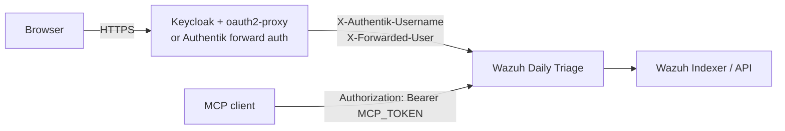

# SSO proxy authentication (Keycloak, Authentik, oauth2-proxy)

The application ships its own password login, but it can also run **behind an authenticating reverse proxy**.
In that mode the proxy proves who the user is, forwards the user name in a header, and the application stops
asking for a password.

> **This is a trust boundary, not a feature toggle.** With `AUTH_DISABLED=true` every request that reaches the
> application is an **admin**. If the proxy can be bypassed, anyone who can reach the pod has full admin access.
> Always combine SSO with a NetworkPolicy or host firewall that allows only the proxy.



## What changes in the application

| Setting | Value | Why |
|---|---|---|
| `AUTH_DISABLED` | `true` | Do not require the app session; trust the proxy. |
| `COOKIE_SECURE` | `true` | Still checked in production; the login cookie must be HTTPS-only. |
| `FORWARDED_ALLOW_IPS` | proxy IP or pod CIDR | Uvicorn may only trust forwarded headers from the proxy. Never `*`. |
| `USER_HEADER` | optional | Header order to read the user name from. Defaults: `X-authentik-username,X-Forwarded-User,Remote-User,X-Auth-Request-User`. |
| `APP_PASSWORD` | can be empty | Not used for authorization in this mode. |
| `APP_SECRET` | set it anyway | Keeps any app session valid across restarts; harmless behind SSO. |

In production, `AUTH_DISABLED=true` produces a startup **warning** (not an error) and skips the
`APP_PASSWORD`/`APP_SECRET` checks. The network restriction is your responsibility.

The audit trail records the proxy user as the actor and the role as `proxy`; every state-changing request,
denial and rule deployment is still written with that name.

## Prerequisites (do not skip)

1. **Network isolation.** Only the ingress controller / proxy may reach port 8080. Use the
   `networkpolicy` component (Kubernetes), a Docker network with only the proxy attached, or a host firewall.
2. **Strip client-supplied identity headers.** The proxy must *overwrite or remove* `X-authentik-username`,
   `X-Forwarded-User`, `Remote-User` and `X-Auth-Request-User` coming from the client. Otherwise a client could
   choose its own admin name.
3. **TLS everywhere.** `COOKIE_SECURE=true`; never expose the app directly over HTTP.
4. **Keep probes public.** `/healthz` and `/readyz` are unauthenticated in the app, but the proxy must also let
   the kubelet reach them, or use `httpGet` probes directly against the pod.
5. **Decide about `/login`.** It remains reachable; you can block it at the proxy if SSO is the only allowed
   way in.

## Option 1 — Keycloak with oauth2-proxy

Keycloak itself is an OIDC provider; the forward-auth layer is **oauth2-proxy** (or an equivalent). This works
with both ingress-nginx and Traefik.

### 1. Keycloak client

Create a confidential client:

- Client ID: `wazuh-triage`
- Client authentication: **on**
- Standard flow: **on**
- Valid redirect URI: `https://triage.example.com/oauth2/callback`
- Web origins: `https://triage.example.com`

Optionally add a group claim if you plan to restrict access at the proxy.

### 2. oauth2-proxy

```yaml
# Deployment args (excerpt)
- --provider=keycloak-oidc
- --oidc-issuer-url=https://keycloak.example.com/realms/REALM
- --client-id=wazuh-triage
- --client-secret=$(OAUTH2_PROXY_CLIENT_SECRET)
- --redirect-url=https://triage.example.com/oauth2/callback
- --cookie-secret=$(OAUTH2_PROXY_COOKIE_SECRET)   # 32 random bytes, base64
- --cookie-secure=true
- --email-domain=*
- --reverse-proxy=true
- --set-xauthrequest=true          # emits X-Auth-Request-User
- --skip-auth-route=POST=^/mcp$    # only if you use the MCP server
```

`--set-xauthrequest=true` is what makes `<proxy>/oauth2/auth` return `X-Auth-Request-User`; without it the
application sees no actor name and records `proxy-user`.

### 3. ingress-nginx

```yaml
metadata:
  annotations:
    nginx.ingress.kubernetes.io/auth-url: "https://oauth2.example.com/oauth2/auth"
    nginx.ingress.kubernetes.io/auth-signin: "https://oauth2.example.com/oauth2/start?rd=$scheme://$host$escaped_request_uri"
    nginx.ingress.kubernetes.io/auth-response-headers: "X-Auth-Request-User,X-Auth-Request-Email"
```

The `auth-response-headers` annotation is required; without it nginx authenticates the request but does not
pass the user name to the application.

### 3′. Traefik instead of nginx

```yaml
apiVersion: traefik.io/v1alpha1
kind: Middleware
metadata:
  name: oauth2-proxy
spec:
  forwardAuth:
    address: http://oauth2-proxy.auth.svc.cluster.local/oauth2/auth
    trustForwardHeader: true
    authResponseHeaders:
      - X-Auth-Request-User
      - X-Auth-Request-Email
```

Attach the middleware to the `IngressRoute` for the application. Add a second, higher-priority route for
`Path('/mcp')` **without** this middleware (see [MCP](MCP#behind-a-proxy)).

### 4. Application

```sh
AUTH_DISABLED=true
COOKIE_SECURE=true
FORWARDED_ALLOW_IPS=10.0.0.0/8        # your ingress controller's pod CIDR
```

Restart, then log out of Keycloak and back in to verify the forwarded header is present.

## Option 2 — Authentik forward auth (Traefik)

Authentik's **embedded outpost** can act as a forward-auth server. The repository ships a ready component:
[`deploy/kubernetes/components/ingress-traefik-authentik`](https://github.com/dururustem68/wazuh-daily-triage/blob/main/deploy/kubernetes/components/ingress-traefik-authentik).

### 1. Authentik

1. Create a **Proxy provider** (forward auth / single application) with external host
   `https://triage.example.com`.
2. Create an **application** bound to that provider and to the group that may use the triage UI.
3. Assign the application to the embedded outpost (or a dedicated outpost) in the same namespace as your
   Traefik instance.

### 2. Traefik middleware and routes

The component contains the full file; the essential parts:

```yaml
apiVersion: traefik.io/v1alpha1
kind: Middleware
metadata:
  name: authentik
spec:
  forwardAuth:
    address: http://authentik-server.authentik.svc.cluster.local/outpost.goauthentik.io/auth/traefik
    trustForwardHeader: true
    authResponseHeaders:
      - X-authentik-username
      - X-authentik-groups
      - X-authentik-email
      - X-authentik-name
      - X-authentik-uid
---
apiVersion: traefik.io/v1alpha1
kind: IngressRoute
metadata:
  name: wazuh-daily-triage
spec:
  routes:
    - kind: Rule
      match: Host(`triage.example.com`)
      middlewares:
        - name: authentik
      services:
        - name: wazuh-daily-triage
          port: 8080
    # Authentik's own sign-in / callback endpoints
    - kind: Rule
      match: Host(`triage.example.com`) && PathPrefix(`/outpost.goauthentik.io/`)
      priority: 1000
      services:
        - name: authentik-server
          namespace: authentik
          port: 80
    # MCP has its own bearer token; no Authentik middleware here
    - kind: Rule
      match: Host(`triage.example.com`) && Path(`/mcp`)
      priority: 900
      services:
        - name: wazuh-daily-triage
          port: 8080
  tls:
    secretName: triage-tls
```

Enable it in your overlay:

```yaml
components:
  - ../components/networkpolicy
  - ../components/ingress-traefik-authentik
```

and set `AUTH_DISABLED=true`, `COOKIE_SECURE=true` and `FORWARDED_ALLOW_IPS` in the overlay's environment
ConfigMap. Cross-namespace service references need Traefik's
`--providers.kubernetescrd.allowCrossNamespace=true`; otherwise add an `ExternalName` service in the app
namespace.

> Authentik also ships an **nginx proxy outpost**. The header names are the same
> (`X-authentik-username`, …); if you use it, keep `auth-response-headers` in the nginx config so the name
> reaches the application.

## Verify the setup

```sh
# 1. Unauthenticated request is redirected to the IdP
curl -sI https://triage.example.com/ | head -n 3

# 2. Sign in through the browser, open the app and start a run.

# 3. The audit trail records the proxy user, not "ui"
tail -n 5 logs/audit.jsonl

# 4. The pod is NOT reachable directly (run from another namespace / host)
curl -m 3 http://<pod-ip>:8080/healthz     # should time out or be refused
```

A direct request that succeeds — or that can set `X-authentik-username` itself — means the deployment is
effectively unauthenticated. Fix the network policy before exposing it.

## Troubleshooting

| Symptom | Cause and fix |
|---|---|
| Redirect loop between proxy and IdP | Wrong `--redirect-url` / Keycloak redirect URI, `--cookie-secure=true` over HTTP, or the proxy is not sending `X-Forwarded-Proto`. |
| App still shows its own login page | `AUTH_DISABLED` is not `true` (only `true`, `1` and `yes` are accepted), or the environment change was not applied to the running pod. |
| App answers `401 not authenticated` | Same as above: the app is still requiring a session because `AUTH_DISABLED` is off. |
| Audit actor is `proxy-user` | The identity header is missing or has a different name. Set `USER_HEADER` or forward `X-Auth-Request-User` / `X-authentik-username`. |
| Everyone is an admin | Expected: SSO mode has no role mapping. For read-only users use [Viewer mode](Viewer-Mode) with app passwords instead. |
| `/mcp` returns `401` behind the proxy | The proxy strips `Authorization`; add the skip route (`POST=^/mcp$`) or a middleware-free `/mcp` route. |
| `/mcp` returns `404` | `MCP_TOKEN` is not set; that is the intended “disabled” answer. See [MCP](MCP). |
| Probes fail after enabling SSO | The proxy intercepts `/healthz`/`/readyz`. Let those paths through, or point the probe at the pod. |
| Logout does not end the SSO session | The app's `/logout` only clears its own cookie. Use the IdP/proxy logout, or hide the app logout button. |

## Limitations to plan around

- **No group → role mapping.** Every user authenticated by the proxy is an admin. Per-user read-only access
  needs [Viewer mode](Viewer-Mode) (app password), not SSO.
- **Environment scoping is per role, not per user.** `ADMIN_ENVS` applies to all SSO users.
- **The app does not see the IdP session.** It only sees the header on each request; a revoked IdP session is
  honoured only as long as the proxy checks it.
- **The header is the identity.** There is no signature on it — the network path is the control.

---

[English](SSO-Proxy-Auth) · [Türkçe](SSO-Proxy-Auth-TR)
