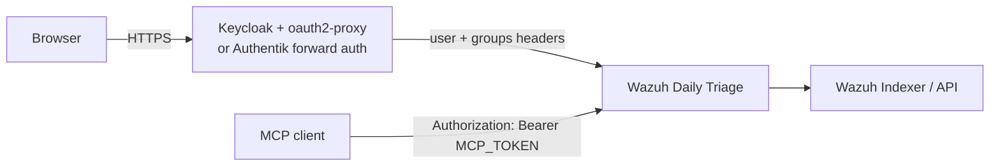

# SSO proxy authentication (Keycloak, Authentik, oauth2-proxy)

The application ships its own password login, but it can also run **behind an authenticating reverse proxy**.
In that mode the proxy proves who the user is, forwards the user name and the user's groups in headers, and the
application stops asking for a password. Since 0.11 the **groups decide the role**: members of
`SSO_ADMIN_GROUPS` are administrators, members of `SSO_VIEWER_GROUPS` are read-only viewers, everyone else gets
`SSO_DEFAULT_ROLE` (see [Roles from groups](#roles-from-groups-011)).

> **This is a trust boundary, not a feature toggle.** With `AUTH_DISABLED=true` the application believes the
> user and group headers of every request that reaches it. If the proxy can be bypassed, anyone who can reach the
> pod can name themselves and pick an administrator group. Always combine SSO with a NetworkPolicy or host
> firewall that allows only the proxy, and set `TRUSTED_PROXIES` or `PROXY_SECRET`.



## What changes in the application

| Setting | Value | Why |
|---|---|---|
| `AUTH_DISABLED` | `true` | Do not require the app session; trust the proxy. |
| `COOKIE_SECURE` | `true` | Still checked in production; the login cookie must be HTTPS-only. |
| `FORWARDED_ALLOW_IPS` | proxy IP or pod CIDR | Uvicorn may only trust forwarded headers from the proxy. Never `*`. |
| `USER_HEADER` | optional | Header order to read the user name from. Defaults: `X-authentik-username,X-Forwarded-User,Remote-User,X-Auth-Request-User`. |
| `SSO_ADMIN_GROUPS` | e.g. `wazuh-admins` | Groups whose members are administrators. Without it nobody is (a startup warning says so). |
| `SSO_VIEWER_GROUPS` | e.g. `soc,auditors` | Groups whose members are read-only viewers. |
| `SSO_DEFAULT_ROLE` | `viewer`, `deny` or `admin` | Everyone in neither list. Default: `viewer`, or `deny` when `SSO_VIEWER_GROUPS` is set. |
| `GROUP_HEADER` | optional | Headers to read the groups from. Defaults: `X-authentik-groups,X-Forwarded-Groups,X-Auth-Request-Groups,Remote-Groups`. |
| `APP_PASSWORD` | can be empty | Not used for authorization in this mode. |
| `APP_SECRET` | set it anyway | Keeps any app session valid across restarts; harmless behind SSO. |

In production, `AUTH_DISABLED=true` produces a startup **warning** (not an error) and skips the
`APP_PASSWORD`/`APP_SECRET` checks. The network restriction is your responsibility.

The audit trail records the proxy user as the actor and the role the groups gave them (`admin` or `viewer`);
every state-changing request, denial and rule deployment is written with that name.

## Roles from groups (0.11)

| The user is in | Role | May |
|---|---|---|
| a group of `SSO_ADMIN_GROUPS` | administrator | everything: run checks, decide, edit the knowledge base, deploy rules, settings |
| a group of `SSO_VIEWER_GROUPS` (and no admin group) | viewer | read every page of the environments `VIEWER_ENVS` allows; no button that changes something works |
| neither | `SSO_DEFAULT_ROLE` | `viewer` (default), `admin`, or `deny`: the request is refused with 403 "no role" |

```sh
AUTH_DISABLED=true
SSO_ADMIN_GROUPS=wazuh-admins
SSO_VIEWER_GROUPS=soc,auditors        # with this set, everyone else is refused (SSO_DEFAULT_ROLE=deny)
TRUSTED_PROXIES=10.42.0.0/16          # your ingress controller's pod CIDR
```

- Group names are compared without case, and a leading `/` is ignored, so the Keycloak full path `/wazuh-admins`
  matches `wazuh-admins`. Several groups in one header may be separated by `|` (Authentik) or `,` (oauth2-proxy).
- An administrator group wins over a viewer group.
- The role is decided on every request; a group change in the identity provider applies as soon as the proxy
  forwards it (for oauth2-proxy: at the next session refresh).
- The sidebar shows the user name and the role; viewers see a **read-only** badge, and the same permission matrix
  as [Viewer mode](Viewer-Mode) applies on the server.

> **Upgrading from 0.10:** before 0.11 every SSO user was an administrator. Now an SSO user without an
> administrator group is a viewer. Set `SSO_ADMIN_GROUPS` before you upgrade, or `SSO_DEFAULT_ROLE=admin` to keep
> the old behaviour for a while (startup warns about it).

### Which header carries the groups

| Proxy | Header | Needed in the proxy configuration |
|---|---|---|
| Authentik forward auth (Traefik, nginx outpost) | `X-authentik-groups` (`a|b|c`) | `X-authentik-groups` in `authResponseHeaders` (the shipped component has it) |
| oauth2-proxy, reverse-proxy mode (`--pass-user-headers`) | `X-Forwarded-Groups` | a `groups` claim in the token |
| oauth2-proxy behind ingress-nginx / Traefik forward auth (`--set-xauthrequest`) | `X-Auth-Request-Groups` | `X-Auth-Request-Groups` in `auth-response-headers` / `authResponseHeaders` |
| Other proxies | `Remote-Groups`, or any header named in `GROUP_HEADER` | – |

The proxy must overwrite or remove these headers when a client sends them, exactly like the user header.

## Prerequisites (do not skip)

1. **Network isolation.** Only the ingress controller / proxy may reach port 8080. Use the
   `networkpolicy` component (Kubernetes), a Docker network with only the proxy attached, or a host firewall.
2. **Strip client-supplied identity headers.** The proxy must *overwrite or remove* the user headers
   (`X-authentik-username`, `X-Forwarded-User`, `Remote-User`, `X-Auth-Request-User`) and the group headers
   (`X-authentik-groups`, `X-Forwarded-Groups`, `X-Auth-Request-Groups`, `Remote-Groups`) coming from the client.
   Otherwise a client could choose its own name and an administrator group.
3. **TLS everywhere.** `COOKIE_SECURE=true`; never expose the app directly over HTTP.
4. **Keep probes public.** `/healthz` and `/readyz` are unauthenticated in the app, but the proxy must also let
   the kubelet reach them, or use `httpGet` probes directly against the pod.
5. **Decide about `/login`.** It remains reachable; you can block it at the proxy if SSO is the only allowed
   way in.

## Option 1 — Keycloak with oauth2-proxy

Keycloak itself is an OIDC provider; the forward-auth layer is **oauth2-proxy** (or an equivalent). This works
with both ingress-nginx and Traefik.

### 1. Keycloak client

Create a confidential client:

- Client ID: `wazuh-triage`
- Client authentication: **on**
- Standard flow: **on**
- Valid redirect URI: `https://triage.example.com/oauth2/callback`
- Web origins: `https://triage.example.com`

Add a **group claim**, so the application can tell administrators from viewers: *Client scopes →
wazuh-triage-dedicated → Add mapper → By configuration → Group Membership*, token claim name `groups`,
"Full group path" on or off (both work), "Add to ID token" and "Add to userinfo" on.

### 2. oauth2-proxy

```yaml
# Deployment args (excerpt)
- --provider=keycloak-oidc
- --oidc-issuer-url=https://keycloak.example.com/realms/REALM
- --client-id=wazuh-triage
- --client-secret=$(OAUTH2_PROXY_CLIENT_SECRET)
- --redirect-url=https://triage.example.com/oauth2/callback
- --cookie-secret=$(OAUTH2_PROXY_COOKIE_SECRET)   # 32 random bytes, base64
- --cookie-secure=true
- --email-domain=*
- --reverse-proxy=true
- --set-xauthrequest=true          # emits X-Auth-Request-User and X-Auth-Request-Groups
- --oidc-groups-claim=groups       # the claim the Keycloak mapper writes
- --skip-auth-route=POST=^/mcp$    # only if you use the MCP server
```

`--set-xauthrequest=true` is what makes `<proxy>/oauth2/auth` return `X-Auth-Request-User` and
`X-Auth-Request-Groups`; without it the application sees no actor name (`proxy-user`) and no groups (everyone gets
`SSO_DEFAULT_ROLE`).

### 3. ingress-nginx

```yaml
metadata:
  annotations:
    nginx.ingress.kubernetes.io/auth-url: "https://oauth2.example.com/oauth2/auth"
    nginx.ingress.kubernetes.io/auth-signin: "https://oauth2.example.com/oauth2/start?rd=$scheme://$host$escaped_request_uri"
    nginx.ingress.kubernetes.io/auth-response-headers: "X-Auth-Request-User,X-Auth-Request-Email,X-Auth-Request-Groups"
```

The `auth-response-headers` annotation is required; without it nginx authenticates the request but does not
pass the user name and groups to the application.

### 3′. Traefik instead of nginx

```yaml
apiVersion: traefik.io/v1alpha1
kind: Middleware
metadata:
  name: oauth2-proxy
spec:
  forwardAuth:
    address: http://oauth2-proxy.auth.svc.cluster.local/oauth2/auth
    trustForwardHeader: true
    authResponseHeaders:
      - X-Auth-Request-User
      - X-Auth-Request-Email
      - X-Auth-Request-Groups
```

Attach the middleware to the `IngressRoute` for the application. Add a second, higher-priority route for
`Path('/mcp')` **without** this middleware (see [MCP](MCP#behind-a-proxy)).

### 4. Application

```sh
AUTH_DISABLED=true
COOKIE_SECURE=true
FORWARDED_ALLOW_IPS=10.0.0.0/8        # your ingress controller's pod CIDR
TRUSTED_PROXIES=10.0.0.0/8
SSO_ADMIN_GROUPS=wazuh-admins         # Keycloak group names, with or without the leading /
SSO_VIEWER_GROUPS=soc
```

Restart, then log out of Keycloak and back in: the sidebar shows your name and role.

## Option 2 — Authentik forward auth (Traefik)

Authentik's **embedded outpost** can act as a forward-auth server. The repository ships a ready component:
[`deploy/kubernetes/components/ingress-traefik-authentik`](https://github.com/dururustem68/wazuh-daily-triage/blob/main/deploy/kubernetes/components/ingress-traefik-authentik).

### 1. Authentik

1. Create a **Proxy provider** (forward auth / single application) with external host
   `https://triage.example.com`.
2. Create an **application** bound to that provider. Bind it to every group that may use the triage UI —
   administrators and viewers — and put their names into `SSO_ADMIN_GROUPS` / `SSO_VIEWER_GROUPS`.
3. Assign the application to the embedded outpost (or a dedicated outpost) in the same namespace as your
   Traefik instance.

### 2. Traefik middleware and routes

The component contains the full file; the essential parts:

```yaml
apiVersion: traefik.io/v1alpha1
kind: Middleware
metadata:
  name: authentik
spec:
  forwardAuth:
    address: http://authentik-server.authentik.svc.cluster.local/outpost.goauthentik.io/auth/traefik
    trustForwardHeader: true
    authResponseHeaders:
      - X-authentik-username
      - X-authentik-groups
      - X-authentik-email
      - X-authentik-name
      - X-authentik-uid
---
apiVersion: traefik.io/v1alpha1
kind: IngressRoute
metadata:
  name: wazuh-daily-triage
spec:
  routes:
    - kind: Rule
      match: Host(`triage.example.com`)
      middlewares:
        - name: authentik
      services:
        - name: wazuh-daily-triage
          port: 8080
    # Authentik's own sign-in / callback endpoints
    - kind: Rule
      match: Host(`triage.example.com`) && PathPrefix(`/outpost.goauthentik.io/`)
      priority: 1000
      services:
        - name: authentik-server
          namespace: authentik
          port: 80
    # MCP has its own bearer token; no Authentik middleware here
    - kind: Rule
      match: Host(`triage.example.com`) && Path(`/mcp`)
      priority: 900
      services:
        - name: wazuh-daily-triage
          port: 8080
  tls:
    secretName: triage-tls
```

Enable it in your overlay:

```yaml
components:   # remote, pinned — or copy the folders next to your overlay to edit the host names
  - https://github.com/dururustem68/wazuh-daily-triage//deploy/kubernetes/components/networkpolicy?ref=v0.11.0
  - https://github.com/dururustem68/wazuh-daily-triage//deploy/kubernetes/components/ingress-traefik-authentik?ref=v0.11.0
```

The component already sets `AUTH_DISABLED=true`, `COOKIE_SECURE=true` and `NOTIFY_UI_URL` (edit the host). Add
`FORWARDED_ALLOW_IPS` (your Traefik pod CIDR) to the overlay's environment ConfigMap yourself. Cross-namespace service references need Traefik's
`--providers.kubernetescrd.allowCrossNamespace=true`; otherwise add an `ExternalName` service in the app
namespace.

> Authentik also ships an **nginx proxy outpost**. The header names are the same
> (`X-authentik-username`, …); if you use it, keep `auth-response-headers` in the nginx config so the name
> reaches the application.

## Verify the setup

```sh
# 1. Unauthenticated request is redirected to the IdP
curl -sI https://triage.example.com/ | head -n 3

# 2. Sign in through the browser, open the app and start a run.

# 3. The audit trail records the proxy user, not "ui"
tail -n 5 logs/audit.jsonl

# 4. The pod is NOT reachable directly (run from another namespace / host)
curl -m 3 http://<pod-ip>:8080/healthz     # should time out or be refused
```

A direct request that succeeds — or that can set `X-authentik-username` itself — means the deployment is
effectively unauthenticated. Fix the network policy before exposing it.

## Troubleshooting

| Symptom | Cause and fix |
|---|---|
| Redirect loop between proxy and IdP | Wrong `--redirect-url` / Keycloak redirect URI, `--cookie-secure=true` over HTTP, or the proxy is not sending `X-Forwarded-Proto`. |
| App still shows its own login page | `AUTH_DISABLED` is not `true` (only `true`, `1` and `yes` are accepted), or the environment change was not applied to the running pod. |
| App answers `401 not authenticated` | Same as above: the app is still requiring a session because `AUTH_DISABLED` is off. |
| Audit actor is `proxy-user` | The identity header is missing or has a different name. Set `USER_HEADER` or forward `X-Auth-Request-User` / `X-authentik-username`. |
| Everyone is read-only after the upgrade | No group header arrives, or `SSO_ADMIN_GROUPS` is not set. Forward `X-authentik-groups` / `X-Auth-Request-Groups`, and set the group names. |
| `403` "no role in this application" | `SSO_VIEWER_GROUPS` is set and the user is in none of the listed groups (`SSO_DEFAULT_ROLE=deny`). Add the user to a group, or set `SSO_DEFAULT_ROLE=viewer`. |
| An administrator sees the read-only badge | The group name differs (spelling, a prefix). Compare with the header the proxy sends; case and a leading `/` do not matter. |
| `/mcp` returns `401` behind the proxy | The proxy strips `Authorization`; add the skip route (`POST=^/mcp$`) or a middleware-free `/mcp` route. |
| `/mcp` returns `404` | `MCP_TOKEN` is not set; that is the intended “disabled” answer. See [MCP](MCP). |
| Probes fail after enabling SSO | The proxy intercepts `/healthz`/`/readyz`. Let those paths through, or point the probe at the pod. |
| Logout does not end the SSO session | The app's `/logout` only clears its own cookie. Use the IdP/proxy logout, or hide the app logout button. |

## Limitations to plan around

- **Two roles only.** A group maps to administrator or viewer; there is no finer role (for example "may decide
  but not deploy").
- **Environment scoping is per role, not per user.** `ADMIN_ENVS` applies to all SSO administrators,
  `VIEWER_ENVS` to all SSO viewers.
- **The app does not see the IdP session.** It only sees the header on each request; a revoked IdP session is
  honoured only as long as the proxy checks it.
- **The header is the identity.** There is no signature on it — the network path is the control.

---

[English](SSO-Proxy-Auth) · [Türkçe](SSO-Proxy-Auth-TR)

## Verifying that requests come from the proxy (0.10)

With `AUTH_DISABLED=true` the application believes whoever reaches it. Three settings make that mean "the proxy":

| Variable | Effect |
|---|---|
| `SSO_REQUIRE_USER` (default `true`) | A request without one of the `USER_HEADER` headers is refused with 401. |
| `TRUSTED_PROXIES` | Addresses/CIDRs of the proxy. Other peers get 403, and `X-Forwarded-For` from these peers is used for the audit trail. |
| `PROXY_SECRET` | The proxy must add the header `X-WDT-Proxy-Secret` with this value. |

`/healthz`, `/readyz`, `/mcp` (own token) and `/metrics` with `METRICS_TOKEN` are not affected. Keep the
NetworkPolicy: these checks complement it, they do not replace it.
