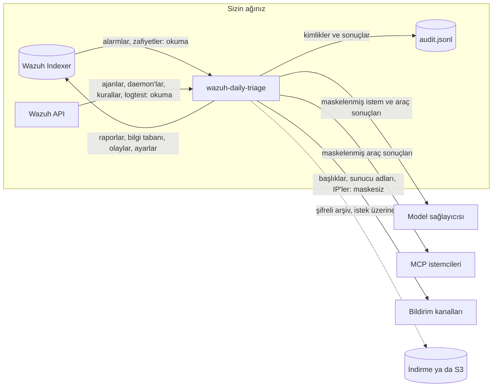

# Güvenlik modeli ve veri akışı

**Kimin için:** güvenlik sorumluları, veri koruma görevlileri, denetçiler ve "bu araç ne yapabilir, verimiz
nereye gider?" sorusunu cevaplaması gereken operatörler. Hesap yetkilerinin tam listesi
[docs/permissions.md](https://github.com/dururustem68/wazuh-daily-triage/blob/main/docs/permissions.md)
belgesindedir; bu sayfa genel bakıştır.

## Varsayılan duruş

- **Wazuh'a karşı salt okunur.** Active response yok, yapılandırma yazımı yok, ajan komutu yok. İndekse yazma
  yalnız uygulamanın kendi `<storage_prefix>-*` indekslerine yapılır (varsayılan `daily-triage-*`).
- **Model okur ve önerir, başka bir şey yapmaz.** Araçları, yapılandırılmış sınırlar içindeki okuma
  sorgularıdır. Kabuğu ve HTTP istemcisi yoktur. Bilgi tabanına yaptığı öneri, bir kişi onaylayana kadar
  hiçbir şeyi değiştirmez.
- **İsteğe bağlı tek yazma yolu.** Kural dağıtımı varsayılan olarak kapalıdır. Açıldığında ayrı bir Wazuh API
  kullanıcısı kullanır ve tek bir kural dosyasına yazar. Bkz. [Kural yaşam döngüsü](Rule-Lifecycle-TR).
- **Üretim modu güvensiz ayarı reddeder.** `ENVIRONMENT=production` ile süreç; örnek ya da eksik parola, eksik
  `APP_SECRET`, güvensiz çerez, kapatılmış TLS doğrulaması, demo anahtarı ya da kimlik bilgisi olmayan kural
  dağıtımıyla açılmaz.

## Salt okunur varsayılan ile kural dağıtımı arasındaki sınır

| | Varsayılan | `rule_deploy.enabled: true` ile |
|---|---|---|
| Wazuh API kullanıcısı | salt okunur `daily-triage` | salt okunur kullanıcı ve ayrı bir `daily-triage-deploy` kullanıcısı |
| Manager'a yazma | yok | tek dosya, `etc/rules/<rule_deploy.file>`, ve manager ya da cluster yeniden başlatması |
| Yazmayı kim tetikler | kimse | **Approve and deploy** ya da **Remove from Wazuh** düğmesine basan yönetici; model ya da zamanlayıcı asla |
| Kural taslakları | metin ve kopyala-yapıştır komutları | aynısı, ayrıca doğrulama ve otomatik geri almayla tek tık dağıtım |
| Ek onay | – | alarmı susturan ya da seviyesini düşüren taslaklarda kural ID'leri yazılır |

Bir sınır Wazuh'un kendisinden gelir: `rules:update` yetkisi tek dosyayla kısıtlanamaz; dolayısıyla dağıtım
kullanıcısı API üzerinden herhangi bir özel kural dosyasının üzerine *yazabilir*. Uygulama yalnız kendi
dosyasına yazar. Bu hesabı ayrı tutun, parolasını bir secret içinde saklayın.

## Veri nereye gider



| Veri | Nereye gider | Nerede, ne kadar tutulur | Sizin kontrolünüz |
|---|---|---|---|
| Alarmlar ve zafiyet durumları | bir koşu için Indexer'dan belleğe okunur | bütün olarak kopyalanmaz; koşu belgesi toplanan özeti tutar: sayılar, gruplar, örnek satırlar | indeks desenleri, Indexer rolü |
| Ajan ve daemon durumu, kural tanımları, logtest sonuçları | Wazuh API'den okunur | ilgili olduğu yerde koşu belgesinde | API rolü; API isteğe bağlıdır |
| Koşu belgesi: pencere, toplanan özet, bulgular, sorular, ölçümler, modelin araç çağrıları (ad, argümanlar, her sonucun ilk 300 karakteri) | **sizin** Indexer'ınızdaki `<önek>-runs` | süresiz ya da `run_retention_days` | saklama süresi; o indeksi kimin okuyabildiği |
| Bilgi tabanı, kararlar, kural taslakları | `<önek>-knowledge` | hiç silinmez | [Yedekleme](Backup-TR) |
| Nöbet olayları ve hükümler; ayarlar | `<önek>-events` (180 gün), `<önek>-settings` | belirtildiği gibi | `backup.keep_events_days` |
| İstem: ortam bilgisi dosyanız, bilgi tabanı, toplanan özet, her araç sonucu | yapılandırdığınız model sağlayıcısı | o sağlayıcının koşullarına göre | maskeleme (varsayılan açık), `ips`, `kinds`, `allow`, yerel model, ortam başına model |
| MCP istemcisi için araç sonuçları | o istemci ve arkasındaki model | o istemcinin koşullarına göre | `MCP_TOKEN`, `MCP_ENVS`, aynı maskeleme |
| Bildirimler: ortam adı, bulgu başlıkları, sunucu adları, IP adresleri | yapılandırdığınız kanallar | o sistemlerde | hangi kanal, hangi olay; **maskelenmez** |
| Denetim izi: kim, ne, hangi ortam, sonuç | uygulamanın biriminde `logs/audit.jsonl` | 20 MB'ta döner, üç kuşak | merkezi depolamaya gönderin |
| Uygulama logu: istekler, hatalar, araç adları ve argümanları (kısaltılmış) | konteynerin stdout'u | log platformunuz | bir süzgeç log satırlarından kimlik bilgilerini çıkarır; logu iç veri sayın |
| Yedek arşivi: bilgi tabanı, raporlar, nöbet olayları, ayarlar | indirme ya da tanımladığınız S3 kovası | sakladığınız yerde | parolanızla şifrelenir; kimlik bilgisi ve araç çağrısı izi içermez |
| Ölçümler | `/metrics` | bellekte, yeniden başlatmada sıfırlanır | yalnız sayaçlar, alarm içeriği yok |

Gözden kaçması kolay iki nokta:

- **Raporlarda gerçek değerler durur.** Maskeleme modele giden sınırda uygulanır. Kurulumunuzun içinde rapor,
  öneri kutusu ve saklanan araç çağrısı izi gerçek e-posta adresini ya da IP'yi gösterir, çünkü inceleyen
  kişinin buna ihtiyacı vardır. Arayüzü ve `<önek>-*` indekslerini buna göre koruyun.
- **Maskeleme takma adlandırmadır, DLP değildir.** Serbest metindeki kişi adları ve e-posta biçiminde olmayan
  kullanıcı adları algılanmaz. Düzenlemeye tabi veride maskelemeyi yerel modelle ya da veri işleme sözleşmesi
  olan bir sağlayıcıyla birlikte kullanın. Ayrıntı ve sınırlar: [Gizlilik](Privacy-TR).

## Uygulamadaki kontroller

| Katman | Etkisi |
|---|---|
| Açılış denetimleri | üretim modu yukarıdaki güvensiz ayarlarda durur; her ileti değişkenin adını verir |
| Kimlik doğrulama | parola ve imzalı `HttpOnly`, `SameSite=Strict` çerez, giriş denemesi sınırı; ya da grup başlığı rolü belirleyen bir SSO proxy ([SSO proxy kimlik doğrulama](SSO-Proxy-Auth-TR)) |
| Yetkilendirme | iki rol (yönetici, salt okunur görüntüleyici), yetki matrisi ve isteğe bağlı rol başına ortam listesi; her rota için sunucu tarafında denetlenir ([Görüntüleyici modu](Viewer-Mode-TR)) |
| Sorgu sınırları | alan izin listesi; zaman aralığı, kova ve belge sayısı sınırı; alarm içine yerleştirilmiş metin keyfi ya da pahalı bir sorguya dönüşemez |
| İstem enjeksiyonu | alarm içeriği istemde veri olarak işaretlenir; kandırılmış bir model bile yalnız bir kişiyi bekleyen bir öneri ekleyebilir |
| Dağıtım kapısı | doğrulama, yeniden başlatma, kuralın yüklenmesi ve logtest denetlenir; herhangi bir hata değişikliği geri alır |
| Web sertleştirmesi | satır içi betiksiz CSP, model çıktısı HTML kapalı markdown olarak gösterilir, `nosniff`, `X-Frame-Options: DENY` |
| Konteyner | root olmayan kullanıcı, salt okunur kök dosya sistemi, bütün yetenekler düşürülmüş |

## Denetim izi: neyi kanıtlar, neyi kanıtlamaz

`logs/audit.jsonl` yalnız sona eklenen bir JSON Lines dosyasıdır. Her kayıt bir önceki kaydın SHA-256 özetini
taşır.

**Kaydedilenler:** girişler ve başarısız girişler, reddedilen istekler (ortam kapsamı dahil), durumu
değiştiren her HTTP isteği, bulgu kararları, bilgi tabanı ve ayar değişiklikleri, geri alma sonucuyla birlikte
kural dağıtımları ve kaldırmaları, yedek dışa ve içe aktarımları, MCP üzerinden gelen bilgi önerileri. Kayıtlar
kimlik ve sonuç tutar; parola, belirteç ya da ham log satırı tutmaz.

**Ortaya çıkardığı:** bir dosya içinde değiştirilen, araya eklenen ya da silinen kayıt.

```sh
docker compose exec triage python -c "from app import auditlog; print(auditlog.verify('logs/audit.jsonl'))"
```

**Tek başına engellemediği ve ortaya çıkarmadığı:**

- Dosyanın tümünün silinmesi ya da en yeni kayıtların kesilmesi. Birime yazabilen biri ikisini de yapabilir.
  Dosyayı merkezi ya da bir kez yazılır depolamaya gönderin ve karşılaştırın.
- Okuma erişimi. Bir raporun okunması kaydedilmez; yalnız durum değişiklikleri ve reddedilen istekler
  kaydedilir.
- Ortak parolanın kime ait olduğu. `APP_PASSWORD` ile aktör roldür. Kişisel hesap verebilirlik için öne SSO
  koyun; o zaman proxy'nin ilettiği kullanıcı adı kaydedilir.

Dönen her kuşak kendi başına bir zincirdir; gönderdiğiniz her dosyayı ayrı doğrulayın. Kubernetes'te varsayılan
birim `emptyDir`'dir: kayıtlar, gönderilmedikçe ya da kalıcı birim bağlanmadıkça pod ile birlikte kaybolur.

## MCP sunucusu

`MCP_TOKEN` tanımlanmadıkça kapalıdır. Yerleşik yapay zekânın okuma araçlarını ve yalnız öneri oluşturan
`propose_knowledge` aracını sunar. Wazuh'u değiştiren, kural dağıtan ya da bilgi tabanını düzenleyen bir araç
yoktur. `MCP_ENVS` ortamları sınırlar, sonuçlar modelinkiler gibi maskelenir ve istekler istemci başına hız
sınırına tabidir. Nöbet olayları MCP'ye açık değildir. Bkz. [MCP sunucusu](MCP-TR).

## Aylık denetim raporu ve ISO 27001

Aylık rapor deterministiktir (yapay zekâ yok) ve alarm hacmini, koşuları, bulguları ve kararları, kural
değişikliklerini, SIEM kesintilerini, ajan kapsamını ve zafiyet SLA'sını listeler. İzleme faaliyetinin gözden
geçirilmesinde destekleyici kanıttır. Bir **uygunluk beyanı değildir**: bir kuruluşu ya da bu yazılımı
ISO 27001 uyumlu ya da sertifikalı yapmaz ve yalnız bu uygulamanın o dönemde gözlemleyip kaydettiklerini
kapsar.

## Güvenlik açığı bildirimi

Özel olarak,
[GitHub güvenlik bildirimleri](https://github.com/dururustem68/wazuh-daily-triage/security/advisories/new)
üzerinden. Bilinçli istisnalar ve kabul edilmiş riskler
[docs/security-exceptions.md](https://github.com/dururustem68/wazuh-daily-triage/blob/main/docs/security-exceptions.md)
belgesindedir.

Ayrıca: [Güvenlik kontrol listesi](Security-Checklist-TR) · [Gizlilik](Privacy-TR) ·
[Kural yaşam döngüsü](Rule-Lifecycle-TR)

*0.11.0 için geçerlidir · gözden geçirme: 2026-11-11*

---

[English](Security-Model) · [Türkçe](Security-Model-TR)
