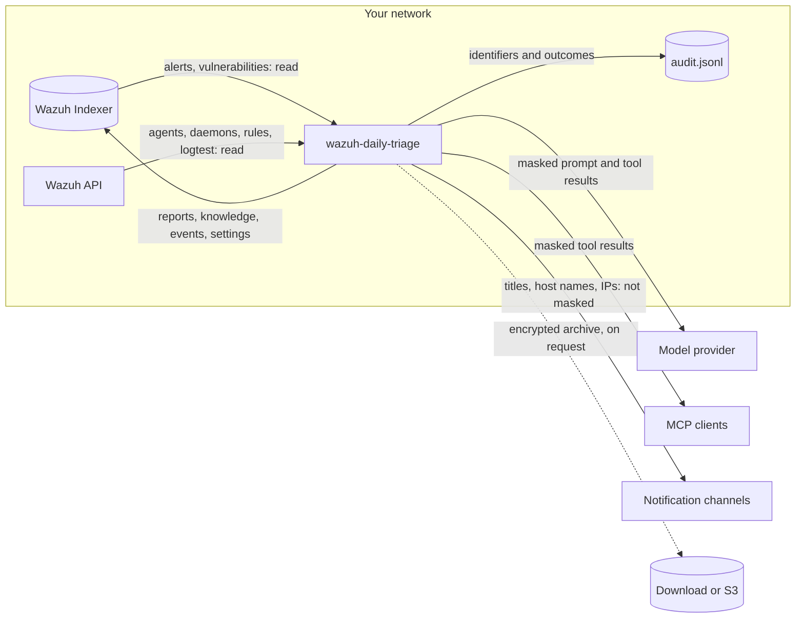

# Security model and data flow

**For:** security leads, DPOs, auditors, and operators who must answer "what can this tool do, and where does
our data go?". The exact account permissions are in
[docs/permissions.md](https://github.com/dururustem68/wazuh-daily-triage/blob/main/docs/permissions.md); this page
is the overview.

## The default posture

- **Read-only towards Wazuh.** No active response, no configuration writes, no agent commands. The only index
  writes go to the application's own `<storage_prefix>-*` indices (default `daily-triage-*`).
- **The model can read and propose, nothing else.** Its tools are read queries inside configured limits. It has
  no shell and no HTTP client. A proposal for the knowledge base does nothing until a person approves it.
- **One optional write path.** Rule deployment is off by default. When switched on it uses a separate Wazuh API
  user and writes one dedicated rules file. See [Rule lifecycle](Rule-Lifecycle).
- **Production refuses unsafe settings.** With `ENVIRONMENT=production` the process does not start with an
  example or missing password, a missing `APP_SECRET`, insecure cookies, disabled TLS verification, the demo
  switch, or rule deployment without credentials.

## Read-only by default, and where the line is

| | Default | With `rule_deploy.enabled: true` |
|---|---|---|
| Wazuh API user | read-only `daily-triage` | the read-only user, plus a separate `daily-triage-deploy` user |
| Writes to the manager | none | one file, `etc/rules/<rule_deploy.file>`, and a manager or cluster restart |
| Who triggers a write | nobody | an administrator pressing **Approve and deploy** or **Remove from Wazuh**; never the model, never a schedule |
| Rule drafts | text plus copy-paste commands | the same, plus one-click deployment with validation and automatic rollback |
| Extra confirmation | – | drafts that silence or lower alerts need the rule IDs typed |

One limit comes from Wazuh itself: the `rules:update` permission cannot be restricted to one file, so the deploy
user *could* overwrite any custom rules file through the API. The application only ever writes its own file.
Keep that account separate and its password in a secret.

## Where data goes



| Data | Goes to | Kept where, how long | Your control |
|---|---|---|---|
| Alerts and vulnerability states | read from the Indexer into memory for a run | not copied as a whole; the run document keeps the collected summary: counts, groups, sample lines | index patterns, the Indexer role |
| Agent and daemon status, rule definitions, logtest results | read from the Wazuh API | in the run document where relevant | the API role; the API is optional |
| Run document: window, collected summary, findings, questions, metrics, the model's tool calls (name, arguments, the first 300 characters of each result) | `<prefix>-runs` in **your** Indexer | forever, or `run_retention_days` | retention; who may read that index |
| Knowledge base, decisions, rule drafts | `<prefix>-knowledge` | never pruned | [Backup](Backup) |
| Watch events and verdicts; settings | `<prefix>-events` (180 days), `<prefix>-settings` | as stated | `backup.keep_events_days` |
| Prompt: your context file, the knowledge base, the collected summary, every tool result | the model provider you configured | under that provider's terms | masking (on by default), `ips`, `kinds`, `allow`, a local model, a per-environment model |
| Tool results for an MCP client | that client and the model behind it | under that client's terms | `MCP_TOKEN`, `MCP_ENVS`, the same masking |
| Notifications: environment name, finding titles, host names, IP addresses | the channels you configured | in those systems | which channels, which events; **not masked** |
| Audit trail: who, what, which environment, result | `logs/audit.jsonl` on the app's volume | rotated at 20 MB, three generations | ship it to central storage |
| Application log: requests, errors, tool names and their arguments (truncated) | stdout of the container | your log platform | a filter removes credentials from log lines; treat the log as internal |
| Backup archive: knowledge, reports, watch events, settings | a download, or the S3 bucket you defined | where you keep it | encrypted with your passphrase; contains no credentials and no tool-call trace |
| Metrics | `/metrics` | in memory, reset on restart | counters only, no alert content |

Two points that are easy to miss:

- **Reports hold real values.** Masking applies at the boundary to the model. Inside your installation, the
  report, the inbox and the stored tool-call trace show the real e-mail address or IP, because the reviewer
  needs them. Protect the UI and the `<prefix>-*` indices accordingly.
- **Masking is pseudonymisation, not DLP.** Personal names in free text and usernames that are not e-mail
  addresses are not detected. For regulated data combine masking with a local model or a provider under a
  data-processing agreement. Details and limits: [Privacy](Privacy).

## Controls in the application

| Layer | Effect |
|---|---|
| Startup checks | production mode stops on the unsafe settings listed above; every message names the variable |
| Authentication | password and a signed `HttpOnly`, `SameSite=Strict` cookie with login throttling; or an SSO proxy whose group header decides the role ([SSO proxy authentication](SSO-Proxy-Auth)) |
| Authorization | two roles, admin and read-only viewer, with a permission matrix and optional per-role environment lists; enforced on the server for every route ([Viewer mode](Viewer-Mode)) |
| Query guard | field allow-list, capped time range, bucket and document counts; injected text in an alert cannot become an arbitrary or expensive query |
| Prompt injection | alert content is marked as data in the prompt; even a fooled model can only add a proposal that waits for a person |
| Deploy gate | validation, restart, rule-loaded check and logtest are verified; any failure rolls the change back |
| Web hardening | CSP without inline scripts, model output rendered as markdown with HTML disabled, `nosniff`, `X-Frame-Options: DENY` |
| Container | non-root, read-only root filesystem, all capabilities dropped |

## The audit trail: what it proves and what it does not

`logs/audit.jsonl` is an append-only JSON Lines file. Each record carries the previous record's SHA-256 hash.

**Recorded:** logins and failed logins, denials (including environment scope), every state-changing HTTP
request, finding decisions, knowledge changes, settings changes, rule deployments and removals with their
rollback outcome, backup exports and imports, knowledge proposals over MCP. Records hold identifiers and
outcomes; no passwords, tokens or raw log lines.

**Detects:** a record that was modified, inserted or removed inside a file.

```sh
docker compose exec triage python -c "from app import auditlog; print(auditlog.verify('logs/audit.jsonl'))"
```

**Does not prevent or detect by itself:**

- Deleting a whole file, or cutting off its newest records. Someone who can write to the volume can do both.
  Ship the file to central or write-once storage and compare.
- Read access. Reading a report is not recorded; only state changes and denials are.
- Who a shared password belongs to. With `APP_PASSWORD` the actor is the role. Use SSO in front for personal
  accountability; then the proxy's user name is recorded.

Each rotated generation is a chain of its own, so verify every file you ship. On Kubernetes the default volume
is an `emptyDir`: records disappear with the pod unless you ship them or mount a persistent volume.

## The MCP server

Off unless `MCP_TOKEN` is set. It offers the read tools of the built-in AI plus `propose_knowledge`, which only
creates a proposal. There is no tool that changes Wazuh, deploys a rule or edits the knowledge base. `MCP_ENVS`
limits the environments, results are masked like the model's, and requests are rate-limited per client. Watch
events are not exposed. See [MCP server](MCP).

## The monthly audit report and ISO 27001

The monthly report is deterministic (no AI) and lists alert volume, runs, findings and decisions, rule changes,
SIEM outages, agent coverage and vulnerability SLA. It is supporting evidence for a review of monitoring
activity. It is **not** a statement of conformity: it does not make an organisation or this software
ISO 27001 compliant or certified, and it only covers what this application observed and recorded in the period.

## Reporting a vulnerability

Privately, through
[GitHub security advisories](https://github.com/dururustem68/wazuh-daily-triage/security/advisories/new).
Deliberate overrides and accepted risks are listed in
[docs/security-exceptions.md](https://github.com/dururustem68/wazuh-daily-triage/blob/main/docs/security-exceptions.md).

See also: [Security checklist](Security-Checklist) · [Privacy](Privacy) · [Rule lifecycle](Rule-Lifecycle)

*Applies to 0.11.0 · reviewed 2026-11-11*

---

[English](Security-Model) · [Türkçe](Security-Model-TR)
