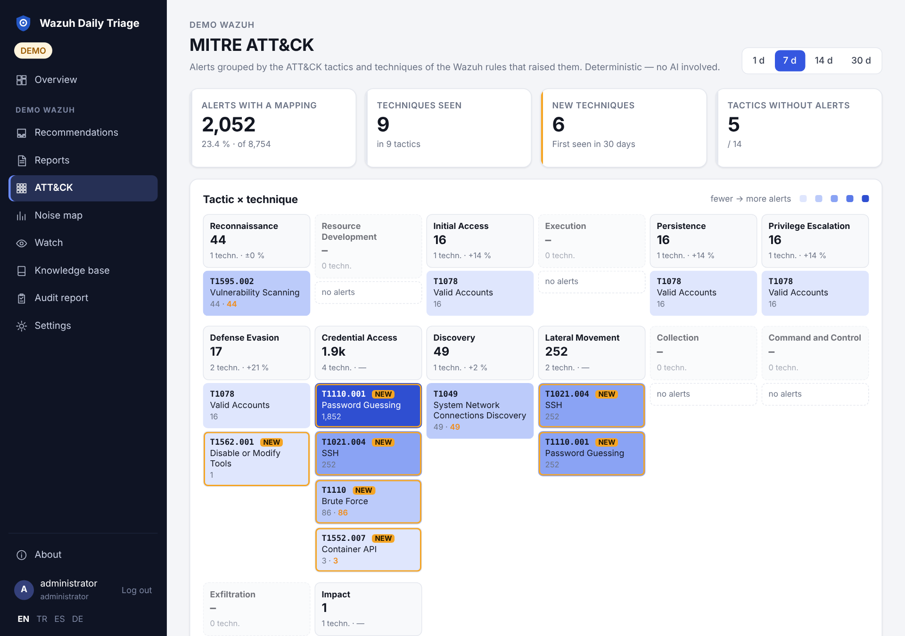

# Kullanıcı rehberi: günlük iş

**Kimin için:** raporları okuyan ve kararları veren kişi. Çalışan bir kurulum varsayılır
([Başlangıç](Getting-Started-TR)). Her bölüm aynı sırayı izler: amaç, nerede, nasıl kullanılır, ne beklenir,
güvenlik etkisi, çalışmazsa neye bakılır.

## Pano (dashboard)

**Amaç.** SIEM'in sağlıklı olup olmadığını, alarmların nasıl göründüğünü ve sizi neyin beklediğini tek sayfada
göstermek.

**Nerede.** Kenar çubuğunun en üstündeki **Genel bakış**; girişten sonraki ilk sayfadır. Kenar çubuğu
ortamlarınızı listeler; birini seçtiğinizde altındaki menü o ortamın sayfalarını açar.

**Ne gösterir** (sağ üstte seçtiğiniz dönem için: **24 saat**, **7 gün**, **30 gün**):

| Bölüm | Ne söyler |
|---|---|
| Ortam kutucukları (birden fazla ortam varsa) | ortam başına sağlık noktası, alarm sayısı, yüksek seviye sayısı ve küçük bir eğilim çizgisi; tıklayınca o ortama geçer |
| Durum satırı | son raporun sağlığı, canlılık kontrolü, son rapor ve sonraki zamanlanmış koşu |
| Ana göstergeler | alarmlar, yüksek seviye ve üstü alarmlar, kritik alarmlar (seviye 12+), her biri aynı uzunluktaki önceki döneme göre değişim ve eğilim çizgisiyle; alarmı olan ajanlar; bekleyen öneriler (acil olanlarla); açık sorular |
| Alarm hacmi | tüm alarmlar, yüksek seviye ve kritik bant zamana göre; kesin sayılar için bir noktanın üzerine gelin |
| Önem dağılımı | alarmların kritik (12–15), yüksek (sizin yüksek seviyeniz–11), orta ve düşük olarak dağılımı |
| MITRE ATT&CK taktikleri | 14 taktik; alarm arttıkça renk koyulaşır, küçük turuncu sayı yüksek seviyedeki alarmlardır. Bir taktiğe tıklayınca matris o taktiğe süzülmüş açılır |
| En sık kurallar, ajanlar, kaynak adresler | yüksek seviye hacmin nereden geldiği; çubuğun turuncu kısmı yüksek seviye payıdır |
| İş listesi | karar bekleyen öneriler, açık sorular, kural değişiklikleri, istekler ve açık maddeler |

Sayılar Indexer üzerindeki deterministik sorgulardan gelir (yapay zekâ yok) ve bir dakika önbellekte tutulur.
Yüksek ya da kritik göstergedeki kırmızı artış bakmaya değer; tek başına toplam alarm sayısı çoğu zaman gürültüyle
büyür.

**Güvenlik etkisi.** Panoyu okumak yalnız okuma yetkisi ister. **Şimdi kontrol et** yönetici rolü ister;
görüntüleyiciler düğmeyi pasif görür.

**Çalışmazsa.** "Sayılar yüklenemedi" uyarısı Indexer'ın cevap vermediğini gösterir; iş listesi saklanmış
raporları okuduğu için yine çalışır. Bkz. [Sorun giderme](Troubleshooting-TR).

## Günlük koşular

**Amaç.** Dönemi rapora dönüştüren AI turu.

**Nasıl çalışır.** Koşu, zamanlamaya göre (günde bir ya da birkaç kez, seçilebilir günlerde) ya da **Şimdi
kontrol et** düğmesiyle başlar. Zaman penceresi *son başarılı koşudan beri*dir; pazartesi koşusu hafta sonunu
kapsar ve hiçbir dönem iki kez incelenmez. Önceki rapor yoksa `window_min_hours` geçerlidir, uzun bir boşluğu
`window_max_hours` sınırlar. Ortamın **Raporlar** sayfasında sabit bir pencere de seçebilirsiniz (24 saat, 72 saat, 7 gün).

Her koşunun iki parçası vardır:

1. **Deterministik toplama**, modelden bağımsızdır: son alarm zamanı ve boş saatler, indexer sağlığı ve disk,
   manager daemon'ları, ajanlar, seviye dağılımı, yüksek seviyeli gruplar, önceki pencereyle karşılaştırma,
   14 günde ilk kez görülen kurallar, izlenen kurallar, zafiyetler.
2. **Yapay zekâ teşhisi**: model bu özeti ve bilgi tabanınızı okur, salt okunur araçlarla derine iner ve
   yapılandırılmış bir rapor teslim eder.

**Beklenen.** **Raporlar** altında yeni bir rapor, bir sağlık durumu (Sağlıklı, Uyarı, Kritik, Hata), öneri
kutusunda yeni öneriler ve belki size sorular.

**Güvenlik etkisi.** Koşu başlatmak yönetici rolü ister. Koşu Wazuh'tan yalnız okur.

**Çalışmazsa.** Zamanında rapor yoksa: konteyner o saatte çalışıyor olmalı, zamanlama açık olmalı ve `TZ`
doğru olmalı. Düğme "meşgul" diyorsa o ortam için bir koşu zaten sürüyordur. Devamı:
[Sorun giderme](Troubleshooting-TR).

## Rapor nasıl okunur

| Bölüm | Ne söyler |
|---|---|
| Özet | modelin birkaç satırlık sonucu; model başarısız olduysa sağlık bayraklarından üretilen deterministik bir özet, ve bunu belirtir |
| Altyapı | SIEM'in kendisi çalışıyor mu: indexer, disk, ajanlar, daemon'lar, sessizlik |
| Bulgular | konu başına bir kart: etiket, önem, kanıt, öneri, bazen kural taslağı |
| Asistanın soruları | yalnız sizin bilebileceğiniz şeyler ("bu giriş sizin miydi?") |
| Bilgi tabanı önerileri | modelin hatırlanmasını önerdikleri; onaylanana kadar etkisiz |
| Veri | arkadaki sayılar, deterministik sorgulardan |
| Toplama hataları (kör nokta) | başarısız olan sorgular; etkilenen bölüm boştur, bu "temiz" demek değildir |
| Yapay zekânın araç çağrıları | modelin hangi sorguları çalıştırdığı, izlenebilirlik için |

Bulgu etiketleri: *Gerçek olay*, *İncelenecek*, *Tespit boşluğu*, *Yanlış pozitif*, *Baseline artışı*,
*Ölçüm*, *Beklenen*, *Düzeltme*. Sağlık bilerek alarmlardan önce gelir: veri almayı bırakmış bir SIEM'den
gelen sakin rapor en kötü durumdur ve bunu altyapı bölümünde görürsünüz.

Kanıt desteklediğinde bulgular **ATT&CK etiketleri** taşır: `T1110.001` gibi teknik kimlikleri (attack.mitre.org'a
bağlanır) ve taktikler. Bunlar bulgunun arkasındaki kuralların `<mitre>` bloğundan, açıkça desteklendiğinde de
modelin kendi eşlemesinden gelir. Olayları gruplamak ve diğer ekiplerle ortak bir dille konuşmak için kullanın;
bir önem derecesi değildir.

Her bulguda ve soruda bir **Kopyala** düğmesi vardır; kanıtı, öneriyi ve komutları bilet, e-posta ya da
terminal için düz metin olarak panoya alır.

## Bulgular ve öneri kutusu

**Amaç.** Karar bekleyenleri, her raporu tek tek açmadan, sırayla geçmek.

**Nerede.** Menüde **Öneriler**.

**Nasıl kullanılır.**

1. Bulguyu ve kanıtını okuyun. *Sunucularda çalıştırılacak kontroller* varsa bunlar birebir, salt okunur
   komutlardır; kopyalayın, çalıştırın, çıktıyı kararınız için saklayın.
2. Durumu seçin: *Onaylandı / ilgileniliyor*, *Yanlış pozitif*, *Kapandı* ya da *Bilinen gürültü (baseline)*.
   Not ekleyin; sonraki koşu okur.
3. **Sonra**, karar vermeden bir sonrakine geçer.

**Beklenen.** Birkaç koşuda bulunan aynı konu bir kez görünür ve tek karar bütün tekrarlarını kapatır. Daha
sonraki bir bulgu, ancak büyük ölçüde aynı kurallarla ilgiliyse önceki kararla kapanır. *Bilinen gürültü
(baseline)* ayrıca bir bilgi tabanı kaydı oluşturur. Yedi günden uzun bekleyenler işaretlenir ve hafta içi bir
hatırlatma bunları listeleyebilir (`notify.on_pending`).

**Güvenlik etkisi.** Karar vermek yönetici rolü ister ve denetim izine yazılır. Görüntüleyici kutuyu okuyabilir
ama karar veremez.

## Bilgi tabanı

**Amaç.** Kurulumun hafızası. Her koşuda modele bağlam olarak verilir; ikinci haftanın birinciden iyi olmasının
nedeni budur.

| Tür | Ne için |
|---|---|
| Ortam bilgisi | ortamla ilgili gerçekler |
| Bilinen gürültü (baseline) | "tarayıcıdan gelen 31101 günde 6.000'e kadar normaldir" ve onu anormal yapacak koşul |
| Karar | "Jenkins'in İnternet'e kapatılmasını önerme; kabul edilmiş risk" |
| Açık madde | üzerinde hâlâ çalıştığınız bir konu |
| İstek / sonraki koşu için not | "yarın db01'deki SSH denemelerine yakından bak" |
| Öğrenilmiş ders | tekrarlanmaması gereken bir hata |
| Cevap | asistanın sorusuna verdiğiniz yanıt (kendiliğinden oluşur) |
| Kural taslağı | önerilen bir Wazuh kuralı; bkz. [Kural yaşam döngüsü](Rule-Lifecycle-TR) |

**Kararlar sonraki koşuları nasıl etkiler.**

- **Aktif** bir kayıt, sonraki her koşunun bağlamıdır: model bilinen gürültüyü olay diye raporlamayı ve
  reddettiğiniz şeyi önermeyi bırakır.
- Modelden (ya da bir MCP istemcisinden) gelen **öneri**, siz **Onayla** diyene kadar etkisizdir. **Reddet**,
  modele bunu bir daha önermemesini söyler.
- Aktif bir baseline kaydı, kritik olaylar dışında, [Nöbet](Watch-TR)'in o kural için bildirim göndermesini
  de durdurur.
- Bilgi tabanı saklama süresiyle hiç silinmez. Yedekleyin: [Yedekleme](Backup-TR).

Mevcut notlarınızı içe/dışa aktarma bölümünden (TXT, CSV ya da YAML şablonu, önizlemeli) ya da
`python -m app.kb` ile getirin; iki kez içe aktarmak yinelenen kayıt oluşturmaz. Biçimler:
[Özellikler](Features-TR).

**Güvenlik etkisi.** Bilgi tabanını değiştirmek yönetici rolü ister. Buraya yazdıklarınız her koşuda modele
gönderilir (her şey gibi maskelenerek); kimlik bilgisi saklamayın.

## Bir bulguyu inceleme

1. Bulgudaki kanıttan başlayın: kural, ajanlar, ilk ve son görülme, kaynak IP'ler, örnek satır.
2. Büyük resim için veri bölümüne bakın: bu kural yeni mi, hacmi değişti mi, o ajanda başka hangi kurallar
   tetiklendi.
3. Listelenmiş sunucu kontrolleri varsa çalıştırın.
4. Başka sorularınız için aynı salt okunur araçları kendi asistanınızdan [MCP](MCP-TR) üzerinden kullanın:
   alarm arama, bir kuralın zaman çizelgesi, IP profili, bir olayın ±30 dakikasındaki korelasyon, ajan ve kural
   bilgisi, logtest.
5. Sonucu durum ve notla kaydedin. Gerçek bir olaysa olay kaydı oluşturun (aşağıda).

Ek kaynaklar (Prometheus, Loki, Kubernetes) tanımlıysa model ve MCP, alarmın çevresindeki pod yeniden
başlatmalarını, OOM kill'leri ve servis loglarını da denetleyebilir. Salt okunurdur; secret ve configmap hiç
okunmaz.

## Olay kaydı taslakları

**Amaç.** Kanıtı yeniden yazmadan bir bulguyu yazılı olay kaydına çevirmek.

**Nasıl.** Bulgu üzerindeki **Olay kaydı taslağı** düğmesi. Model kesin zamanları, ajanları ve sayıları salt
okunur araçlarla toplar ve şablonunuzu doldurur: zaman çizelgesi, kök neden, etki, kanıt sorguları, aksiyonlar.
Tespit edemediği yer "…" olarak kalır. Düzenleyin, indirin ya da yapılandırılmışsa Zammad bileti veya Jira
kaydı olarak açın.

**Güvenlik etkisi.** Kayıt gerçek değerler içerir. Bilet açmak bunları o bilet sistemine gönderir. Taslak,
modelin kanıtı okuyuşudur; kayıt hâline gelmeden önce bir kişi kontrol etmelidir.

## Aylık denetim raporu

**Amaç.** Gözden geçirme toplantısı için bir aylık izleme faaliyetinin özeti.

**Nerede.** Ortam menüsünde **Denetim raporu**; PDF ya da Markdown.

**İçerik.** Alarm hacmi, koşular, bulgular ve kararlarınız, kural değişiklikleri (kim, ne zaman, hangi seviye
düşürüldü), canlılık kontrolünün gördüğü SIEM kesintileri, ajan kapsamı, zafiyet SLA'sı. Yapay zekâ kullanılmaz;
aynı ay her zaman aynı raporu verir.

**Sınırlar.** Bu uygulamanın gözlemleyip kaydettiklerini kapsar. Saklanmış koşusu olmayan aylar boştur.
ISO 27001 ya da ISMS gözden geçirmesini izleme faaliyetinin kanıtı olarak destekler; tek başına uygunluğu
göstermez.

## MITRE ATT&CK

**Amaç.** Alarmlarınızın hangi saldırgan tekniklerine işaret ettiğini, neyin yeni olduğunu ve hangi taktiklerin
hiç alarm üretmediğini görmek.

**Nerede.** Ortam menüsünde **ATT&CK** ya da panodaki bir taktik.

**Nasıl okunur.**

- **Ana göstergeler:** ATT&CK eşlemesi olan alarmlar (ve tüm alarmlar içindeki payları), görülen teknikler,
  30 gün içinde ilk kez görülen teknikler, alarmı olmayan taktikler.
- **Matris:** saldırı zinciri sırasına göre taktik başına bir sütun, teknik başına bir hücre. Koyu hücrelerde
  daha çok alarm vardır; turuncu sayı yüksek seviyedeki kısımdır; turuncu çerçeveli ve **NEW** yazan hücre,
  dönemden önceki 30 günde görülmemiştir. Hücreler attack.mitre.org'daki tekniğe bağlanır. Bir sütun başlığına
  tıklayarak o taktiğe süzün.
- **Teknikler tablosu:** alarmlar, yüksek seviyeli alarmlar, önceki döneme göre değişim, ajanlar, alarmı üreten
  kurallar ve son görülme zamanı.
- **Alarmı olmayan taktikler:** bu taktiği taşıyan hiçbir kural dönem içinde eşleşmedi (ve ayrıca listelenenler
  önceki 30 günde de eşleşmedi).

**Ne anlama gelir, ne gelmez.**

- Yalnız kuralında `<mitre>` bloğu olan alarmlar görünür. Wazuh kural setindeki birçok kuralda vardır; özel
  kurallara eklenmesi gerekir. Eşlenen payın düşük olması görünümün zayıf olduğunu gösterir, ortamın güvenli
  olduğunu değil.
- Alarmı olmayan bir taktik, bir tespit boşluğu için **ipucudur**: ya bu türden bir şey olmadı ya da hiçbir kural
  onu algılamıyor. Ölçülmüş bir kapsam değildir.
- Birden çok taktiğe eşlenmiş bir kuralın teknikleri, Wazuh panosunda olduğu gibi her taktiğin altında
  listelenir.

**Güvenlik etkisi.** Yalnız okuma; yapay zekâ yok. Sağ üstten 1, 7, 14 ya da 30 gün seçin.

## Gürültü haritası

**Nerede.** Ortam menüsünde **Gürültü haritası**, yapay zekâsız. Son 1, 7, 14 ya da 30 günün en yoğun
kurallarını, bunların tüm alarmlardaki ve yüksek seviye bandındaki payını ve seviye düşürme adaylarını
gösterir. Bir kural için sonraki koşudan taslak isteyebilir ya da iskelet taslağı kendiniz oluşturabilirsiniz.
Ayrıntı: [Özellikler](Features-TR).

Ayrıca: [Kural yaşam döngüsü](Rule-Lifecycle-TR) · [Nöbet](Watch-TR) · [Örnek senaryolar](Scenarios-TR) ·
[SSS](FAQ-TR)

*0.11.0 için geçerlidir · gözden geçirme: 2026-11-11*

---

[English](User-Guide) · [Türkçe](User-Guide-TR)
