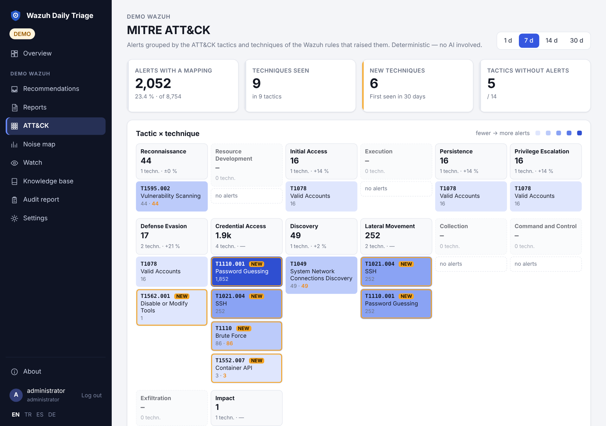

# User guide: daily work

**For:** the person who reads the reports and makes the decisions. It assumes a working installation
([Getting started](Getting-Started)). Each section follows the same order: purpose, where to find it, how to use
it, what to expect, security effect, what to check when it does not work.

## The dashboard

**Purpose.** One page that tells you whether the SIEM is healthy, what the alerts look like, and what is
waiting for you.

**Where.** **Overview** at the top of the sidebar; it is the start page after sign-in. The sidebar lists your
environments; pick one, and the menu below it opens that environment's pages.

**What it shows**, for the period you choose at the top right (**24 h**, **7 days**, **30 days**):

| Part | What it tells you |
|---|---|
| Environment tiles (with more than one environment) | per environment: health dot, alert count, level-high count and a small trend line; click one to switch |
| Status line | health of the last report, the liveness check, the last report and the next scheduled run |
| Key figures | alerts, alerts at or above the high level, critical alerts (level 12+), each with the change against the previous period of the same length and a trend line; agents with alerts; waiting recommendations (with the urgent ones); open questions |
| Alert volume | all alerts, the high level and the critical band over time; hover a point for the exact numbers |
| Severity | the alerts split into critical (12–15), high (your high level–11), medium and low |
| MITRE ATT&CK tactics | the 14 tactics; the colour gets darker with more alerts, the small number is the alerts at the high level. Click a tactic to open the matrix filtered to it |
| Top rules, agents, source addresses | where the high-level volume comes from; the orange part of a bar is the high-level share |
| Work queue | recommendations waiting for a decision, open questions, rule changes, requests and open items |

The numbers come from deterministic queries on the Indexer (no AI) and are cached for a minute. A red increase
in the high or critical figure is worth a look; the alert total alone often grows with noise.

**Security effect.** Reading the dashboard needs only the read permission. **Run check now** needs the
administrator role; viewers see it disabled.

**If it does not work.** "The numbers could not be loaded" means the Indexer did not answer; the work queue still
works because it reads stored reports. See [Troubleshooting](Troubleshooting).

## Daily runs

**Purpose.** The AI round that turns the period into a report.

**How it works.** A run happens on the schedule (one or more times a day, selectable weekdays) or when you
press **Run check now**. The time window is *since the last successful run*, so a Monday run covers the weekend
and nothing is analysed twice. `window_min_hours` applies when there is no earlier report, `window_max_hours`
caps a long gap. On the environment's **Reports** page you can choose a fixed window instead (24 hours, 72 hours, 7 days).

Each run has two parts:

1. **Deterministic collection**, independent of the model: last alert time and empty hours, indexer health and
   disk, manager daemons, agents, level distribution, high-level groups, comparison with the previous window,
   rules seen for the first time in 14 days, watched rules, vulnerabilities.
2. **AI diagnosis**: the model reads that summary and your knowledge base, looks deeper with read-only tools and
   submits a structured report.

**Expect.** A new report under **Reports**, a health state (Healthy, Warning, Critical, Error), new
recommendations in the inbox and possibly questions for you.

**Security effect.** Starting a run needs the admin role. A run only reads from Wazuh.

**If it does not work.** No report at the scheduled time: the container must be running at that time, the
schedule must be enabled, and `TZ` must be right. "Busy" on the button: a run for that environment is already
active. More in [Troubleshooting](Troubleshooting).

## Reading a report

| Section | What it tells you |
|---|---|
| Summary | the model's conclusion in a few lines; if the model failed, a deterministic summary built from the health flags, and it says so |
| Infrastructure | is the SIEM itself working: indexer, disk, agents, daemons, silence |
| Findings | one card per issue: label, severity, evidence, recommendation, sometimes a rule draft |
| Questions from the assistant | what only you can know ("was this login yours?") |
| Knowledge base proposals | what the model suggests remembering; inactive until approved |
| Data | the numbers behind it, from deterministic queries |
| Collection errors (blind spots) | queries that failed; the affected section is empty, which is not the same as clean |
| AI tool calls | which queries the model ran, for traceability |

Finding labels: *Real incident*, *Investigate*, *Detection gap*, *False positive*, *Baseline increase*,
*Measurement*, *Expected*, *Correction*. Health comes before alerts on purpose: a quiet report from a SIEM that
stopped receiving data is the worst case, and the infrastructure section is where you see it.

Findings carry **ATT&CK tags** when the evidence supports them: technique ids such as `T1110.001` (linked to
attack.mitre.org) and the tactics. They come from the `<mitre>` block of the rules behind the finding, plus the
model's own mapping when it is clearly supported. Use them to group incidents and to talk to other teams in a
shared vocabulary; they are not a severity.

Every finding and question has a **Copy** button that puts the evidence, recommendation and commands on the
clipboard as plain text for a ticket, a mail or a terminal.

## Findings and the recommendations inbox

**Purpose.** Go through what needs a decision, one item at a time, without opening every report.

**Where.** **Recommendations** in the menu.

**How to use it.**

1. Read the finding and its evidence. If it lists *Checks to run on the servers*, those are exact read-only
   commands; copy them, run them, and keep the output for your decision.
2. Set the status: *Acknowledged / working on it*, *False positive*, *Closed* or *Known noise (baseline)*. Add a
   note; the next run reads it.
3. **Later** moves to the next item without deciding.

**Expect.** The same issue found in several runs appears once, and one decision settles every occurrence. A
later finding is only closed by an earlier decision when it is about largely the same rules. *Known noise
(baseline)* also creates a knowledge-base entry. Items waiting longer than seven days are marked, and a weekday
reminder can list them (`notify.on_pending`).

**Security effect.** Decisions need the admin role and are written to the audit trail. A viewer can read the
inbox but not decide.

## The knowledge base

**Purpose.** The installation's memory. It is given to the model as context on every run, which is why the
second week is better than the first.

| Kind | Use it for |
|---|---|
| Context | facts about the environment |
| Known noise (baseline) | "rule 31101 from the scanner is normal up to 6,000 a day", with what would make it abnormal |
| Decision | "do not recommend closing Jenkins to the Internet; accepted risk" |
| Open item | something you are still working on |
| Request / note for next run | "look closely at SSH attempts on db01 tomorrow" |
| Lesson learned | a mistake not to repeat |
| Answer | your reply to a question from the assistant (created automatically) |
| Rule draft | a proposed Wazuh rule; see [Rule lifecycle](Rule-Lifecycle) |

**How decisions affect later runs.**

- An **active** entry is context for every following run: the model stops reporting known noise as an incident
  and stops suggesting what you rejected.
- A **proposal** from the model (or from an MCP client) has no effect until you press **Approve**. **Reject**
  tells the model not to propose it again.
- An active baseline entry also keeps the [Watch](Watch) from notifying about that rule, except for critical
  events.
- The knowledge base is never pruned by retention. Back it up: [Backup](Backup).

Bring existing notes with **Import / export** (TXT, CSV or YAML templates, with a preview) or
`python -m app.kb`; importing twice creates no duplicates. Formats: [Features](Features).

**Security effect.** Changing the knowledge base needs the admin role. What you write there is sent to the
model on every run (masked like everything else), so do not store credentials in it.

## Investigating a finding

1. Start from the evidence on the finding: rule, agents, first and last seen, source IPs, a sample line.
2. Check the **Data** section for the wider picture: is this rule new, did its volume change, which other rules
   fired on that agent.
3. Run the listed server checks if there are any.
4. For further questions use the same read-only tools from your own assistant over [MCP](MCP): alert search,
   timeline of a rule, IP profile, correlation ±30 minutes around an event, agent and rule information, logtest.
5. Record the outcome as a status and a note. If it is a real incident, create an incident record (below).

With extra sources configured (Prometheus, Loki, Kubernetes), the model and MCP can also check pod restarts,
OOM kills and service logs around the alert. Read-only; secrets and configmaps are never read.

## Incident record drafts

**Purpose.** Turn a finding into a written incident record without retyping the evidence.

**How.** **Incident draft** on a finding. The model collects exact times, agents and counts with read-only
tools and fills your template: timeline, root cause, impact, evidence queries, actions. What it cannot establish
stays as "…". Edit it, download it, or open it as a Zammad ticket or a Jira issue if those are configured.

**Security effect.** The record contains real values. A ticket sends them to that ticket system. The draft is
the model's reading of the evidence; a person must check it before it becomes a record.

## The monthly audit report

**Purpose.** A summary of a month's monitoring activity for a review meeting.

**Where.** **Audit report** in the environment menu; PDF or Markdown.

**Contents.** Alert volume, runs, findings and your decisions, rule changes (who, when, what was lowered), SIEM
outages seen by the liveness check, agent coverage, vulnerability SLA. No AI is involved; the same month always
gives the same report.

**Limits.** It covers what this application observed and recorded. Months without stored runs are empty. It
supports an ISO 27001 or ISMS review as evidence of monitoring activity; it does not show conformity by itself.

## MITRE ATT&CK

**Purpose.** See which attacker techniques your alerts point to, what is new, and which tactics produce no alert
at all.

**Where.** **ATT&CK** in the environment menu, or a tactic on the dashboard.

**How to read it.**

- **Key figures:** alerts with an ATT&CK mapping (and their share of all alerts), techniques seen, techniques
  seen for the first time in 30 days, tactics without alerts.
- **Matrix:** one column per tactic in kill-chain order, one cell per technique. Darker cells have more alerts;
  the orange number is the high-level part; a cell with an orange frame and **NEW** was not seen in the 30 days
  before the period. Cells link to the technique on attack.mitre.org. Click a column header to filter to it.
- **Techniques table:** alerts, high-level alerts, change against the previous period, agents, the rules that
  raised them and the last time seen.
- **Tactics without alerts:** no rule carrying that tactic matched in the period (and, listed separately, not in
  the 30 days before either).

**What it does and does not mean.**

- It only shows alerts whose rule has a `<mitre>` block. Many Wazuh ruleset rules have one; custom rules need
  it added. A low mapped share means the view is thin, not that the environment is safe.
- A tactic without alerts is a **hint** for a detection gap: either nothing of that kind happened, or no rule
  detects it. It is not a measured coverage.
- A rule mapped to several tactics lists its techniques under each of them, as the Wazuh dashboard does.

**Security effect.** Read only; no AI. Choose 1, 7, 14 or 30 days at the top right.

## Noise map

**Where.** **Noise map** in the environment menu, without AI. It shows the busiest rules of the last 1, 7, 14 or
30 days, their share of all alerts and of the high-level band, and candidates for a level reduction. From a rule
you can ask the next run for a draft or create a skeleton draft yourself. Details: [Features](Features).

See also: [Rule lifecycle](Rule-Lifecycle) · [Watch](Watch) · [Scenarios](Scenarios) · [FAQ](FAQ)

*Applies to 0.11.0 · reviewed 2026-11-11*

---

[English](User-Guide) · [Türkçe](User-Guide-TR)
