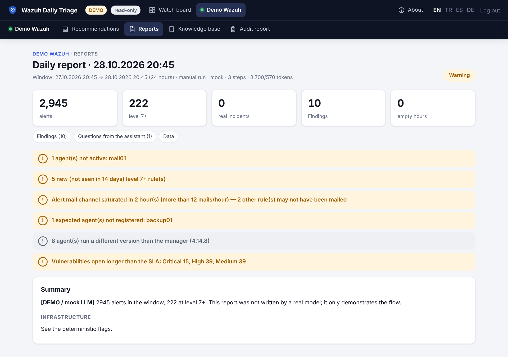

# Görüntüleyici modu (salt okunur rol)

İkinci bir parola, meslektaşların hiçbir şeyi değiştirmeden her şeyi okumasını sağlar. Raporları ve açık
önerileri görmesi gereken yöneticiler, denetçiler, SOC vardiya liderleri ve uygulama sahipleri için
tasarlanmıştır; triage çalıştırma veya kural dağıtma yetkisi vermez.



## Etkinleştirme

```sh
# .env
VIEWER_PASSWORD=<güçlü bir parola, APP_PASSWORD'dan farklı>
AUTH_DISABLED=false          # görüntüleyici modu uygulama parolası özelliğidir
```

Konteyneri yeniden başlatın. Giriş sayfası artık salt okunur görüntüleyici girişinin mevcut olduğunu söyler.
İki parola aynı formu kullanır; rolü, eşleşen parola belirler:

| Parola | Rol | Oturum |
|---|---|---|
| `APP_PASSWORD` | `admin` | imzalı çerez, 12 saat |
| `VIEWER_PASSWORD` | `viewer` | imzalı çerez, 12 saat |

Üretimde, `APP_PASSWORD` ile aynı olan `VIEWER_PASSWORD` için uygulama **açılmaz**. Boş değer rolü kapatır.

## Görüntüleyici ne yapabilir?

| İzin | Admin | Görüntüleyici | Kapsam |
|---|---|---|---|
| `read` | ✓ | ✓ | pano, raporlar, öneri gelen kutusu, bilgi tabanı ve YAML dışa aktarımı, denetim raporu, terfi paketi görüntüleme, kopyalar ve PDF'ler |
| `run` | ✓ | – | triage koşusu, canlılık kontrolü, bağlantı testi, bildirim testi |
| `decide` | ✓ | – | bulgu kararları, soruları yanıtlama, gelen kutusu işlemleri, olay kayıtları |
| `knowledge` | ✓ | – | bilgi kaydı oluşturma/güncelleme/silme, içe aktarma |
| `deploy` | ✓ | – | kural taslağı onaylama/dağıtma/geri alma/kalıcılaştırma |
| `admin` | ✓ | – | ortam düzeyi işlemler ve `METRICS_TOKEN` olmadan `/metrics` |

Matris `app/authz.py` içindedir; HTTP middleware **her** rotada kontrol eder. Düğmeyi gizlemek kontrol değildir:
elle hazırlanmış bir `POST` `403` alır ve denetim kaydına `denied:<izin>` olarak yazılır.

### 0.7.0'da bilinen kozmetik sınır

Bazı yazma kontrolleri (örneğin **Run check now** ve karar düğmeleri) görüntüleyiciye hâlâ gösterilir.
Kapalı davranırlar — sunucu isteği reddeder — ama görünürler. Sınır olarak düğmenin yokluğunu değil, 403'ü
kabul edin.

## Görüntüleyicinin gördüğü ortamları sınırlama

Üretim, hazırlık ve müşteri ortamları tek kurulumu paylaşıyorsa rolleri kapsamlandırın:

```sh
VIEWER_ENVS=staging,lab        # boş = tüm ortamlar
ADMIN_ENVS=prod,staging,lab    # isteğe bağlı, boş = tümü
```

Liste dışındaki bir ortamın URL'sini açan görüntüleyici `403` sayfası görür ve ret denetlenir. Aynı kontrol
sayfa işleyicilerinin içinde de çalışır; tahmin edilen bir ortam kimliği veri sızdırmaz.

## Doğrulama

1. Çıkış yapın, `VIEWER_PASSWORD` ile giriş yapın.
2. Kenar çubuğunda **read-only** etiketi görünür; pano raporları ve önerileri gösterir.
3. Bir bulguyu açın: karar düğmeleri ve **Incident record draft** işe yaramaz — istek `403` ile reddedilir.
4. **Run check now** deneyin: koşu başlamaz ve listede yeni koşu görünmez.
5. Denetim kaydını kontrol edin:

```sh
tail -n 5 logs/audit.jsonl
# {"action":"denied","actor":"ui","role":"viewer","result":"denied:run",...}
```

6. Görüntüleyici oturumuyla `GET /metrics` `403` döner; `METRICS_TOKEN` tanımlıysa kimlik bilgisi oturum
   değil, bearer token olur.

## Operasyonel notlar

- **Oturumlar 12 saat sürer.** `POST /logout` çerezi siler.
- **Parolayı değiştirmek mevcut oturumları bitirmez.** Çerezde rol ve son kullanma tarihi var, parola yok.
  Hepsini hemen geçersiz kılmak için `APP_SECRET` değiştirin.
- **Parola tüm görüntüleyiciler tarafından paylaşılır.** Bireysel görüntüleyici hesabı ve kişi bazlı denetim
  kimliği yoktur: denetim kaydı rolü `viewer`, aktörü ortak `ui` olarak yazar (yalnızca giriş kayıtlarında
  aktör `viewer`). Adlandırılmış salt okunur kullanıcılar
  gerekiyorsa SSO proxy kullanın — ama aşağıdaki sınırlamaya bakın.
- **GET isteklerinden CSRF riski yoktur.** Tüm durum değiştiren işlemler `POST`/`DELETE`'tir ve aynı izin
  kontrolünden geçer.

## Görüntüleyici modu ile SSO

Bu ikisi mevcut tasarımda birbirini dışlar:

- `AUTH_DISABLED=true` **her** isteği admin yapar, çünkü vekilden gelen grup/rol eşlemesi yoktur.
  `VIEWER_PASSWORD` yetkilendirmede yok sayılır.
- `AUTH_DISABLED=false` uygulama girişini korur ve görüntüleyici rolünü destekler, ancak bu durumda vekil
  kullanıcıları doğrulamamalı (veya uygulama girişinin yerine geçmemelidir).

Hem SSO kimliği hem salt okunur kullanıcı gerekiyorsa pratik seçenekler:

1. Uygulama parolalarını kullanın ve salt okunur erişim gereken kişilere görüntüleyici parolasını verin.
2. Ayrı yapılandırmalı ikinci bir örnek çalıştırın ve yetkilerini ağ/vekil katmanında sınırlayın.
3. Vekilde ayrı bir ana makine ve HTTP metodu allow-list'i ile salt okunur zorlayın — **önerilmez**, çünkü bir
   `GET` bağlantısı uygulamayı korumaz.

## Güvenlik kontrol listesi

- `VIEWER_PASSWORD` uzun, benzersiz ve `APP_PASSWORD`'dan farklı.
- `APP_SECRET` ayarlı; oturumlar yeniden başlatmada korunur ve taklit edilemez.
- TLS arkasında `COOKIE_SECURE=true`.
- Açılış kontrolleri için `ENVIRONMENT=production`.
- Kurulum paylaşımlıysa hazırlık/müşteri verisini `VIEWER_ENVS` ile sınırlayın.
- Denetim sevkiyatı yapılandırılmış (`logs/audit.jsonl` 20 MB'ta döner, üç nesil tutar). Dosya hash zinciriyle
  bağlıdır: her satırda `prev` ve `hash` bulunur, böylece değiştirilen veya silinen satır tespit edilir.

  ```sh
  docker compose exec triage python -c "from app import auditlog; print(auditlog.verify())"
  # {'ok': True, 'lines': 42, 'broken': None, 'file': 'logs/audit.jsonl'}
  ```

Wazuh'un en az yetkili hesapları ve denetim biçimi için [docs/permissions.md](https://github.com/dururustem68/wazuh-daily-triage/blob/main/docs/permissions.md).

---

[English](Viewer-Mode) · [Türkçe](Viewer-Mode-TR)
