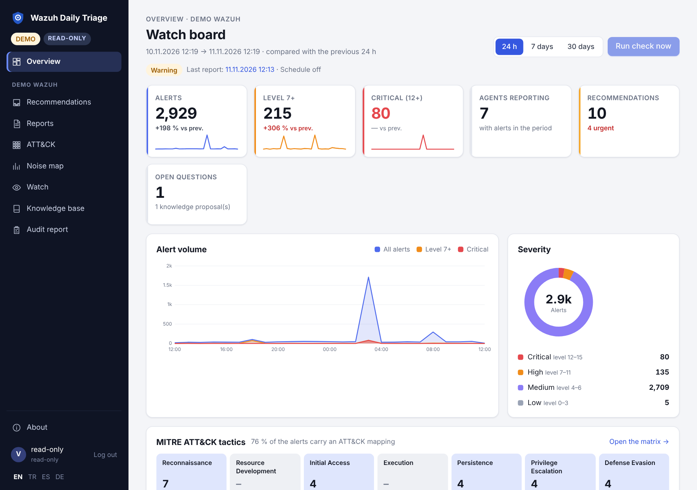

# Viewer mode (read-only role)

The read-only role lets colleagues read everything without changing anything. There are two ways to give it:
a second application password (`VIEWER_PASSWORD`, this page), or — behind an SSO proxy — membership of a group
listed in `SSO_VIEWER_GROUPS` ([SSO proxy authentication](SSO-Proxy-Auth), since 0.11). Both lead to the same
role and the same permission matrix.

It is intended for managers,
auditors, SOC shift leads and application owners who need the reports and the open recommendations, not the
ability to run triage or deploy rules.



## Enable it

```sh
# .env
VIEWER_PASSWORD=<a strong password, different from APP_PASSWORD>
AUTH_DISABLED=false          # viewer mode is an app-password feature
```

Restart the container. The login page then says that a read-only viewer sign-in is available. Both passwords
use the same form; the application decides the role from the password that matched:

| Password | Role | Session |
|---|---|---|
| `APP_PASSWORD` | `admin` | signed cookie, 12 hours |
| `VIEWER_PASSWORD` | `viewer` | signed cookie, 12 hours |

In production, startup **refuses** a `VIEWER_PASSWORD` that equals `APP_PASSWORD`. An empty value simply
disables the role.

## What the viewer may do

| Permission | Admin | Viewer | Covers |
|---|---|---|---|
| `read` | ✓ | ✓ | dashboard, reports, recommendation inbox, knowledge base and its YAML export, audit report, promotion package view, the **Watch** page (events and AI verdicts), copies and PDFs |
| `run` | ✓ | – | start a triage run, liveness check, connection test, notification test, **Scan now** on the Watch page |
| `decide` | ✓ | – | finding decisions, answering questions, inbox actions, incident records |
| `knowledge` | ✓ | – | create/update/delete knowledge entries, import |
| `deploy` | ✓ | – | approve/deploy/undeploy/promote rule drafts |
| `admin` | ✓ | – | environment-level operations, `/metrics` without `METRICS_TOKEN`, and everything under **Settings** — including reading it: watch, AI round, masking profile (and its YAML export), backup export/import, acknowledging a storage loss |

A write route that nobody mapped to a permission needs `admin` (fail closed, since 0.9.2); a test checks every
route, so a new feature cannot open itself to the viewer by accident.

The matrix lives in `app/authz.py`; the HTTP middleware checks it for **every** route. Hiding a button is never
the control: a crafted `POST` gets `403` and is written to the audit trail as `denied:<permission>`.

### Known cosmetic limitation

The sidebar hides **Settings** and the dashboard shows **Run check now** disabled for a viewer, but some write
controls (for example the decision buttons in a report and in the inbox) are still rendered. They fail closed —
the server rejects the request — but they are visible. Treat the 403 as the boundary, not
the absence of a button.

## Limit the environments a viewer sees

When production, staging and customer instances share one installation, scope each role:

```sh
VIEWER_ENVS=staging,lab        # empty = all environments
ADMIN_ENVS=prod,staging,lab    # optional, empty = all
```

A viewer who opens a URL for an environment outside the list gets a `403` page, and the denial is audited. The
same check runs inside the page handlers, so a guessed environment id does not leak data.

## Verify

1. Sign out, then sign in with `VIEWER_PASSWORD`.
2. The sidebar shows a **read-only** pill; the dashboard shows reports and recommendations.
3. Open a finding: the decision buttons and **Incident record draft** do nothing useful — the request is
   rejected with `403`.
4. Try **Run check now**: the run does not start and no run appears in the list.
5. Check the audit trail:

```sh
tail -n 5 logs/audit.jsonl
# {"action":"denied","actor":"ui","role":"viewer","result":"denied:run",...}
```

6. `GET /metrics` with a viewer session returns `403` unless `METRICS_TOKEN` is configured (then the bearer
   token, not the session, is the credential).

## Operational notes

- **Sessions last 12 hours.** `POST /logout` clears the cookie.
- **Rotating the password does not end existing sessions.** The cookie contains the role and an expiry, not the
  password. Change `APP_SECRET` to invalidate every session immediately.
- **The password is shared by all viewers.** There are no individual viewer accounts and no per-viewer audit
  identity: the audit trail records the role `viewer` with the shared actor `ui` (only login records say
  `viewer`). If you need named read-only users, use SSO with `SSO_VIEWER_GROUPS` (below).
- **No CSRF risk from GETs.** All state-changing operations are `POST`/`DELETE` and go through the same
  permission check.

## Viewer mode and SSO (0.11)

Behind an SSO proxy (`AUTH_DISABLED=true`) the password login is off, so `VIEWER_PASSWORD` is not used. The role
comes from the user's groups instead:

```sh
AUTH_DISABLED=true
SSO_ADMIN_GROUPS=wazuh-admins       # administrators
SSO_VIEWER_GROUPS=soc,auditors      # read-only viewers; everyone else is refused
```

| | Viewer password | SSO viewer group |
|---|---|---|
| Who is it | everyone who knows the shared password | each person, by their own account |
| Audit trail actor | `ui` (shared) | the user name from the proxy |
| Taking access away | change the password and `APP_SECRET` | remove the user from the group |
| Permissions | the matrix above | the same matrix |
| Environments | `VIEWER_ENVS` | `VIEWER_ENVS` |

Group header names, proxy configuration and the default role for users in no listed group:
[SSO proxy authentication](SSO-Proxy-Auth).

## Security checklist

- `VIEWER_PASSWORD` is long, unique and different from `APP_PASSWORD`.
- `APP_SECRET` is set, so sessions survive restarts and cannot be forged.
- `COOKIE_SECURE=true` behind TLS.
- `ENVIRONMENT=production` so the startup checks run.
- `VIEWER_ENVS` limits staging/customer data when the installation is shared.
- Audit shipping is configured (`logs/audit.jsonl` rotates at 20 MB, keeps three generations). The file is
  hash-chained: every line carries `prev` and `hash`, so an edited or deleted line is detectable.

  ```sh
  docker compose exec triage python -c "from app import auditlog; print(auditlog.verify())"
  # {'ok': True, 'lines': 42, 'broken': None, 'file': 'logs/audit.jsonl'}
  ```

See also [docs/permissions.md](https://github.com/dururustem68/wazuh-daily-triage/blob/main/docs/permissions.md) for the least-privilege Wazuh accounts and the audit format.

---

[English](Viewer-Mode) · [Türkçe](Viewer-Mode-TR)
